<!-- omit in toc -->
# Edge Computing for the IoT

<!-- omit in toc -->
## Lecture Information

| **Lecture Title**   | Edge Computing for the IoT                                                       |
|---------------------|----------------------------------------------------------------------------------|
| **Author**          | Prof. Marco Picone (marco.picone@unimore.it)                                     |
| **License**         | [Creative Commons Attribution 4.0](https://creativecommons.org/licenses/by/4.0/) |

> **Prerequisites:** [The Constrained Application Protocol (CoAP)](../../communication-protocols-and-patterns/coap-protocol/coap_protocol.md),
> [Resource & Service Discovery](../../communication-protocols-and-patterns/resource-and-service-discovery/resource_and_service_discovery.md)
> and [Publish/Subscribe Communication Pattern & MQTT Protocol](../../communication-protocols-and-patterns/pubsub-mqtt-protocol/pubsub_mqtt_protocol.md)
> (CoAP methods and Observe, `/.well-known/core`, CoRE Link Format, Resource Directory, MQTT brokers and topics).

<!-- omit in toc -->
# Table of Contents

- [A. Cloud Computing \& the Internet of Things](#a-cloud-computing--the-internet-of-things)
  - [A.1 IoT Cloud Platforms: Characteristics \& Features](#a1-iot-cloud-platforms-characteristics--features)
  - [A.2 Open Issues of IoT Cloud Platforms](#a2-open-issues-of-iot-cloud-platforms)
- [B. The Cloud "Addiction" Problem](#b-the-cloud-addiction-problem)
  - [B.1 The Internet Architecture As We Know It](#b1-the-internet-architecture-as-we-know-it)
  - [B.2 Cloud "Addiction"](#b2-cloud-addiction)
  - [B.3 The Connectivity Challenge](#b3-the-connectivity-challenge)
- [C. The Edge/Fog Computing Vision](#c-the-edgefog-computing-vision)
  - [C.1 Envisioned Edge/Fog Architecture](#c1-envisioned-edgefog-architecture)
  - [C.2 Cycles of Computing: Shared Central vs Local Computation](#c2-cycles-of-computing-shared-central-vs-local-computation)
  - [C.3 The Cloud-Centric Vision](#c3-the-cloud-centric-vision)
  - [C.4 The IoT Disrupts the Cloud](#c4-the-iot-disrupts-the-cloud)
  - [C.5 A New Computational Model: Edge Computing](#c5-a-new-computational-model-edge-computing)
  - [C.6 Edge/Fog Computing](#c6-edgefog-computing)
  - [C.7 Edge vs Fog Computing](#c7-edge-vs-fog-computing)
- [D. Distributed IoT Applications](#d-distributed-iot-applications)
  - [D.1 A Distributed Point of View](#d1-a-distributed-point-of-view)
  - [D.2 Intelligence at the Edge](#d2-intelligence-at-the-edge)
  - [D.3 Intelligent Distributed Architecture](#d3-intelligent-distributed-architecture)
  - [D.4 Edge Computing Characteristics \& Attributes](#d4-edge-computing-characteristics--attributes)
  - [D.5 Values of Edge Computing](#d5-values-of-edge-computing)
  - [D.6 Collaboration between Edge and Cloud](#d6-collaboration-between-edge-and-cloud)
  - [D.7 IoT \& Edge Architecture](#d7-iot--edge-architecture)
- [E. Working on the Edge](#e-working-on-the-edge)
  - [E.1 Goals of an Edge Computing Architecture](#e1-goals-of-an-edge-computing-architecture)
  - [E.2 Edge Computing Reference Architecture](#e2-edge-computing-reference-architecture)
    - [E.2.1 Smart Service](#e21-smart-service)
    - [E.2.2 Service Fabric](#e22-service-fabric)
    - [E.2.3 Connectivity and Computing Fabric](#e23-connectivity-and-computing-fabric)
    - [E.2.4 Edge Computing Nodes](#e24-edge-computing-nodes)
  - [E.3 Network Providers \& Edge Computing](#e3-network-providers--edge-computing)
  - [E.4 Edge Computing Software Evolution](#e4-edge-computing-software-evolution)
  - [E.5 Edge Operating System: the IoT Gateway](#e5-edge-operating-system-the-iot-gateway)
  - [E.6 IoT \& Edge Means Interoperability](#e6-iot--edge-means-interoperability)
- [F. The IoT Hub: a Fog Node for Smart Object Management](#f-the-iot-hub-a-fog-node-for-smart-object-management)
  - [F.1 IoT Hub Functions](#f1-iot-hub-functions)
  - [F.2 Link Layer Functions: the Border Router](#f2-link-layer-functions-the-border-router)
  - [F.3 Application Layer Functions](#f3-application-layer-functions)
  - [F.4 Service and Resource Discovery](#f4-service-and-resource-discovery)
  - [F.5 Resource Directory](#f5-resource-directory)
  - [F.6 Origin Server](#f6-origin-server)
  - [F.7 CoAP-to-CoAP / HTTP-to-CoAP Proxy and Cache](#f7-coap-to-coap--http-to-coap-proxy-and-cache)
  - [F.8 Resource Access through the IoT Hub](#f8-resource-access-through-the-iot-hub)
- [G. IoT Hub, Cloud \& Edge Synchronization: Virtual Replication](#g-iot-hub-cloud--edge-synchronization-virtual-replication)
  - [G.1 The Virtual IoT Hub](#g1-the-virtual-iot-hub)
  - [G.2 Operational Scenarios](#g2-operational-scenarios)
  - [G.3 Polling Resources](#g3-polling-resources)
  - [G.4 Observing Resources](#g4-observing-resources)
  - [G.5 Pushing Resources](#g5-pushing-resources)
  - [G.6 Synchronization Protocol](#g6-synchronization-protocol)
  - [G.7 Replica Communication \& Management](#g7-replica-communication--management)
- [H. Summary](#h-summary)
- [References](#references)

# A. Cloud Computing & the Internet of Things

The **Internet of Things (IoT)** envisages the overall merging of several "things" while using the Internet as the
backbone of the communication system, in order to establish a smart interaction between people and surrounding objects.

The **Cloud**, being a crucial component of the IoT, provides valuable application-specific services in many application
domains. A number of **IoT Cloud providers** have emerged on the market to offer suitable and specific IoT-based services,
covering application development, device and system management, heterogeneity management, data management, analytics,
deployment, monitoring, visualization and research.

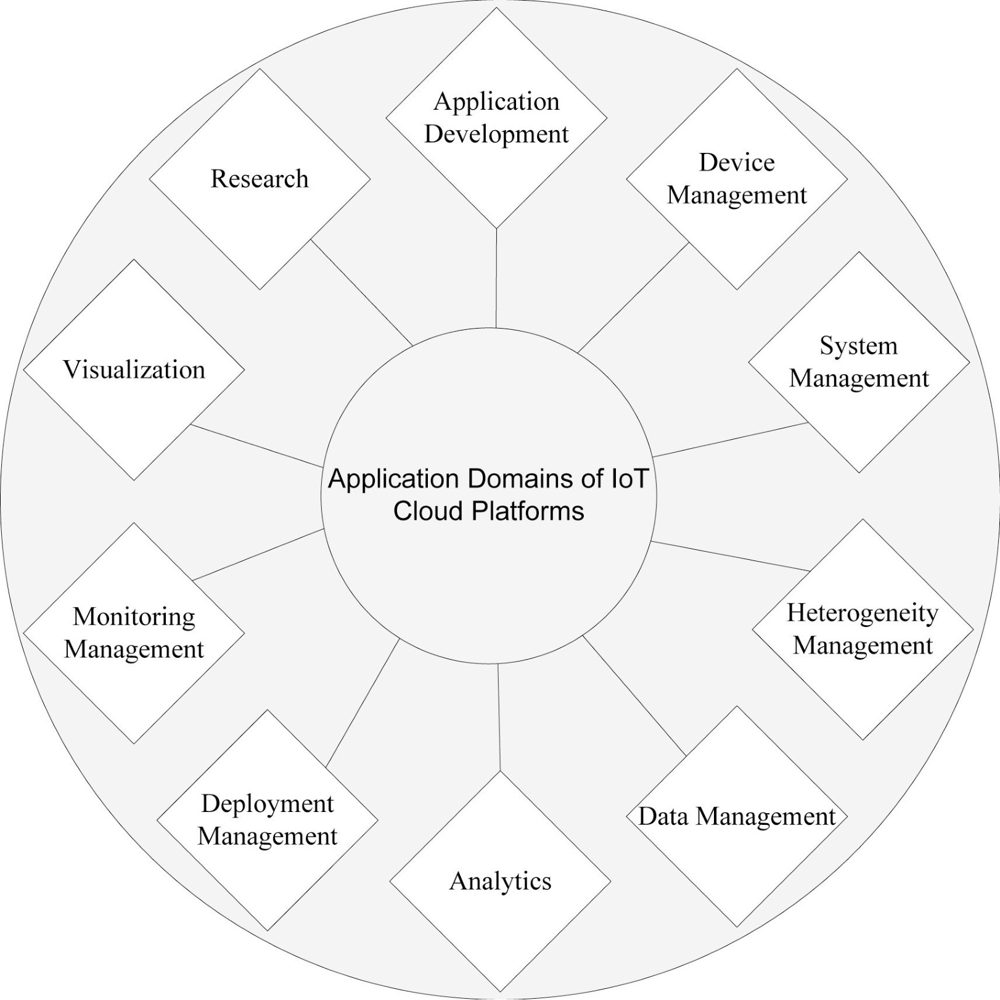

**Figure 1:** Application domains of IoT Cloud Platforms.

---

## A.1 IoT Cloud Platforms: Characteristics & Features

The main common characteristics and features of IoT Cloud platforms are:

- **Real-time event processing**
- **Device management, inventory & registry**
- **Secure communication**
- **IoT Gateway & Hub for devices**
- **Authentication and encryption**
- **Device Clones / Replicas / Digital Twins**
- **Intelligence & Cognitive Services**
- **Huge storage**
- **Data visualization and reporting**
- **Multiple protocols support**
- **Integration and third-party services**

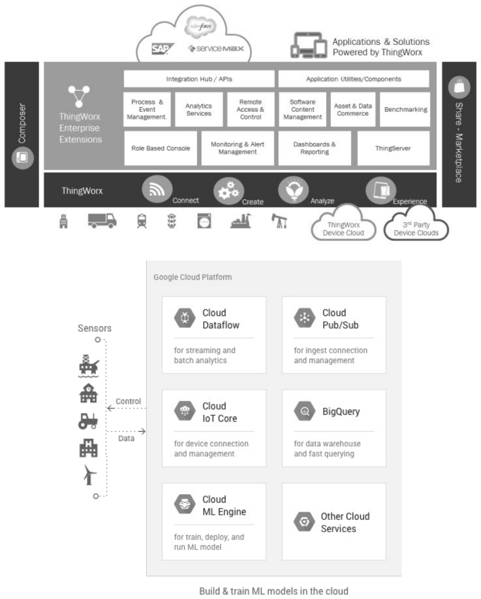

**Figure 2:** Examples of IoT Cloud platform architectures: PTC ThingWorx (top) and an IoT reference architecture on
Google Cloud Platform (bottom), where sensors and devices are connected to cloud services for ingestion (Pub/Sub, IoT
Core), stream and batch processing (Dataflow), storage and querying (BigQuery) and machine learning (ML Engine).

> **Note:** Google Cloud IoT Core, shown in Figure 2, was retired by Google in August 2023. The example remains
> representative of the typical structure of a cloud-centric IoT platform, where device connectivity, ingestion,
> processing, storage and intelligence are all provided as managed cloud services.

---

## A.2 Open Issues of IoT Cloud Platforms

Together with their advantages, IoT Cloud platforms present some common **open issues**:

- **Hard to manage complex systems.**
- **Limitations in installing edge programs on a custom platform.**
- **Cost management & control.**
- **Strong bond with the vendor/provider** (vendor lock-in).
- **Learning curve.**

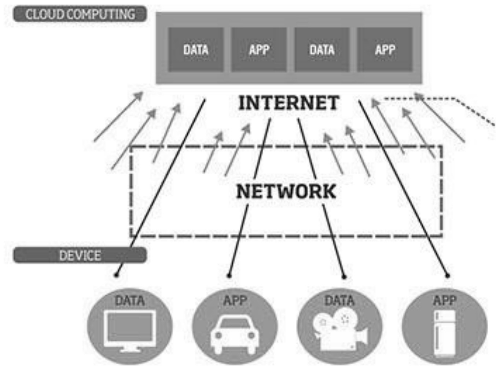

**Figure 3:** Cloud-centric IoT architecture: devices send data to applications running in the cloud through the
network and the Internet.

These issues lead to two fundamental questions that drive this lecture:

> Is the Cloud always the best option to handle an IoT project?
> Is a Cloud-centric vision the only approach to design an IoT application?

---

# B. The Cloud "Addiction" Problem

## B.1 The Internet Architecture As We Know It

In the traditional Internet architecture, **services**, **storage** and **processing** are concentrated in the Cloud,
while users and connected objects at the periphery of the network continuously send and receive data to and from it.

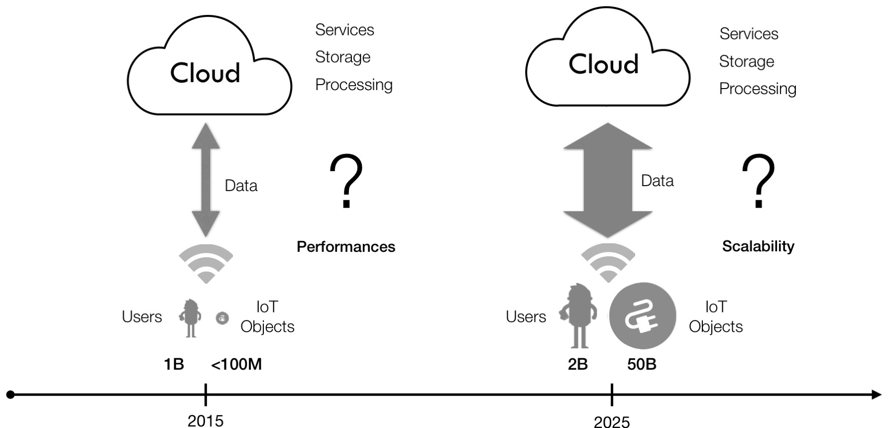

**Figure 4:** The Internet architecture as we know it: in 2015 about 1 billion users and less than 100 million IoT
objects exchanged data with the Cloud (raising **performance** questions); with billions of users and tens of billions
of IoT objects, the same centralized model raises **scalability** questions.

The growth in the number of connected objects, and consequently in the volume of data they generate, makes the
centralized model increasingly critical in terms of:

- **Performance:** every interaction requires a round trip to a remote data center.
- **Scalability:** network links and cloud services must handle a continuously growing amount of data and requests.

---

## B.2 Cloud "Addiction"

When all the intelligence of an IoT application lives in the Cloud, even the simplest local interaction depends on a
working connection to remote services. This is what we call the Cloud **"addiction"** problem.

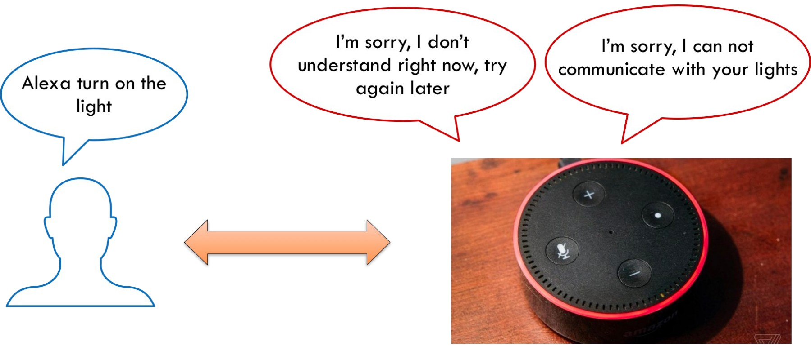

**Figure 5:** Cloud "addiction": a user asks a voice assistant to turn on the light in the same room, but if the
connection to the cloud is unavailable the assistant can neither understand the command nor communicate with the lights.

The user, the voice assistant and the smart light are all physically in the same place, but the interaction fails
because the processing of the command and the communication with the light are both mediated by the Cloud.

---

## B.3 The Connectivity Challenge

Real-world outages clearly show the consequences of the Cloud "addiction" problem. In January 2016, Nest smart home
products experienced a connectivity issue that left users unable to monitor and control their homes.

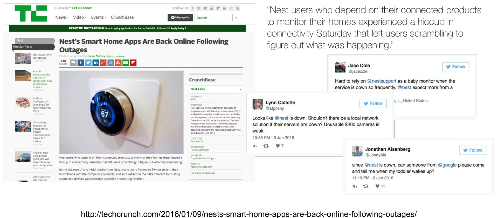

**Figure 6:** The Nest smart home apps outage (TechCrunch, January 2016) and some user reactions: *"Nest users who
depend on their connected products to monitor their homes experienced a hiccup in connectivity Saturday that left users
scrambling to figure out what was happening."*

The reactions of the users highlight a key requirement: **"Shouldn't there be a local network solution if their servers
are down?"**. Devices that are physically installed in a home should keep providing their core functionalities even when
the connection to the Cloud is not available.

---

# C. The Edge/Fog Computing Vision

## C.1 Envisioned Edge/Fog Architecture

The **Edge/Fog Computing** vision introduces an intermediate layer of **Edge Nodes** between the Cloud and the users and
IoT objects. Edge nodes **bring computing on the edge** of the network: they can process data locally, communicate
with each other and interact with the Cloud only when needed.

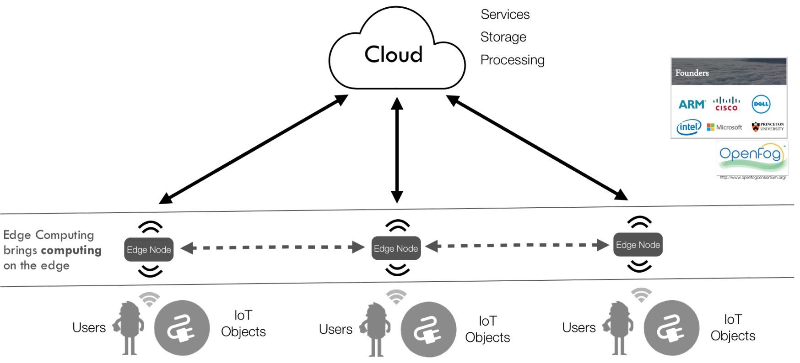

**Figure 7:** Envisioned Edge/Fog architecture: Edge Nodes, close to users and IoT objects, communicate with each other
and with the Cloud, which keeps providing services, storage and processing.

> **Note:** the OpenFog Consortium (founded by ARM, Cisco, Dell, Intel, Microsoft and Princeton University) shown in
> Figure 7 merged into the Industrial Internet Consortium (now Industry IoT Consortium) in 2019. Its OpenFog Reference
> Architecture was adopted as the IEEE 1934-2018 standard.

---

## C.2 Cycles of Computing: Shared Central vs Local Computation

The history of computing shows a continuous oscillation between **centralized** and **distributed** models.

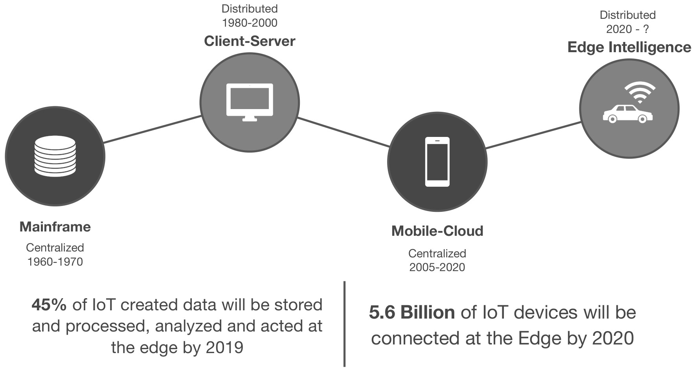

**Figure 8:** Cycles of computing: Mainframe (centralized, 1960-1970), Client-Server (distributed, 1980-2000),
Mobile-Cloud (centralized, 2005-2020) and Edge Intelligence (distributed, 2020 onwards). Source of the predictions: IDC
FutureScape Worldwide Internet of Things Predictions, 2016.

The computing models of the last seven decades oscillate between the use of **shared and central** resources and
**exclusive and local** computing power. The key factors deciding the direction of the curve are the advances in
**computing** and **communication**:

- **Cheap and powerful computing power** pushes towards the use of **local** resources.
- **Cheap and fast communication technologies** enable the use of **shared, central** resources.

Networked PCs and client-server models created a balanced distributed computing model between the two extremes of
Mainframes and standalone computers, enabled by high-speed local area networks.

---

## C.3 The Cloud-Centric Vision

- The technology trend moved towards **central resources** with the early web model, enabled by cheap and fast wide
  area networking compared to the amount of data being transferred.
- Shared and centralized resources are **highly efficient**, as they maximize the utilization of computing resources
  and provide **elasticity** and **scalability**.
- Given their central location, typically in data centers, they can be **more easily secured**, and their lifecycle
  management is less complex than in distributed systems.
- However, they need **highly available communication channels** of sufficient bandwidth and speed to reach end users,
  which may incur significant cost.

The Cloud Computing model seems to have found a happy compromise in the distributed computing spectrum, balancing the
pros and cons of exclusive/local versus shared/central resources. However, this solution will not last in the IoT era.

---

## C.4 The IoT Disrupts the Cloud

The IoT disrupts the Cloud computing model by introducing new usage scenarios with the following key requirements:

- **Real-time:** decisions often need to be made within tens of milliseconds. Today's communication infrastructure and
  the laws of physics require **local decision-making**, as a round trip to the Cloud would take an excessive amount of
  time.
- **Connectivity:** mobile networks are often spotty and cannot guarantee connectivity to the Cloud. Hence, decision
  making must occur **locally**.
- **Data volume:** the amount of data generated by sensors can be huge (e.g., hundreds of high-resolution cameras
  creating video streams at 30 frames per second), which could saturate wide-area communication channels.

> The disruption of the Cloud model is **not the replacement of the Cloud** but rather its **extension to the edge**.

---

## C.5 A New Computational Model: Edge Computing

- The **Cloud will continue to exist**. Certain functions are best performed in the Cloud, such as the training of
  predictive analytics algorithms, as typically only the Cloud holds all the necessary data.
- **Edge Computing** provides computing power and storage in the space **between the devices and the Cloud**. Edge
  computing devices include:
  - **IoT Gateways**;
  - **Routers**;
  - **Micro data centers** on the edge and on mobile network base stations.
- The new model is a **fully distributed computing model**, supporting a wide range of interaction and communication
  paradigms.

---

## C.6 Edge/Fog Computing

**Edge/Fog Computing** brings computation, storage and networking resources to the edge of the access network, in
order to enable:

- **real-time** data processing;
- **minimal latency**;
- the **best Quality of Service/Experience** (QoS/QoE);
- **independence from Internet connectivity** for operations;
- **flexible** networking, security and privacy.

The Edge/Fog Computing paradigm is the reference architecture for the IoT and involves several actors and technologies
for its innovation, implementation and deployment.

---

## C.7 Edge vs Fog Computing

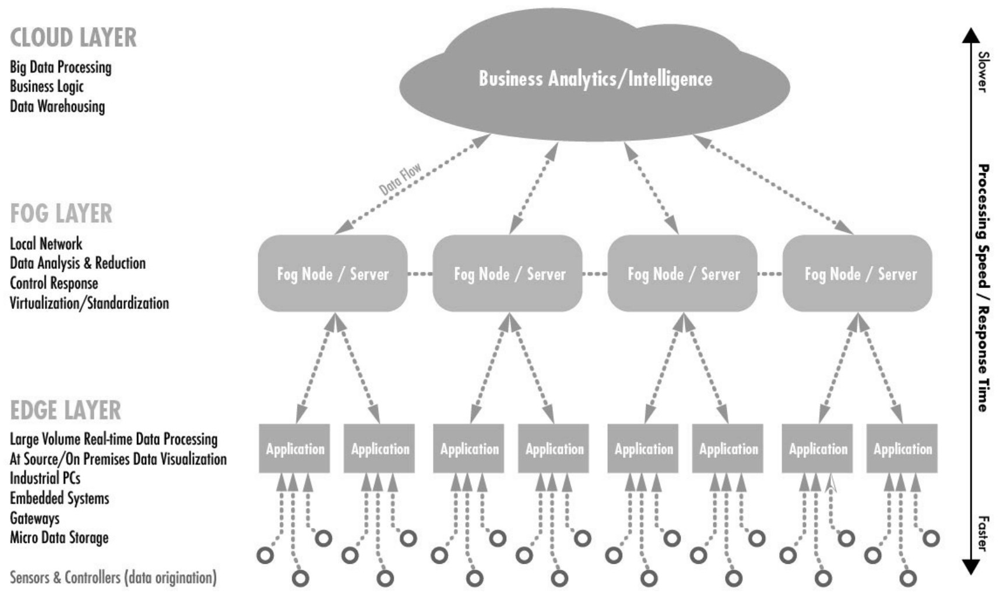

**Figure 9:** Cloud, Fog and Edge layers: processing speed and response time improve moving from the Cloud (big data
processing, business logic, data warehousing) to the Fog (local network, data analysis & reduction, control response,
virtualization/standardization) and to the Edge (large volume real-time data processing, on-premises data
visualization, industrial PCs, embedded systems, gateways, micro data storage). Source: WinSystems.

- Fog Computing and Edge Computing are **very similar** in several aspects, since both bring intelligence, storage and
  processing resources **closer to where data is created**.
- The key difference between the two lies in **where the intelligence and the computing power are placed**:
  - **Fog Computing** places intelligence at the **Local Area Network (LAN)** level: data is transmitted from the
    endpoints to a gateway (fog node), where it is processed and the results are sent back.
  - **Edge Computing** places intelligence and processing power **directly in the devices**, such as embedded automation
    controllers and Smart Objects.
- Performing computations at the edge of the network **reduces network traffic** and the risk of data bottlenecks, and
  optimizes resource usage in a cloud computing system. It also improves **security**, since data can be encrypted
  closer to its source.

> **Note:** in this lecture the term **Edge Computing** is used with the broader meaning of **"Working on the Edge"**,
> considering both the layers associated with Edge and Fog Computing.

---

# D. Distributed IoT Applications

## D.1 A Distributed Point of View

Moving from a cloud-centric to a distributed model enables new interaction patterns and capabilities:

- **Autonomous, local decision-making** based on incoming IoT data and cached enterprise information.
- **Peer-to-peer networking**, e.g., security cameras communicating among themselves about an object within their scope.
- **Edge networking**, e.g., platoon driving, where vehicles self-organize into groups traveling together, orchestrated
  and controlled by a micro data center in the base station of a mobile network.
- **Distributed queries** across data stored in devices, in the Cloud and anywhere in between.
- **Distributed data management**, e.g., data aging: which data to store, where and for how long.
- **Self-learning algorithms** that learn and execute on the edge, learn in the Cloud and execute on the edge, or learn
  and execute in the Cloud.
- **Isolation**, involving devices that are disconnected for a long time, operating with minimal energy consumption to
  maximize their lifespan.

---

## D.2 Intelligence at the Edge

By introducing intelligence at the edge nodes, systems can:

- **take decisions more quickly and efficiently**, since the round-trip delay to contact the Cloud is removed;
- **reach decisions according to local identity management and access control policies**, securing the data close to
  its source;
- **reduce communication costs** by limiting communication over public wide area networks.

These opportunities come from technology evolutions in several fields:

- manufactured devices and **5G networks**;
- algorithms and new standards in **Software-Defined Networking (SDN)**;
- **Multi-access Edge Computing (MEC)** architecture (originally *Mobile* Edge Computing);
- **IoT evolution** and standard approaches;
- **analytics** and device and data **ownership**.

---

## D.3 Intelligent Distributed Architecture

An intelligent distributed Edge architecture drives intelligence capabilities to enable **autonomy** and
**collaboration** of things, people and services:

- **Autonomy of things:** things can perform autonomous connection, discovery, learning, optimization,
  decision-making and execution.
- **Collaboration of things:** including collaboration between things, between things and humans, between things and
  local smart systems, and between things and the Cloud.

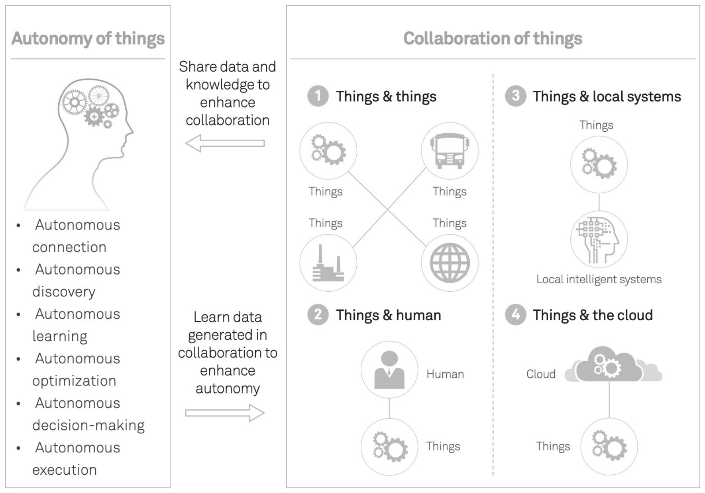

**Figure 10:** Intelligent distributed architecture: autonomy of things and collaboration of things (things & things,
things & human, things & local systems, things & the cloud). Things share data and knowledge to enhance collaboration
and learn from data generated in collaboration to enhance their autonomy. Source: IEC Edge Intelligence White Paper.

---

## D.4 Edge Computing Characteristics & Attributes

**Connectivity**

- Connectivity is the **basis** of Edge Computing. The diversity of connected physical objects and application scenarios
  requires the Edge layer to provide connection functionalities through various network interfaces, protocols,
  topologies, network deployments and configurations, and network management and maintenance.
- Connectivity needs to fully exploit the advances in the networking field, such as **TSN** (Time-Sensitive Networking),
  **SDN**, **NFV** (Network Function Virtualization), **NaaS** (Network as a Service), **WLAN**, **NB-IoT** and **5G**.
  Additionally, it needs to consider interoperability with a variety of existing **industrial buses** (in particular in
  Industrial IoT scenarios).

**First Entry of Data**

- As a bridge between the physical and the digital worlds, Edge Computing is the **first entry point for data**.
- With massive, real-time and complete data, Edge Computing implements data management and creates value based on the
  data lifecycle, supporting innovative applications such as **predictive maintenance**, asset efficiency and
  management.
- As the first entry of data, the Edge layer also faces the challenges caused by real-time constraints, determinism,
  heterogeneity and diversity.

**Constraint**

- Edge computing products need to work in several heterogeneous conditions and operating environments, such as
  industrial sites (with interference, dust, vibration, current/voltage fluctuations).
- Specific challenging scenarios require constrained **power consumption**, **cost** and **space** for edge devices.
- In critical environments, Edge computing products need hardware and software integration and optimization to adapt to
  various conditions and constraints.

**Distribution and Scalability**

- Edge Computing needs to support **distributed computing and storage**, dynamic scheduling and unified management of
  distributed resources, distributed intelligence, autonomous scalability and distributed security capabilities.
- Software innovations and Cloud Computing technologies such as **virtualization**, **containers** and **lambda
  functions** (serverless) are migrating from the Cloud to the Edge to support the scalability and reliability of Edge
  software architectures.

**Collaboration and Interoperability**

- Collaboration and interoperability are the foundation for the digital transformation of industries and applications
  on the Edge. Edge Computing must support collaboration in connection, data, management, control, application and
  security.
- Edge applications must be based on **standard communication protocols and mechanisms**, with a highly modular design
  and a set of uniform interfaces that can be easily integrated into new or existing applications. In particular:
  - **RESTful CoAP and HTTP interfaces** are used for the interaction with Smart Objects and legacy components;
  - **RESTful HTTP APIs** and **MQTT/AMQP** communication can be used to provide access to computed analyses and
    real-time metrics to external applications and Cloud services.

---

## D.5 Values of Edge Computing

- **Massive and Heterogeneous Connections:** networks are the cornerstone of system interconnection and data
  aggregation. With the surge in the number of connected devices, networks face enormous challenges in terms of
  operations and maintenance, management, flexible expansion and reliability. The complexity of handling a large number
  of heterogeneous connections must be addressed at the Edge in an intelligent and efficient way, to ensure real-time
  reliability of connections and interoperability of services both at the Edge and with the Cloud.
- **Real-Time Services:** industrial and low-latency applications (e.g., vehicular and mobility services) have strict
  real-time requirements, in some scenarios within **10 milliseconds**. If data analysis and control logic are
  implemented only in the Cloud, it is difficult to meet these requirements.
- **Data Optimization:** applications collect huge amounts of heterogeneous data from several sources. Data must be
  aggregated, presented in a unified way and made accessible, so that it can serve intelligent Edge applications in a
  flexible and efficient manner.
- **Smart Applications:** business process optimization, Operation and Maintenance (O&M) automation and service
  innovation drive applications to be smart. Edge intelligence delivers significant efficiency and cost advantages, and
  intelligent applications such as predictive maintenance are driving industries towards new service and business
  models.
- **Security and Privacy Protection:** security is critical for both Cloud and Edge Computing and requires end-to-end
  protection. The network edge is close to IoT devices, making access control and threat protection difficult. Edge
  security includes **device**, **network**, **data** and **application** security, together with the integrity and
  confidentiality of key data and the protection of production and personal data.

---

## D.6 Collaboration between Edge and Cloud

- **Cloud Computing** is suitable for non-real-time tasks, long-period data and business decision-making scenarios.
- **Edge Computing** plays a strategic role in real-time, low-latency, short-period data and local decision-making
  scenarios, potentially also in **offline** contexts.
- Edge and Cloud Computing are two important foundations for the digital transformation of industries. Their
  collaboration in terms of **network**, **service**, **application** and **intelligence** is a fundamental pillar to
  support more scenarios and unleash greater value in industry digitalization and IoT adoption.

| Point of Collaboration | Edge Computing                     | Cloud Computing                      |
|------------------------|------------------------------------|--------------------------------------|
| **Network**            | Data aggregation (TSN + OPC UA)    | Data analysis                        |
| **Service**            | Agent                              | Service orchestration                |
| **Application**        | Micro applications                 | Lifecycle management of applications |
| **Intelligence**       | Distributed reasoning (inference)  | Centralized training                 |

---

## D.7 IoT & Edge Architecture

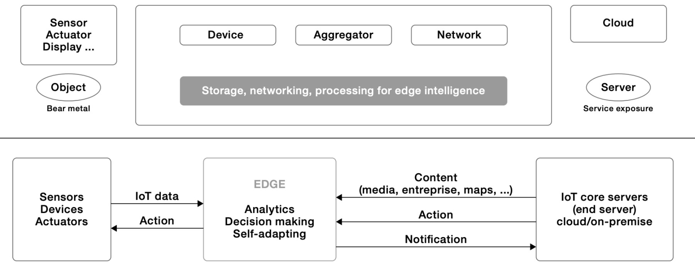

**Figure 11:** IoT & Edge architecture. Top: objects (sensors, actuators, displays on bare metal), the Edge (devices,
aggregators and network providing storage, networking and processing for edge intelligence) and the Cloud (servers
providing service exposure). Bottom: sensors, devices and actuators send IoT data to the Edge and receive actions; the
Edge performs analytics, decision making and self-adaptation, sends notifications to the IoT core servers
(cloud/on-premise) and receives content and actions from them.

The Edge becomes the place where IoT data is first **analyzed**, where **decisions** are taken and where the system
**self-adapts**, while the Cloud provides global services, content and long-term processing.

---

# E. Working on the Edge

## E.1 Goals of an Edge Computing Architecture

The aim is to define a general view and approach to Edge Computing architectures in order to achieve:

- **Coordination between the Physical and Digital Worlds:** a real-time, systematic cognitive model of the physical
  world is established. The status of the physical world is predicted, and its behavior is emulated in the digital
  world. This approach simplifies the reconstruction of the physical world and drives the optimization of the operation
  of physical systems.
- **Cross-Industry Collaboration:** the Information and Communications Technology (ICT) industry and vertical industries
  can build and reuse knowledge modelling systems in their own domains. The ICT industry shields the complexity of ICT
  technologies using a horizontal Edge Computing model and reference architecture.
- **Reduced System Heterogeneity and Simplified Cross-Platform Migration:** model-based interfaces between systems,
  subsystems, services, and new and legacy systems enable interaction and simplify integration. Software interfaces can
  be decoupled from development languages, platforms, tools and protocols, reducing the complexity of cross-platform
  migration.
- **Effective Support for System Lifecycle Activities:** lifecycle activities include application development,
  deployment and operation, data processing and security services. To address these challenges, the ICT industry is
  adopting technological innovations such as **virtualization**, **Software-Defined Networking (SDN)**, **model-driven
  Service Orchestrators (SO)** and **microservices**.

---

## E.2 Edge Computing Reference Architecture

The **Edge Computing Reference Architecture 2.0**, proposed by the Edge Computing Consortium (ECC) and the Alliance of
Industrial Internet (AII), organizes an Edge Computing system in multiple layers, with **all-layer openness** and
cross-cutting **management**, **full-lifecycle data** and **security** services.

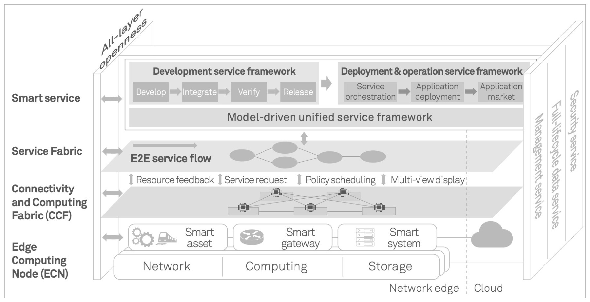

**Figure 12:** Edge Computing Reference Architecture 2.0: Smart Service, Service Fabric, Connectivity and Computing
Fabric (CCF) and Edge Computing Nodes (ECN), with cross-layer management, full-lifecycle data and security services.
Source: Edge Computing Consortium.

### E.2.1 Smart Service

The **Smart Service** layer is based on:

- a **common model** and a common **development and deployment framework** (develop, integrate, verify, release);
- **intelligent coordination** between service development and deployment (service orchestration, application
  deployment, application market);
- **consistent software development interfaces** and **automatic deployment and operations** through **Continuous
  Integration and Continuous Delivery (CI/CD)** technologies.

### E.2.2 Service Fabric

The **Service Fabric** provides **service orchestration** to enable **Edge-to-Edge (E2E)** communication and
interoperability (E2E service flows).

The aim is to allow existing services to easily communicate and interact, considering applications from the same or from
different producers/developers. This enables the creation of new applications, services and business models, and the
enhancement and enrichment of collected and analyzed data.

### E.2.3 Connectivity and Computing Fabric

The **Connectivity and Computing Fabric (CCF)** enables a simplified architecture and simplifies the distributed edge
intelligence architecture for services (resource feedback, service requests, policy scheduling, multi-view display).

It allows the connection and communication of the involved elements in a **shared and secure network** that may also be
**controlled by software** and potentially **fully virtualized**.

### E.2.4 Edge Computing Nodes

Intelligent **Edge Computing Nodes (ECNs)**, such as smart assets, smart gateways and smart systems, provide **network**,
**computing** and **storage** resources. ECNs are compatible with a variety of **heterogeneous connections**, support
**real-time processing and response**, and deliver **integrated hardware and software security**.

---

## E.3 Network Providers & Edge Computing

Network operators are natural actors of Edge Computing, since they own the infrastructure (e.g., mobile network base
stations) closest to users and devices. Following the **ETSI Multi-access Edge Computing (MEC)** approach, cloud
providers and telecom operators are bringing computing and storage capabilities **inside the mobile network**.

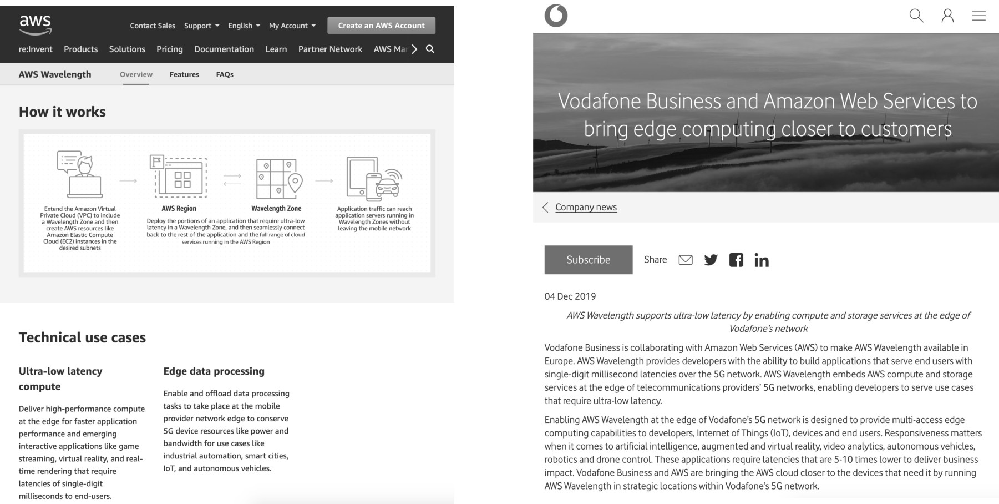

**Figure 13:** AWS Wavelength and the Vodafone Business / AWS collaboration (December 2019): AWS compute and storage
services are embedded at the edge of the 5G network to provide single-digit millisecond latencies to mobile devices and
end users, for use cases such as ultra-low latency compute and edge data processing.

---

## E.4 Edge Computing Software Evolution

- Most IoT ECN technology, i.e., the technology hosting edge processing capabilities, runs on flavors of the **Linux OS**
  on different kinds of processor architectures.
- An industry-wide trend is emerging to package edge computing capabilities into **microservices** and deploy them within
  **containers** on IoT ECNs.
- Containers provide **security through isolation**; they also serve as **deployment units** that simplify lifecycle
  management through less interdependency and complexity.

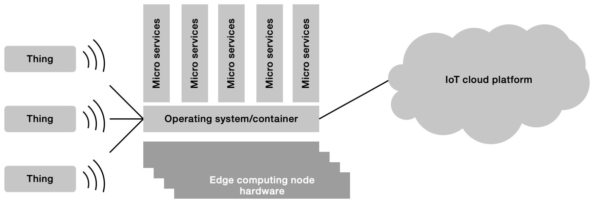

**Figure 14:** Edge computing software evolution: things connect to microservices running on an operating
system/container layer on top of the edge computing node hardware, which in turn communicates with the IoT cloud
platform.

---

## E.5 Edge Operating System: the IoT Gateway

- In Edge Computing, data is processed, analyzed and aggregated at the network edge, near things and data sources.
- The **IoT Gateway** is the natural host of these capabilities. Its main functions include **cloud offloading**,
  **private data filtering**, **data aggregation**, **protocol translation** and **caching**.
- The OS running on IoT gateways is usually a **general purpose OS** such as Linux. Horizontal decoupling brings
  openness to gateways.
- Third-party applications can be deployed on the gateway OS directly on the **host OS**, in a **container** (e.g., LXC,
  Docker) or in a **virtual machine**.
- The basic function of a gateway is always **networking**. The IoT gateway should support:
  - rich network protocols, including **Layer 2 (L2)** and **Layer 3 (L3)**;
  - **Virtual Local Area Networks (VLANs)**;
  - **routing**, **multicast** and **reliability** protocols, so that the gateway has flexible networking capabilities
    and can interconnect with equipment from third-party manufacturers.

---

## E.6 IoT & Edge Means Interoperability

- Today's IoT largely exists **in isolation**, and it is still hard to realize a truly interconnected world where devices
  are interoperable.
- **Consistent APIs** for connectivity and security, together with the adoption of **standard protocols and data
  formats**, are strategic elements to solve interoperability issues.
- Interoperability is one of the main pillars of the IoT, and in particular of IoT applications on the Edge.
- The adoption of existing standards and widespread protocols and approaches coming from the Internet (**IP-based
  stack**) and the **World Wide Web** brings several advantages:
  - **local & remote interaction** with objects and services (device-to-device and device-to-cloud approaches);
  - sharing of well-known **standard protocols** and **data/resource representations**;
  - easy **management, integration and composition** of services;
  - management of **heterogeneity** and **dynamism**;
  - efficient **data collection** from multiple sources;
  - **self-discovery** and **autonomous configurability**.

---

# F. The IoT Hub: a Fog Node for Smart Object Management

The **IoT Hub** is a **Fog node** placed at the edge of multiple physical networks, with the goal of creating an
**IP-based IoT network** to be used as an infrastructure for the deployment of **Web of Things (WoT)** applications.

As opposed to Smart Objects (SOs), the IoT Hub is a node that does **not** present strong limitations on computational
power and available memory, nor strict requirements on energy consumption. This makes it the ideal place to implement
functions that would be too expensive for constrained devices.

## F.1 IoT Hub Functions

The IoT Hub plays a fundamental role by implementing the following functions at different layers of the protocol stack:

- **Border Router**
- **Service and Resource Discovery**
- **Resource Directory (RD)**
- **Origin Server (OS)**
- **CoAP-to-CoAP (C2C) Proxy**
- **HTTP-to-CoAP (H2C) Proxy**
- **Cache**

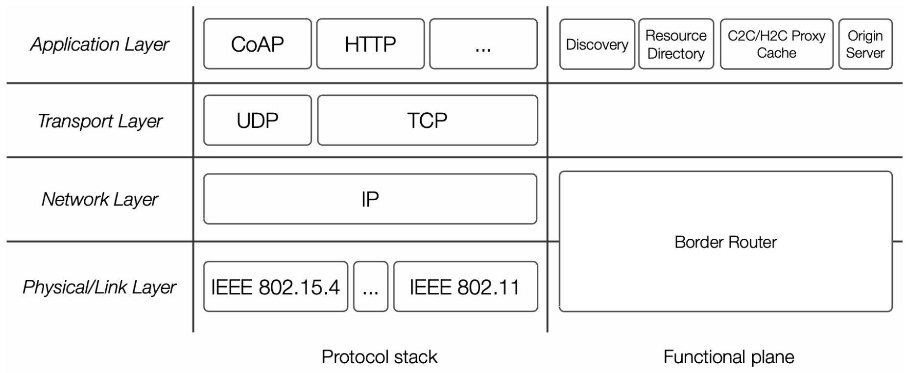

**Figure 15:** The IoT Hub protocol stack (IEEE 802.15.4/IEEE 802.11 at the physical/link layer, IP at the network
layer, UDP/TCP at the transport layer, CoAP/HTTP at the application layer) and its functional plane: Border Router at
the link and network layers, and Discovery, Resource Directory, C2C/H2C Proxy and Cache, and Origin Server at the
application layer.

---

## F.2 Link Layer Functions: the Border Router

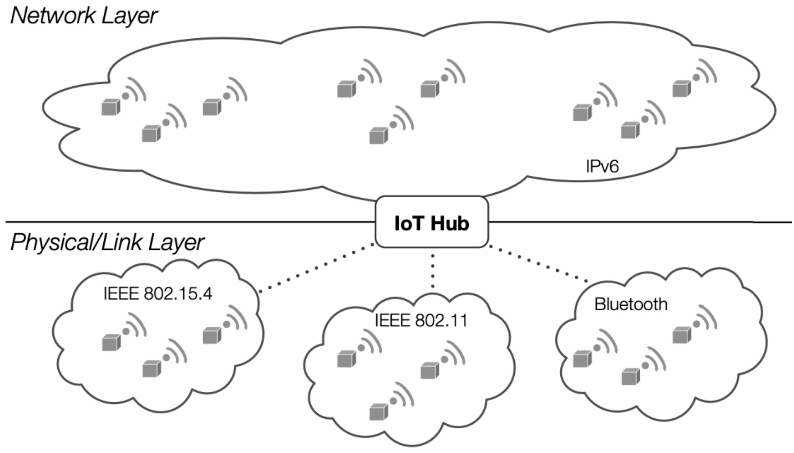

**Figure 16:** The IoT Hub as Border Router between multiple physical/link layer networks (IEEE 802.15.4, IEEE 802.11,
Bluetooth) and a single IPv6 network layer.

- **Border Router:** the IoT Hub is the gateway/bridge between one or more **constrained networks** (e.g., IEEE
  802.15.4) and the rest of the IP network.
- The border router function implemented by the IoT Hub is two-fold:
  - on the one hand, the IoT Hub provides **intra-network IP routing**, for instance by acting as the coordinator of an
    **RPL-based IEEE 802.15.4 multi-hop network**;
  - on the other hand, it provides a **single addressing space** for the multiple networks it is attached to.

---

## F.3 Application Layer Functions

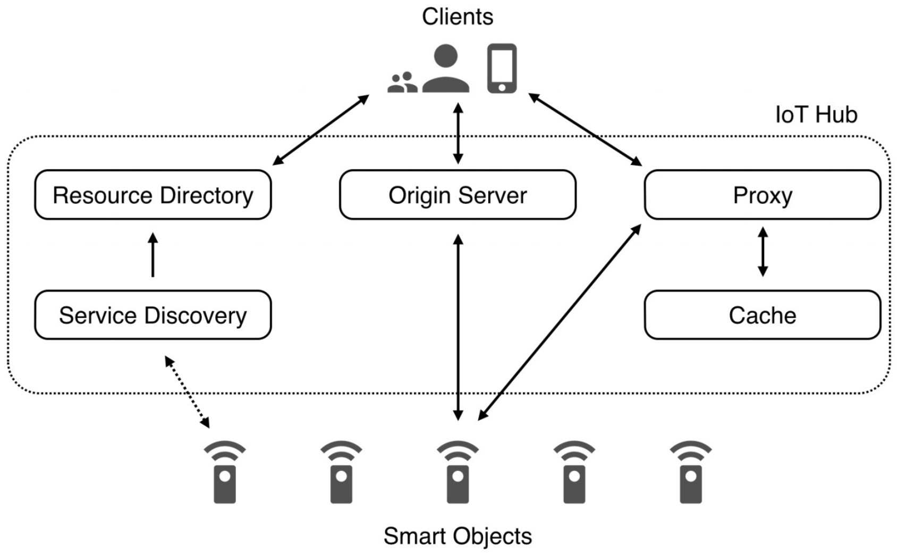

**Figure 17:** Application layer functions of the IoT Hub: Service Discovery, Resource Directory, Origin Server, Proxy
and Cache, mediating the interaction between Clients and Smart Objects.

At the application layer, the IoT Hub acts as the **single entry point** for clients that want to interact with the
Smart Objects of the network it manages: it discovers the Smart Objects and their resources, keeps them in a Resource
Directory, hosts resources on behalf of the Smart Objects that cannot act as servers, and mediates and caches the
requests through its proxy.

---

## F.4 Service and Resource Discovery

The IoT Hub implements **Service and Resource Discovery** to constantly have knowledge of the Smart Objects it is
supposed to manage.

**Service Discovery** aims at retrieving the **scheme**, **IP address** and **port** at which a Smart Object endpoint is
reachable. This function can be implemented according to multiple mechanisms:

- **zero-configuration** mechanisms based on **Multicast DNS** (mDNS, RFC 6762) and **DNS-Based Service Discovery**
  (DNS-SD, RFC 6763);
- **network scanning** (e.g., using NMap);
- other mechanisms, such as lightweight multicast forwarding and distributed P2P service discovery.

Once the endpoints have been discovered, they can be queried to retrieve the list of resources they host
(**Resource Discovery**):

- for **CoAP-based** Smart Objects, the `/.well-known/core` URI is used, and the list of resources is returned in
  **CoRE Link Format** (RFC 6690);
- for **HTTP-based** Smart Objects, the list can be returned using **Web Linking** (RFC 8288, which obsoletes RFC 5988);
- for proprietary Smart Objects that are not standard-compliant, other mechanisms can be integrated.

---

## F.5 Resource Directory

The **Resource Directory (RD)** is a specialized element that serves as a **registry** for all the resources in the IP
network managed by the IoT Hub. Resources are characterized by a **link** (i.e., a URI) and a set of **attributes**
describing them, as defined in RFC 6690.

The RD provides:

- a function set for the **registration** and **update** of resources;
- a function set for the **deletion** of resources;
- a function set for the **lookup** of resources.

The RD can be queried by clients to discover links to resources, and requests can contain **query parameters** to
filter the results. The RD is accessed using **CoAP**.

The **Resource Discovery** module interacts with the RD: when resources are discovered, they are **registered** in the
RD and then **periodically updated**.

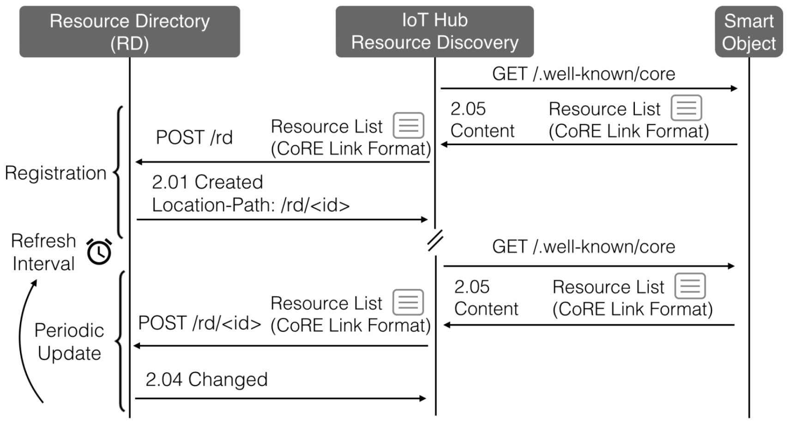

**Figure 18:** Resource Directory registration and periodic update performed by the Resource Discovery module of the IoT
Hub.

The registration steps are the following:

1. The Resource Discovery module retrieves the resources of the Smart Object with a `GET /.well-known/core` request and
   receives the resource list in CoRE Link Format (`2.05 Content`).
2. The Resource Discovery module registers the resources on the RD by sending a CoAP `POST /rd` request with the links
   of the discovered resources.
3. The RD replies with `2.01 Created` and the URI of the newly created registration resource (`Location-Path: /rd/<id>`),
   which is then used for any update or deletion operation.
4. After a **refresh interval**, the discovery is repeated and the registration is **periodically updated** with a
   `POST /rd/<id>` request (`2.04 Changed`).

The registration is also repeated by reporting the links that allow access through the **CoAP-to-CoAP proxy** and the
**HTTP-to-CoAP proxy**, which can be used by clients that need a proxy (with optional protocol translation).

> **Note:** the interaction shown here follows the CoRE Resource Directory specification, published as RFC 9176 in
> 2022. See the [Resource & Service Discovery](../../communication-protocols-and-patterns/resource-and-service-discovery/resource_and_service_discovery.md)
> lecture for the details of the registration and lookup interfaces.

---

## F.6 Origin Server

- In some cases, Smart Objects have very limited capabilities and **cannot act as servers** hosting resources.
- When this occurs, Smart Objects act as **clients** and need an external node to maintain resources on their behalf.
  To support this situation, the IoT Hub provides an **Origin Server (OS)** function.
- Clients can request the IoT Hub to **create and maintain resources on their behalf**. In this case, clients also need
  to take care of the **registration of the newly created resources on the RD**, since their attributes are unknown to
  the Origin Server.
- The IoT Hub is then used to access these resources.

---

## F.7 CoAP-to-CoAP / HTTP-to-CoAP Proxy and Cache

The IoT Hub can act as an **intermediary** for the communication with Smart Objects, either as a:

- **CoAP-to-CoAP (C2C) proxy**, to allow external CoAP clients to access constrained resources that cannot be reached
  directly;
- **HTTP-to-CoAP (H2C) proxy**, to allow HTTP clients to access CoAP resources.

There are several reasons that motivate the presence of a proxy in IoT scenarios:

- to **shield the constrained network** from the outside, e.g., for security reasons (DoS attacks);
- to support the **integration with the existing Web** through legacy HTTP clients;
- to **reduce the network load**;
- to support **data formats** that might not be suitable for constrained applications (e.g., XML);
- to ensure **high availability** of resources through **caching**.

For this reason, the IoT Hub also implements a **cache**, which is particularly useful in the presence of proxies: the
IoT Hub keeps a **"fresh" representation** of resources that can be used to serve requests without forwarding them to
the Smart Object. This avoids unnecessary computation on constrained devices and also makes it possible for clients to
get information from **duty-cycled devices**, which may not be reachable at all times.

---

## F.8 Resource Access through the IoT Hub

The IoT Hub enables clients to effectively discover and access resources hosted by heterogeneous Smart Objects. Its
added value is the capability to **completely hide the diverse nature of the Smart Objects**, in terms of hardware,
wired/wireless communication protocols and application-layer protocols, from clients, which can interact with them using
**uniform interfaces** and **without any prior configuration**.

The interaction with Smart Objects through the IoT Hub occurs according to the following steps:

1. The client **discovers the IoT Hub** through a suitable mechanism, such as DNS-SD.
2. The client **queries the RD** of the IoT Hub to get the list of resources matching its interests (resource
   discovery); the RD returns the list of links in CoRE Link Format.
3. The client **selects the resource** to access. Since each resource has been registered with multiple links (direct,
   through the CoAP-to-CoAP proxy, or through the HTTP-to-CoAP proxy), the client can select the URI that best fits its
   characteristics.
4. The client **sends requests** to the Smart Object using the URI selected at the previous step (resource access) and
   according to the type of interface exposed by the resource (e.g., a sensor resource might support only read - `GET` -
   operations, while actuators might also support write - `POST`/`PUT` - operations).

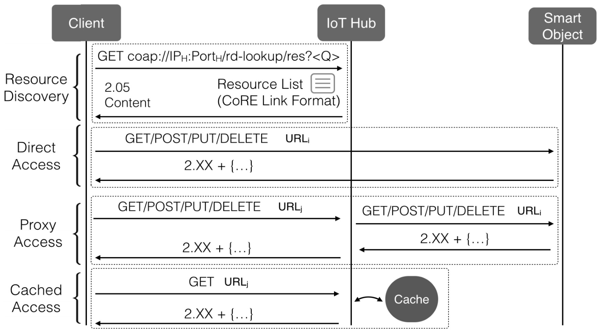

**Figure 19:** Resource access through the IoT Hub: resource discovery on the RD (`GET coap://IP_H:Port_H/rd-lookup/res?<Q>`),
followed by direct access to the Smart Object, access through the IoT Hub proxy, or cached access served directly by the
IoT Hub.

---

# G. IoT Hub, Cloud & Edge Synchronization: Virtual Replication

## G.1 The Virtual IoT Hub

- Large-scale IoT platforms for interconnected devices are required to effectively manage the resources provided by
  Smart Objects.
- To cope with a large number of resources in a **scalable**, **seamless** and **secure** way, it is possible to
  dynamically handle **IoT Hub virtual instances** both at the Cloud and at the Edge level.
- The basic concept is the **Virtual IoT Hub**: a Cloud-based entity **replicating all the functions of a physical IoT
  Hub**, which external clients query to access resources.
- IoT Hub virtual replicas are **constantly synchronized** with the physical IoT Hub through a **dedicated,
  low-overhead synchronization protocol** based on **MQTT** (Message Queue Telemetry Transport).
- The reference research work focuses on **Cloud-side virtualization** to support **Edge-to-Cloud (E2C)** scenarios, but
  the same approach can also be applied to **Edge-to-Edge (E2E)** contexts.

This approach anticipates the concept of **Digital Twin** applied to edge infrastructure: the virtual replica mirrors the
state and the capabilities of its physical counterpart, decoupling the external consumers from the physical network.

---

## G.2 Operational Scenarios

Resource access through the platform can occur according to three **operational models** implemented by a Smart Object:

- **CoAP server**;
- **Observable CoAP server**;
- **CoAP client**.

The corresponding **operational methodologies** are:

- **Polling resources**;
- **Observing resources**;
- **Pushing resources**.

In all the scenarios, a **Cloud Access Control** component receives the requests of the consumers and routes them to
one of the available IoT Hub replicas, while the physical IoT Hub is connected to the Cloud through a VPN.

---

## G.3 Polling Resources

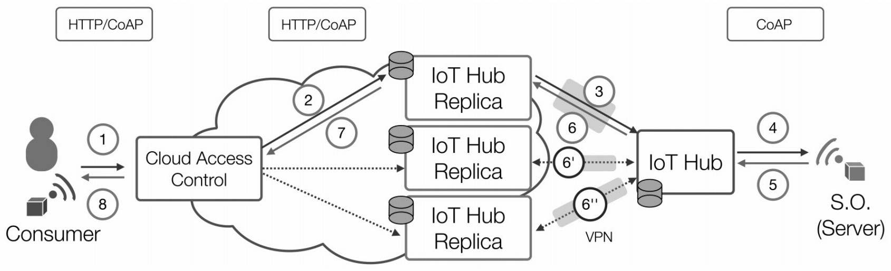

**Figure 20:** Polling resources: the consumer request (1) reaches the Cloud Access Control, which forwards it to a
replica (2); the replica forwards it to the IoT Hub (3) and, if needed, to the Smart Object acting as a server (4-5);
the response flows back to the consumer (6-8), while the other replicas are synchronized (6', 6'').

An HTTP/CoAP client requests a resource from the Cloud platform, which internally **selects a suitable IoT Hub replica**
and forwards the request. The request reaches the Smart Object **only if neither the replica nor the IoT Hub have a fresh
cached representation** of the resource. The other replicas (which are not in the path of the request) are kept in sync
using the synchronization protocol.

---

## G.4 Observing Resources

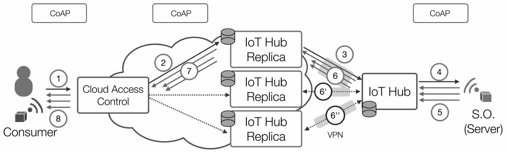

**Figure 21:** Observing resources: the observe request creates an "observe chain" from the consumer to the replica,
the IoT Hub and the Smart Object; notifications flow back along the same chain, while the other replicas are kept in
sync.

A CoAP client requests a resource from the Cloud platform using the **CoAP Observe option**. The Cloud platform
internally selects a suitable IoT Hub replica and forwards the request. The observe request is then forwarded to the IoT
Hub and to the Smart Object, thus creating an **"observe chain"**. Resource updates are then sent from the Smart Object
back to the IoT Hub, then to the replica, and finally to the CoAP client. The other replicas (which are not in the path
of the request) are kept in sync using the synchronization protocol.

---

## G.5 Pushing Resources

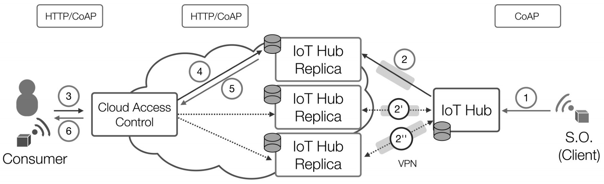

**Figure 22:** Pushing resources: the Smart Object acting as a CoAP client updates its resources on the IoT Hub (1),
which synchronizes all the replicas (2, 2', 2''); consumer requests (3-6) are served directly by a replica.

A Smart Object acting as a **CoAP client** posts and updates resources on the IoT Hub, which acts as **Origin Server**.
All replicas are kept in sync using the synchronization protocol, and external clients' requests are **served by a
replica** without reaching the physical network.

---

## G.6 Synchronization Protocol

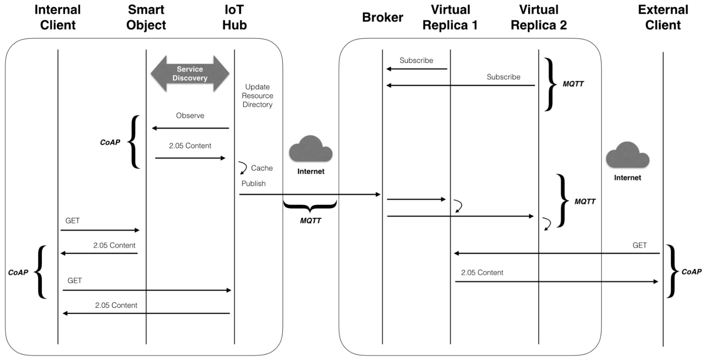

**Figure 23:** Synchronization protocol between the IoT Hub and its virtual replicas: internal clients interact with
the IoT Hub and the Smart Objects using CoAP; the IoT Hub publishes resource updates through an MQTT broker, to which
the virtual replicas are subscribed; external clients interact with the virtual replicas using CoAP.

The synchronization protocol works as follows:

1. The **virtual replicas subscribe** to the MQTT broker to receive the updates of the IoT Hub.
2. Inside the local network, the IoT Hub performs service discovery, updates its Resource Directory and observes the
   resources of the Smart Objects using **CoAP**, caching their representations.
3. Every time a resource changes, the IoT Hub **publishes** the update on the MQTT broker over the Internet, and the
   broker delivers it to **all the replicas**.
4. **Internal clients** can access the resources directly on the Smart Objects or through the IoT Hub, while
   **external clients** access them through a virtual replica, which can answer using its synchronized state.

The use of MQTT allows the IoT Hub to send each update **only once**, independently of the number of replicas, while
the broker takes care of the distribution.

---

## G.7 Replica Communication & Management

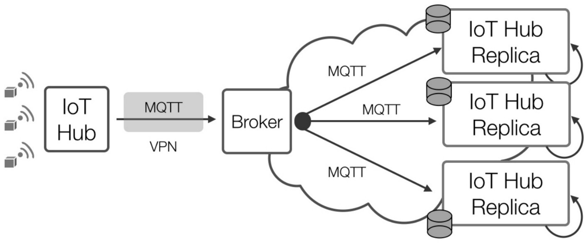

**Figure 24:** The broker-based message flow between the IoT Hub and its replicas: the IoT Hub publishes messages
through MQTT over a VPN to the broker, which forwards them to all the IoT Hub replicas.

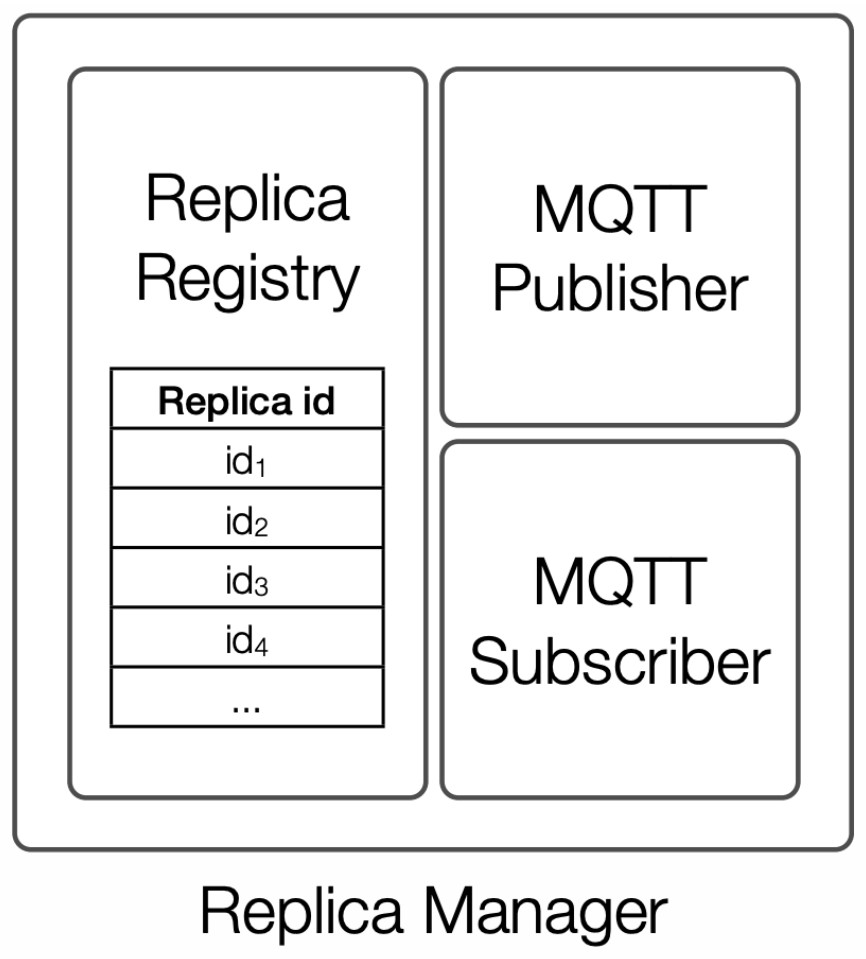

**Figure 25:** Internal structure of the Replica Manager of the IoT Hub: the Replica Registry (keeping the identifiers
of the active replicas), the MQTT Publisher and the MQTT Subscriber.

The **Replica Manager** module of the IoT Hub is responsible for keeping track of the active replicas in the **Replica
Registry** and for communicating with them through an **MQTT Publisher** (to send resource updates) and an **MQTT
Subscriber** (to receive messages coming from the replicas, e.g., requests to be forwarded to the physical network).

---

# H. Summary

| Aspect                | Cloud Computing                                    | Edge/Fog Computing                                          |
|-----------------------|----------------------------------------------------|-------------------------------------------------------------|
| Location              | Centralized data centers                           | Close to devices (gateways, routers, base stations, devices) |
| Latency               | High, depends on the round trip to the cloud       | Low, suitable for real-time (milliseconds) requirements     |
| Connectivity          | Requires a reliable Internet connection            | Can operate locally, also offline                           |
| Data                  | Long-period, global data                           | Short-period, local data (first entry of data)              |
| Typical tasks         | Big data analytics, training, business decisions   | Filtering, aggregation, inference, local decision-making    |
| Resources             | Virtually unlimited, elastic                       | Limited and heterogeneous                                   |
| Management            | Simpler, centralized lifecycle management          | Complex, distributed lifecycle management                   |

**Summary:**
Edge Computing does not replace the Cloud but **extends it towards the edge** of the network, moving computation,
storage and intelligence where data is generated. This removes the Cloud "addiction" of IoT applications, enabling
**real-time**, **offline-capable**, **bandwidth-efficient** and **privacy-preserving** solutions. Fog nodes such as the
**IoT Hub** apply this vision by providing border routing, discovery, Resource Directory, Origin Server, proxy and cache
functions close to Smart Objects, while **virtual replication** and MQTT-based synchronization allow the same resources
to be seamlessly and scalably accessed both at the Edge and in the Cloud.

---

# References

- O. Vermesan, P. Friess (eds.), *Internet of Things Applications - From Research and Innovation to Market Deployment*,
  pp. 287-313, River Publishers Series in Communications, Aalborg, Denmark, 2014. ISBN: 9788793102941
- Edge Computing Consortium & Alliance of Industrial Internet, *Edge Computing Reference Architecture 2.0*, 2017 -
  [http://en.ecconsortium.net/Uploads/file/20180328/1522232376480704.pdf](http://en.ecconsortium.net/Uploads/file/20180328/1522232376480704.pdf)
- ETSI, *Developing Software for Multi-Access Edge Computing*, ETSI White Paper No. 20, 2nd edition -
  [https://www.etsi.org/images/files/ETSIWhitePapers/etsi_wp20ed2_MEC_SoftwareDevelopment.pdf](https://www.etsi.org/images/files/ETSIWhitePapers/etsi_wp20ed2_MEC_SoftwareDevelopment.pdf)
- E. Guardo, *Edge Computing: challenges, solutions and architectures arising from the integration of Cloud Computing
  with Internet of Things*, PhD Dissertation, Università degli Studi di Catania -
  [http://dspace.unict.it/bitstream/10761/3908/1/GRDRNN84L09C351V-Tesi%20Dottorato%20-%20Ermanno%20Guardo.pdf](http://dspace.unict.it/bitstream/10761/3908/1/GRDRNN84L09C351V-Tesi%20Dottorato%20-%20Ermanno%20Guardo.pdf)
- WinSystems, *Cloud, Fog and Edge Computing - What's the Difference?* -
  [https://www.winsystems.com/cloud-fog-and-edge-computing-whats-the-difference/](https://www.winsystems.com/cloud-fog-and-edge-computing-whats-the-difference/)
- IEC, *Edge Intelligence*, White Paper -
  [https://www.iec.ch/whitepaper/pdf/IEC_WP_Edge_Intelligence.pdf](https://www.iec.ch/whitepaper/pdf/IEC_WP_Edge_Intelligence.pdf)
- *Azure IoT: a Practical Entry to New Retail* -
  [https://www.slideshare.net/DanielLi72/azure-iot-a-practical-entry-to-new-retail](https://www.slideshare.net/DanielLi72/azure-iot-a-practical-entry-to-new-retail)
- Qwilt, *Welcome to the Edge* -
  [https://qwilt.com/welcome-edge-evolution-cloud-computing/](https://qwilt.com/welcome-edge-evolution-cloud-computing/)
- S. Cirani, G. Ferrari, N. Iotti, M. Picone, *The IoT hub: a fog node for seamless management of heterogeneous connected
  smart objects*, 2015 12th Annual IEEE International Conference on Sensing, Communication, and Networking - Workshops
  (SECON Workshops), Seattle, WA, 2015, pp. 1-6. doi: 10.1109/SECONW.2015.7328145 -
  [https://ieeexplore.ieee.org/document/7328145](https://ieeexplore.ieee.org/document/7328145)
- S. Cirani, G. Ferrari, M. Mancin, M. Picone, *Virtual Replication of IoT Hubs in the Cloud: A Flexible Approach to
  Smart Object Management*, Journal of Sensor and Actuator Networks, 2018, 7, 16 -
  [https://www.mdpi.com/2224-2708/7/2/16](https://www.mdpi.com/2224-2708/7/2/16)
- M. Simsek et al., *5G-Enabled Tactile Internet*, IEEE Journal on Selected Areas in Communications, Vol. 34, No. 3,
  March 2016
- P. P. Ray, *A survey of IoT cloud platforms*, Future Computing and Informatics Journal, Vol. 1, Issues 1-2, 2016 -
  [https://www.sciencedirect.com/science/article/pii/S2314728816300149](https://www.sciencedirect.com/science/article/pii/S2314728816300149)
- TechCrunch, *Nest's Smart Home Apps Are Back Online Following Outages*, January 2016 -
  [http://techcrunch.com/2016/01/09/nests-smart-home-apps-are-back-online-following-outages/](http://techcrunch.com/2016/01/09/nests-smart-home-apps-are-back-online-following-outages/)
- AWS Wavelength - [https://aws.amazon.com/wavelength/](https://aws.amazon.com/wavelength/)
- Z. Shelby, *Constrained RESTful Environments (CoRE) Link Format*, RFC 6690, IETF, August 2012 -
  [https://www.rfc-editor.org/rfc/rfc6690](https://www.rfc-editor.org/rfc/rfc6690)
- M. Nottingham, *Web Linking*, RFC 8288, IETF, October 2017 (obsoletes RFC 5988) -
  [https://www.rfc-editor.org/rfc/rfc8288](https://www.rfc-editor.org/rfc/rfc8288)
- C. Amsüss, Z. Shelby, M. Koster, C. Bormann, P. van der Stok, *CoRE Resource Directory*, RFC 9176, IETF, April 2022 -
  [https://www.rfc-editor.org/rfc/rfc9176](https://www.rfc-editor.org/rfc/rfc9176)
- S. Cheshire, M. Krochmal, *Multicast DNS*, RFC 6762, IETF, February 2013 -
  [https://www.rfc-editor.org/rfc/rfc6762](https://www.rfc-editor.org/rfc/rfc6762)
- S. Cheshire, M. Krochmal, *DNS-Based Service Discovery*, RFC 6763, IETF, February 2013 -
  [https://www.rfc-editor.org/rfc/rfc6763](https://www.rfc-editor.org/rfc/rfc6763)
