<!-- omit in toc -->
# The Constrained Application Protocol (CoAP)

<!-- omit in toc -->
## Lecture Information

| **Lecture Title**   | The Constrained Application Protocol (CoAP)                                      |
|---------------------|----------------------------------------------------------------------------------|
| **Author**          | Prof. Marco Picone (marco.picone@unimore.it)                                     |
| **License**         | [Creative Commons Attribution 4.0](https://creativecommons.org/licenses/by/4.0/) | 


<!-- omit in toc -->
# Table of Contents

- [A. Characteristics of IoT Networks \& Application-Layer Requirements](#a-characteristics-of-iot-networks--application-layer-requirements)
  - [A.1 Why HTTP and TCP Are Not Well Suited](#a1-why-http-and-tcp-are-not-well-suited)
  - [A.2 An Application Layer for the IoT: the Web of Things](#a2-an-application-layer-for-the-iot-the-web-of-things)
- [B. The Constrained Application Protocol (CoAP)](#b-the-constrained-application-protocol-coap)
  - [B.1 CoAP URIs \& Default Ports](#b1-coap-uris--default-ports)
  - [B.2 CoAP Standardization \& Related IETF CoRE Documents](#b2-coap-standardization--related-ietf-core-documents)
  - [B.3 CoAP vs. HTTP Protocol Stack](#b3-coap-vs-http-protocol-stack)
- [C. CoAP Layered Architecture](#c-coap-layered-architecture)
  - [C.1 CoAP Messaging: Message ID \& Token](#c1-coap-messaging-message-id--token)
- [D. CoAP Messaging Reliability](#d-coap-messaging-reliability)
  - [D.1 Message Types](#d1-message-types)
  - [D.2 Confirmable vs. Non-Confirmable Messages](#d2-confirmable-vs-non-confirmable-messages)
  - [D.3 Reliable Transmission \& Exponential Back-off](#d3-reliable-transmission--exponential-back-off)
  - [D.4 Piggy-backed and Separate Responses](#d4-piggy-backed-and-separate-responses)
  - [D.5 Matching Messages: Message ID vs. Token](#d5-matching-messages-message-id-vs-token)
- [E. CoAP Message Format](#e-coap-message-format)
  - [E.1 Version, Type \& Token Length](#e1-version-type--token-length)
  - [E.2 Code: Methods \& Response Codes](#e2-code-methods--response-codes)
  - [E.3 Message ID](#e3-message-id)
  - [E.4 Token](#e4-token)
  - [E.5 Options, Payload Marker \& Payload](#e5-options-payload-marker--payload)
- [F. CoAP Options](#f-coap-options)
  - [F.1 Option Format \& Delta Encoding](#f1-option-format--delta-encoding)
  - [F.2 Extended Option Delta \& Length](#f2-extended-option-delta--length)
  - [F.3 Option Value Formats](#f3-option-value-formats)
  - [F.4 CoAP Options Registry](#f4-coap-options-registry)
  - [F.5 Uri-Host, Uri-Port, Uri-Path \& Uri-Query](#f5-uri-host-uri-port-uri-path--uri-query)
  - [F.6 Location-Path \& Location-Query](#f6-location-path--location-query)
  - [F.7 Content-Format \& Accept](#f7-content-format--accept)
- [G. IoT-Oriented Features](#g-iot-oriented-features)
  - [G.1 Resource Observation](#g1-resource-observation)
    - [G.1.1 The Observer Design Pattern](#g11-the-observer-design-pattern)
    - [G.1.2 Observation Flow Example](#g12-observation-flow-example)
  - [G.2 Block-wise Transfers](#g2-block-wise-transfers)
    - [G.2.1 Block1 and Block2 Options](#g21-block1-and-block2-options)
    - [G.2.2 Anatomy of a Block Option Value](#g22-anatomy-of-a-block-option-value)
    - [G.2.3 Block2 Example (Response Payload)](#g23-block2-example-response-payload)
    - [G.2.4 Block1 Example (Request Payload)](#g24-block1-example-request-payload)
  - [G.3 Group Communication](#g3-group-communication)
  - [G.4 Resource Discovery](#g4-resource-discovery)
  - [G.5 HTTP/CoAP Proxying](#g5-httpcoap-proxying)
- [H. Exercise: Building a CoAP Message Step by Step](#h-exercise-building-a-coap-message-step-by-step)
  - [H.1 Header: Version, Type \& Token Length](#h1-header-version-type--token-length)
  - [H.2 Header: Code](#h2-header-code)
  - [H.3 Header: Message ID](#h3-header-message-id)
  - [H.4 Token](#h4-token)
  - [H.5 Options: From the URI to Option Numbers \& Deltas](#h5-options-from-the-uri-to-option-numbers--deltas)
  - [H.6 Options: Uri-Host](#h6-options-uri-host)
  - [H.7 Options: Uri-Port](#h7-options-uri-port)
  - [H.8 Options: Uri-Path Segments](#h8-options-uri-path-segments)
  - [H.9 Payload Marker \& Complete Message](#h9-payload-marker--complete-message)
- [I. CoAP vs. HTTP vs. MQTT Summary](#i-coap-vs-http-vs-mqtt-summary)
- [References](#references)

# A. Characteristics of IoT Networks & Application-Layer Requirements

IoT networks, and in particular **Low-power and Lossy Networks (LLNs)**, have characteristics that are significantly different from those of traditional Internet deployments:

- **Small Packet Size:**
  - In constrained IoT networks the maximum physical layer packet can be quite limited, according to the deployment and the communication technology.
  - *Example (IoT):* IEEE 802.15.4 networks have a maximum frame size of **127 bytes**.
- **Low Bandwidth:**
  - Data rates can be in the order of tens of kbit/s.
- **Low Power:**
  - According to the scenario and the deployment, some or all devices are **battery operated**.
- **Low Cost:**
  - Devices are typically associated with sensors, switches, etc. This drives other characteristics such as **low processing power** and **limited memory**.
- **Unreliability:**
  - Uncertain radio connectivity, battery drain, device lockups, physical tampering, etc.
- **Duty Cycling:**
  - IoT devices may **sleep for long periods** of time in order to save energy and are **unable to communicate** during these sleep periods.

---

## A.1 Why HTTP and TCP Are Not Well Suited

Application-layer protocols must be designed carefully in order to take into account the **constraints deriving from lower layers** and the very nature of **smart objects**.

**HTTP and TCP are not well suited for constrained environments:**

- **HTTP** introduces **overhead**:
  - It is a **text-based** and **verbose** protocol: headers can easily exceed the size of a single constrained network frame.
  - Parsing text requires more processing and memory than parsing a compact binary format.
- **TCP** is a **connection-oriented** transport:
  - **Setting up and maintaining connections** (three-way handshake, connection state, congestion control) is a heavy task for constrained devices.
  - **Duty cycling is not compatible** with keeping connections alive: a device that sleeps most of the time cannot maintain long-lived TCP connections.

> **Solution:** the **Constrained Application Protocol (CoAP)**, which brings the REST architectural style to constrained devices and networks with a compact binary format on top of UDP.

---

## A.2 An Application Layer for the IoT: the Web of Things

The adoption of a RESTful application layer enables the vision of the **Web of Things (WoT)**:

- **Connected objects** are organized in a **web architecture** and use **web technologies** to exchange information.
- Smart objects are **integrated with the World Wide Web**, building an *Extended Internet* where physical things are accessible as web resources.
- The **patterns of the web are well-known** and can be reused effectively (REST): developers can interact with devices using the same concepts (URIs, methods, response codes, media types) they already use for web applications.

---

# B. The Constrained Application Protocol (CoAP)

The **Constrained Application Protocol (CoAP)** is an **application-layer protocol** designed to be used by **constrained devices** in terms of computational capabilities, which may feature **limited battery** and operate in **constrained (low-power and lossy) networks**.

**Key Features:**

- **Standardization:**
  - Designed by the **IETF Constrained RESTful Environments (CoRE) Working Group** and standardized in **RFC 7252**.
- **RESTful Protocol:**
  - Resources identified by URIs and manipulated through methods (`GET`, `POST`, `PUT`, `DELETE`) and response codes inspired by HTTP.
- **Binary Protocol:**
  - **Small message size** (fixed header of only **4 bytes**) and **easy to parse**.
- **Easy Mapping to HTTP:**
  - CoAP maps to HTTP easily, in order to guarantee **integration with the WWW** through proxies.
- **Lightweight Transport:**
  - CoAP runs on top of **UDP**, avoiding the cost of connection management.
- **IoT-Oriented Features:**
  - **Asynchronous** message exchange.
  - **Multicast** communication.
  - Built-in **resource discovery**, **resource observation**, and **block-wise transfers**.

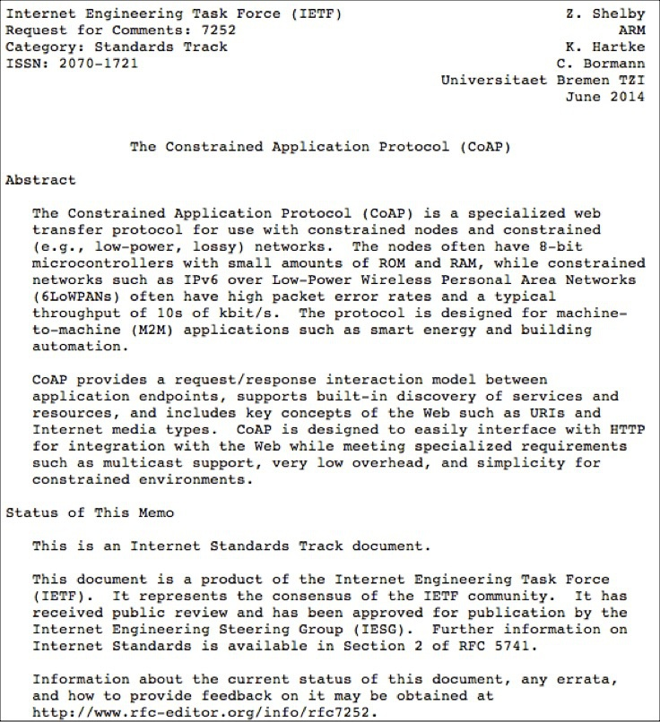

**Figure 1:** The first page of RFC 7252 - The Constrained Application Protocol (CoAP) - [https://www.rfc-editor.org/rfc/rfc7252](https://www.rfc-editor.org/rfc/rfc7252).

---

## B.1 CoAP URIs & Default Ports

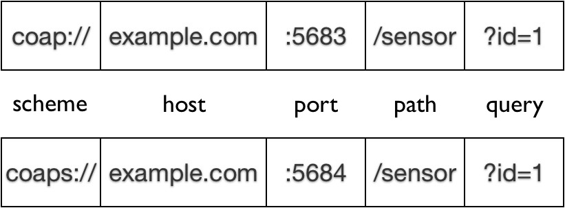

**Figure 2:** Structure of CoAP URIs using the `coap://` and `coaps://` schemes.

- CoAP URIs use the **`coap://`** or **`coaps://`** scheme.
- **`coaps://`** refers to **secure CoAP**, which uses **DTLS** (Datagram Transport Layer Security) as a secure transport, similarly to **HTTPS** with **TLS**.
- **Default ports:**
  - `coap://` uses **UDP port 5683**.
  - `coaps://` uses **UDP port 5684**.
- The remaining URI components (**host**, **port**, **path**, **query**) have the same meaning they have in HTTP.
  - *Example (IoT):* `coap://example.com:5683/sensor?id=1` identifies the resource `sensor` with the query parameter `id=1` hosted by `example.com`.

---

## B.2 CoAP Standardization & Related IETF CoRE Documents

Besides the core specification (RFC 7252), the IETF CoRE Working Group has produced a set of documents that extend CoAP with additional functionalities:

| Document | Type / Number | Description |
|----------|---------------|-------------|
| **CoRE Link Format** | RFC 6690 | "Web Linking" using a link format for use by constrained web servers to describe hosted resources. |
| **Block-wise Transfers** | RFC 7959 | "Block" options for transferring multiple blocks of information from a resource representation in multiple request/response pairs. |
| **Group Communication** | RFC 7390 | CoAP in group communication contexts, on top of IP multicast. |
| **HTTP-CoAP Mapping** | RFC 8075 | HTTP-to-CoAP protocol translation for proxies, focusing on the reverse proxy case. |
| **Observe** | RFC 7641 | "Observe" option to enable a subscribe/notify paradigm in CoAP. |
| **CoAP over TCP, TLS & WebSockets** | RFC 8323 | Transport of CoAP over reliable, connection-oriented transports. |
| **Resource Directory** | RFC 9176 | Resource Directory (RD) hosting descriptions of resources held on other servers, allowing lookups to be performed for those resources. |
| **CoRE Interfaces** | Internet Draft | REST interface descriptions for Batch, Sensor, Parameter and Actuator types for use in constrained web servers using the CoRE Link Format. |

> **Note:** The IETF CoRE Working Group is still active and new documents (e.g., an updated version of group communication, OSCORE for end-to-end security) keep extending the CoAP ecosystem. The up-to-date list of documents is available at [https://datatracker.ietf.org/wg/core/documents/](https://datatracker.ietf.org/wg/core/documents/).

---

## B.3 CoAP vs. HTTP Protocol Stack

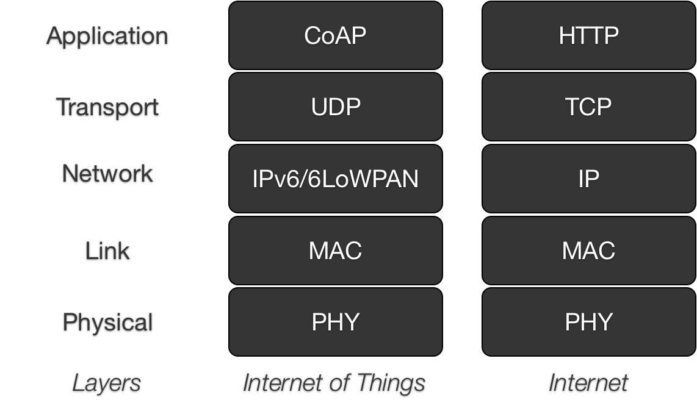

**Figure 3:** Comparison between the IoT protocol stack based on CoAP and the traditional Internet protocol stack based on HTTP.

The comparison between the two stacks highlights how CoAP has been designed to replace HTTP in constrained environments while preserving the same architectural principles:

| Layer           | Internet of Things | Internet |
|-----------------|--------------------|----------|
| **Application** | CoAP               | HTTP     |
| **Transport**   | UDP                | TCP      |
| **Network**     | IPv6 / 6LoWPAN     | IP       |
| **Link**        | MAC                | MAC      |
| **Physical**    | PHY                | PHY      |

- **CoAP over UDP** replaces **HTTP over TCP**: no connection setup and maintenance.
- **IPv6 over 6LoWPAN** (IPv6 over Low-Power Wireless Personal Area Networks) allows constrained devices to be natively addressable through IPv6, with header compression to fit small frames.

---

# C. CoAP Layered Architecture

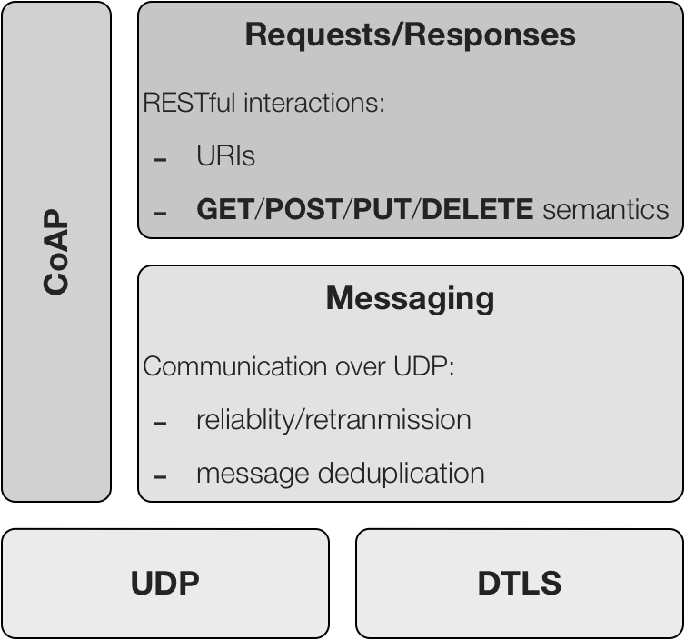

**Figure 4:** CoAP logical layers: the Requests/Responses layer on top of the Messaging layer, running over UDP or DTLS.

CoAP is based on a **request/response communication model**, but since it runs on top of **UDP**:

- **Reliability is not provided by the transport layer**: retransmissions may be needed and must be handled by CoAP itself.
- **Asynchronous communications** may require a mechanism to **match requests and responses**.

For this reason, CoAP is logically characterized by **two layers**:

- **Messaging Layer:**
  - Deals with the communication over UDP between two endpoints.
  - Support for **duplicate detection** (message deduplication).
  - **(Optional) reliability** through acknowledgements and retransmissions.
- **Requests/Responses Layer:**
  - Implements **RESTful interactions**: URIs and `GET`/`POST`/`PUT`/`DELETE` semantics.
  - Requests and responses are carried by messages of the Messaging layer.

> **Note:** The two layers are a logical abstraction: they are both part of the same CoAP header and are not implemented as separate protocols.

---

## C.1 CoAP Messaging: Message ID & Token

- CoAP messages are exchanged between **UDP endpoints** (default port **5683**).
- As in HTTP, CoAP messages are either **requests** or **responses**.
- **Message ID (16 bits):**
  - Included in every message.
  - Used to **detect duplicates** and to implement **optional reliability** (acknowledgement of received messages).
  - Belongs to the **Messaging layer**.
- **Token (0 to 8 bytes):**
  - Used to **match requests and responses**.
  - Belongs to the **Requests/Responses layer**.
- **Message IDs and Tokens are separate concepts** and work **orthogonally**:
  - A single request/response exchange can span **multiple messages** with **different Message IDs** but the **same Token** (see [D.4 Piggy-backed and Separate Responses](#d4-piggy-backed-and-separate-responses)).

---

# D. CoAP Messaging Reliability

The use of **UDP**, especially in **LLNs**, might lead to **messages being lost**.

- Reliability **cannot be provided by the transport layer** (as it would happen with TCP) and must be ensured at the **application layer** by CoAP.
- Reliability is implemented by performing **retransmissions with exponential back-off**: the timeout is **doubled at each retransmission**.
- A maximum of **4 retransmissions** (`MAX_RETRANSMIT`) can be performed.

> **Note:** The transport of CoAP over reliable transports (**TCP**, **TLS** and **WebSockets**) has been standardized in **RFC 8323**. In that case the reliability mechanisms of the Messaging layer are delegated to the transport and the message format is slightly different. In this lecture we focus on the original and most widespread **CoAP over UDP**.

---

## D.1 Message Types

CoAP defines **4 types of messages**:

- **CON (Confirmable):**
  - Used for messages that **must be transmitted reliably**.
  - Each CON message requires an acknowledgement.
  - *Example (IoT):* A command to turn off an industrial machine.
- **NON (Non-confirmable):**
  - Used for messages for which **reliability is not needed**.
  - *Example (IoT):* Periodic temperature readings where an occasional loss is acceptable.
- **ACK (Acknowledgement):**
  - Used to **acknowledge the reception** of a CON message.
  - It can also carry a response (*piggy-backed response*).
- **RST (Reset):**
  - Used to indicate that a message was received but **could not be processed** (e.g., the receiver lacks the context to process it, for instance after a reboot) and to **cancel** a reliable transmission.

---

## D.2 Confirmable vs. Non-Confirmable Messages

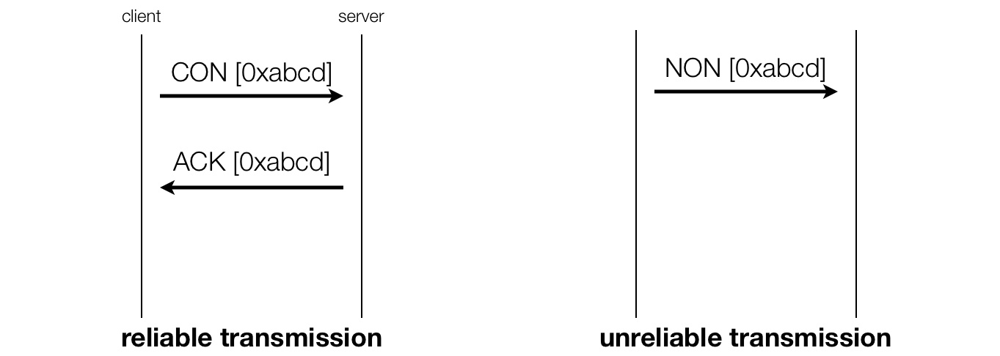

**Figure 5:** Reliable transmission with a CON message acknowledged by an ACK carrying the same Message ID (left) and unreliable transmission with a NON message (right).

- When a **CON request** is sent, an **ACK** is required to be sent back to acknowledge the correct reception of the request.
  - The ACK carries the **same Message ID** of the CON message (`0xabcd` in the figure).
- When a **NON request** is sent, the response **should be returned in a NON message**.
- **CON messages provide reliability:** if no ACK is returned before a **retransmission timeout** (with exponential back-off), the message is **retransmitted**.

---

## D.3 Reliable Transmission & Exponential Back-off

The following sequence describes how a client reliably transmits a CON message to a server.

**Step 1 - First transmission:** the client sends the CON message at time `t0` and sets a **timer** that expires after `ΔT`.

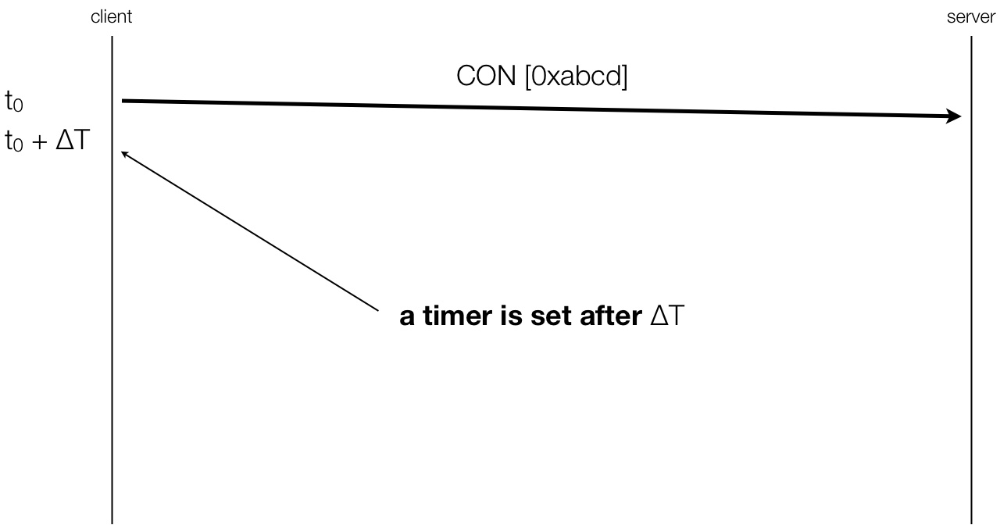

**Figure 6:** The client sends a CON message and sets a retransmission timer of `ΔT`.

**Step 2 - Timeout:** no ACK is received before the timer expires.

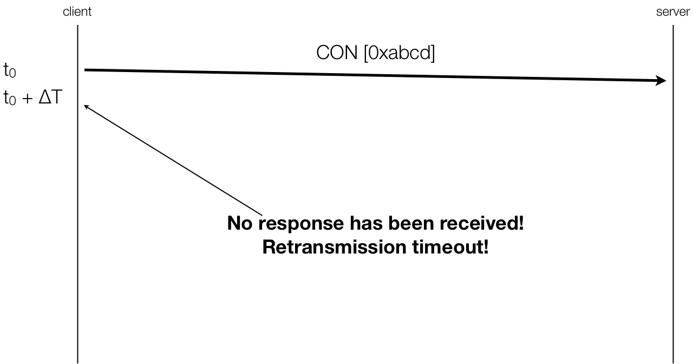

**Figure 7:** No response has been received before the expiration of the timer: retransmission timeout.

**Step 3 - First retransmission:** the client retransmits the message (with the **same Message ID**) at `t0 + ΔT` and sets a new timer with a **doubled** timeout `2ΔT`.

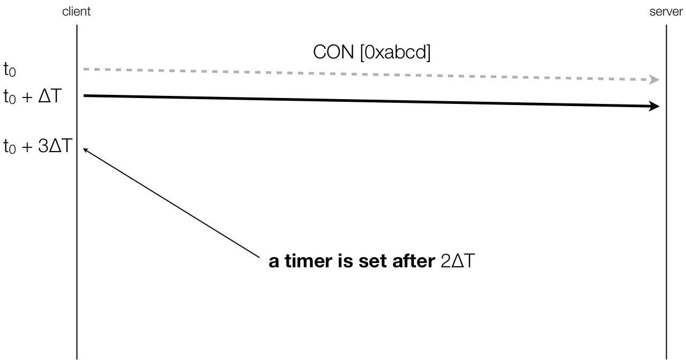

**Figure 8:** The message is retransmitted and the timer is set to `2ΔT`.

**Step 4 - Second timeout:** again, no ACK is received before `t0 + 3ΔT`.

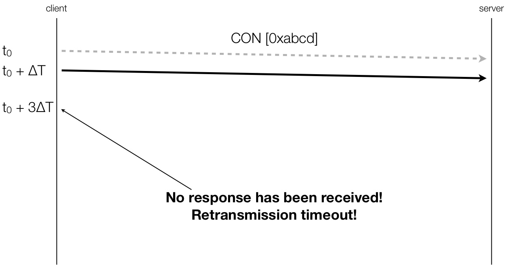

**Figure 9:** Second retransmission timeout.

**Step 5 - Second retransmission:** the message is retransmitted at `t0 + 3ΔT` and the timer is set to `4ΔT`.

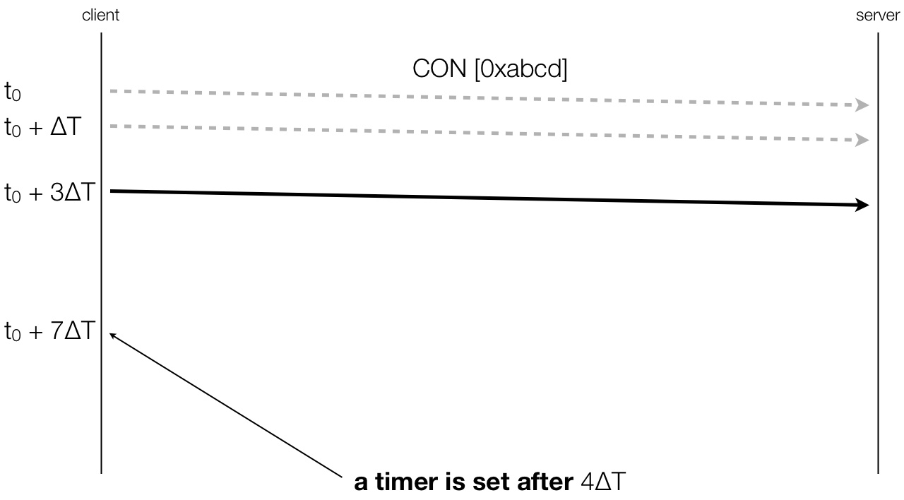

**Figure 10:** The message is retransmitted again and the timer is set to `4ΔT`.

**Step 6 - Acknowledgement:** the server receives the message and replies with an **ACK** carrying the same Message ID. The ACK is received **before the timer expires** (`t0 + 7ΔT`), so the **timer is invalidated** and the transmission is completed.

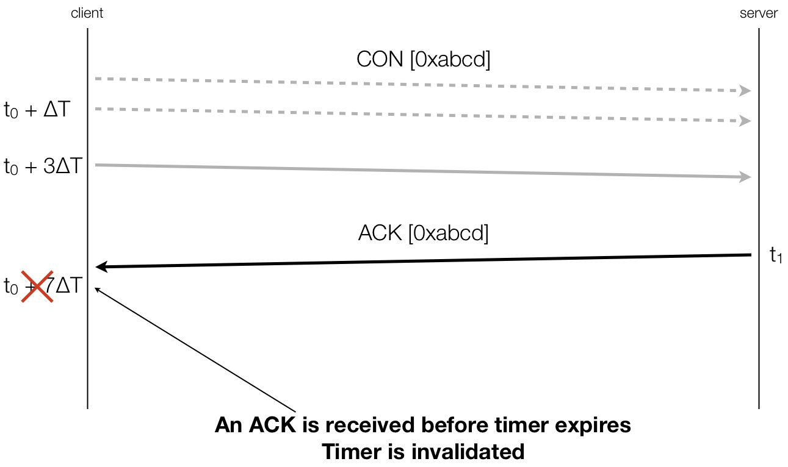

**Figure 11:** An ACK is received before the timer expires and the timer is invalidated.

**Transmission Parameters (RFC 7252):**

| Parameter | Default Value | Description |
|-----------|---------------|-------------|
| `ACK_TIMEOUT` | 2 seconds | Base timeout for the first retransmission. |
| `ACK_RANDOM_FACTOR` | 1.5 | The initial timeout is chosen randomly between `ACK_TIMEOUT` and `ACK_TIMEOUT * ACK_RANDOM_FACTOR` (i.e., 2-3 s) to avoid synchronized retransmissions. |
| `MAX_RETRANSMIT` | 4 | Maximum number of retransmissions. |
| `MAX_TRANSMIT_SPAN` | 45 seconds | Maximum time from the first transmission of a CON message to its last retransmission. |

**Key Points:**

- With 4 retransmissions, the message is sent at `t0`, `t0 + ΔT`, `t0 + 3ΔT`, `t0 + 7ΔT` and `t0 + 15ΔT`; if no ACK arrives by `t0 + 31ΔT` the transmission is considered **failed** and the application is notified.
- The **exponential back-off** reduces the load on congested or lossy networks.
- Thanks to the **Message ID**, the receiver can **detect duplicates** (e.g., when an ACK is lost and the sender retransmits a message that was already received) and avoid processing the same message twice.

---

## D.4 Piggy-backed and Separate Responses

When a **CON request** is sent, the CoAP response can be:

- **Piggy-backed**, if the server can **respond immediately**:
  - The response is **included in the ACK message** that acknowledges the request (*implicit acknowledgement*).
- **Separate**, if the server **cannot respond immediately** (e.g., it needs to wake up a sensor and read a new value):
  - The server first sends an **empty ACK** to acknowledge the request, so that the client stops retransmitting it.
  - When the data is available, the server sends a **new CON message** containing the response, which is acknowledged by the client with a new **ACK**.

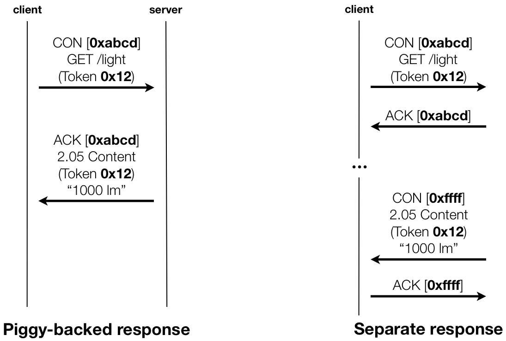

**Figure 12:** Piggy-backed response (left) vs. separate response (right) for a `GET /light` request.

**Example (IoT):** A client requests the brightness of a smart light (`GET /light`):

- **Piggy-backed:** the server immediately replies with an ACK containing `2.05 Content` and the payload `"1000 lm"`.
- **Separate:** the server acknowledges the request with an empty ACK and, once the measurement is available, sends a CON message with `2.05 Content` and `"1000 lm"`, acknowledged by the client.

---

## D.5 Matching Messages: Message ID vs. Token

The two response modes clearly show the **orthogonal role** of Message IDs and Tokens.

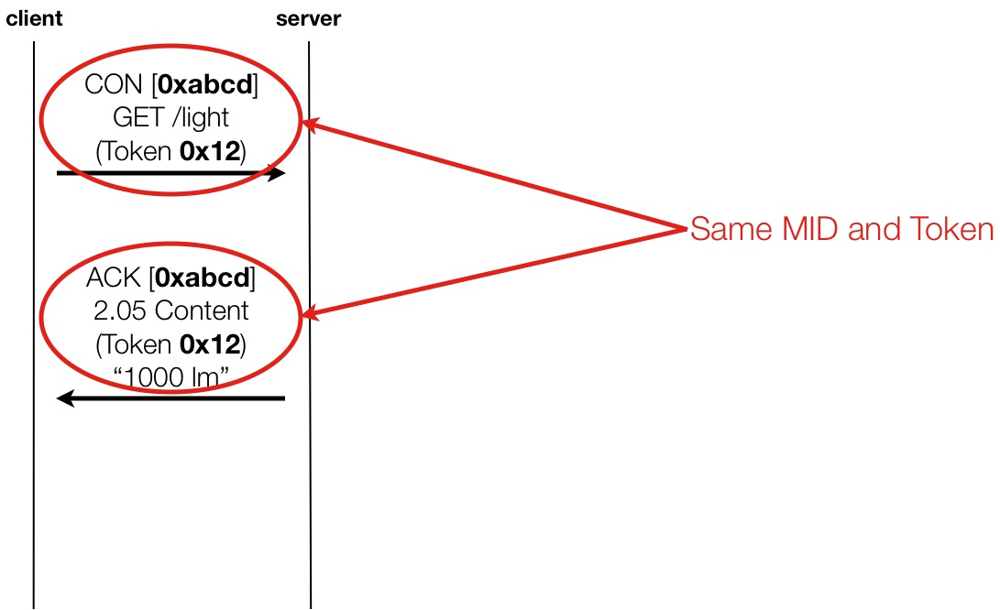

**Figure 13:** In a piggy-backed response the request and the ACK share the same Message ID and the same Token.

- **Piggy-backed response:** the request and its response are carried by the CON/ACK pair, so they share **both** the **same Message ID** (`0xabcd`) and the **same Token** (`0x12`).

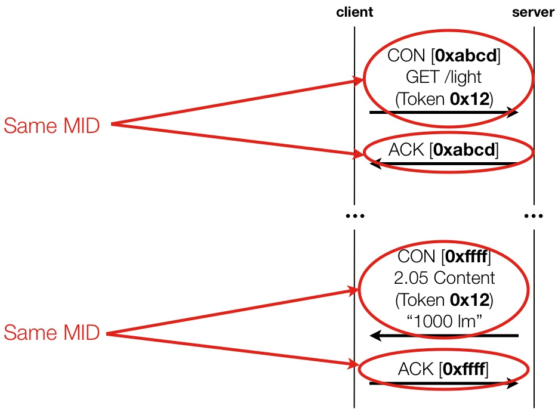

**Figure 14:** In a separate response each CON message is acknowledged by an ACK with the same Message ID.

- **Separate response - Messaging layer:** there are **two independent CON/ACK exchanges**, each with its own Message ID (`0xabcd` for the request, `0xffff` for the response). The Message ID matches each **CON** with its **ACK**.

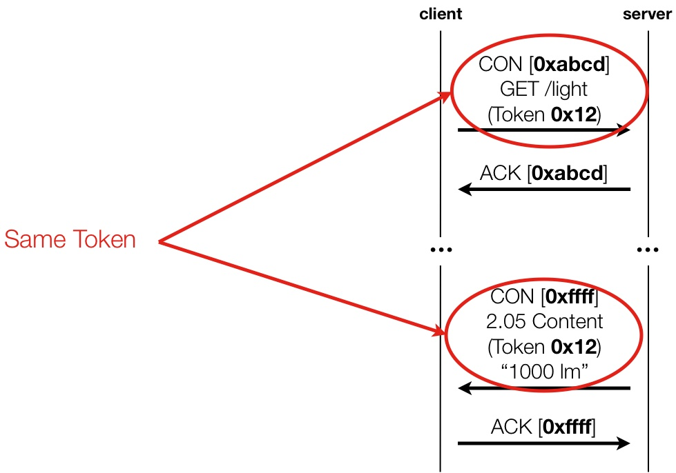

**Figure 15:** In a separate response the request and the response are matched through the same Token.

- **Separate response - Requests/Responses layer:** the request and the response are carried by **different messages**, with different Message IDs, but they share the **same Token** (`0x12`). The Token matches the **response** with its **request**.

**Summary:**

| Identifier | Layer | Purpose | Matches |
|------------|-------|---------|---------|
| **Message ID** | Messaging | Duplicate detection & reliability | CON ↔ ACK/RST |
| **Token** | Requests/Responses | Request/response correlation | Request ↔ Response(s) |

---

# E. CoAP Message Format

CoAP messages are encoded in a simple **binary format** composed of a **fixed-size 4-byte header**, followed by a variable-length **Token**, a sequence of **Options** and an optional **Payload**.

```
 0                   1                   2                   3
 0 1 2 3 4 5 6 7 8 9 0 1 2 3 4 5 6 7 8 9 0 1 2 3 4 5 6 7 8 9 0 1
+-+-+-+-+-+-+-+-+-+-+-+-+-+-+-+-+-+-+-+-+-+-+-+-+-+-+-+-+-+-+-+-+
|Ver| T |  TKL  |      Code     |          Message ID           |
+-+-+-+-+-+-+-+-+-+-+-+-+-+-+-+-+-+-+-+-+-+-+-+-+-+-+-+-+-+-+-+-+
|   Token (if any, TKL bytes) ...
+-+-+-+-+-+-+-+-+-+-+-+-+-+-+-+-+-+-+-+-+-+-+-+-+-+-+-+-+-+-+-+-+
|   Options (if any) ...
+-+-+-+-+-+-+-+-+-+-+-+-+-+-+-+-+-+-+-+-+-+-+-+-+-+-+-+-+-+-+-+-+
|1 1 1 1 1 1 1 1|    Payload (if any) ...
+-+-+-+-+-+-+-+-+-+-+-+-+-+-+-+-+-+-+-+-+-+-+-+-+-+-+-+-+-+-+-+-+
```

**Figure 16:** CoAP message format (RFC 7252, Section 3).

The following sections describe each field of the message.

---

## E.1 Version, Type & Token Length

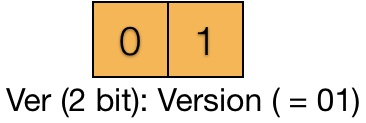

**Figure 17:** The Version field.

- **Ver (2 bits) - Version:** CoAP version number. It is always set to `1` (`01` in binary).

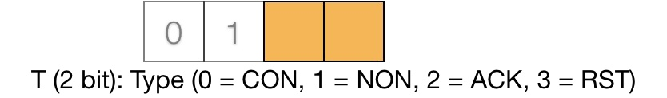

**Figure 18:** The Type field.

- **T (2 bits) - Type:** the message type: `0` = **CON**, `1` = **NON**, `2` = **ACK**, `3` = **RST**.

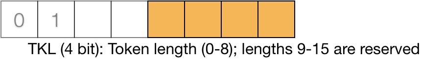

**Figure 19:** The Token Length field.

- **TKL (4 bits) - Token Length:** the length of the Token field in bytes (**0-8**). Lengths **9-15 are reserved** and must not be sent.

---

## E.2 Code: Methods & Response Codes

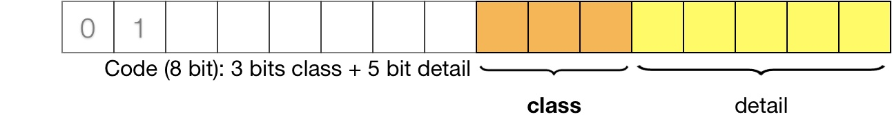

**Figure 20:** The Code field is split into a 3-bit class and a 5-bit detail.

**Code (8 bits):** split into a **3-bit class** (most significant bits) and a **5-bit detail** (least significant bits), documented as `c.dd` (e.g., `2.05`).

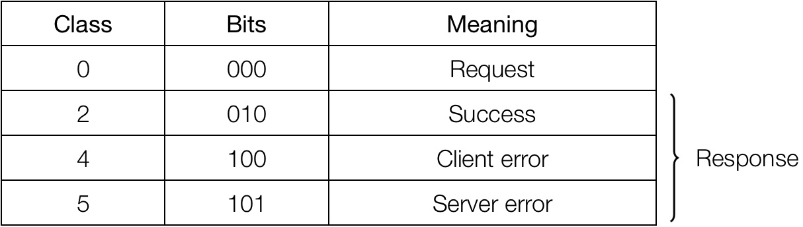

**Figure 21:** CoAP Code classes.

**Class:**

- If all bits are set to `0` (class `0`), the message is a **request**.
- Otherwise it is a **response**:
  - The **first bit** indicates whether it is a **success** (`2`) or an **error** response.
  - The **last bit** indicates whether the error is due to the **client** (`4`) or to the **server** (`5`).

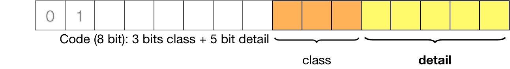

**Figure 22:** The detail part of the Code field.

**Detail:**

- In case of **requests**, the detail indicates the **method**:
  - `0.01` **GET**, `0.02` **POST**, `0.03` **PUT**, `0.04` **DELETE**.
  - Special case: `0.00` indicates an **empty message** (e.g., an empty ACK or a RST).
- In case of **responses**, the detail gives additional information related to the response, similarly to HTTP status codes:
  - `2.01` Created, `2.02` Deleted, `2.04` Changed, `2.05` Content.
  - `4.00` Bad Request, `4.02` Bad Option, `4.04` Not Found, `4.05` Method Not Allowed, ...
  - `5.00` Internal Server Error, `5.01` Not Implemented, ...

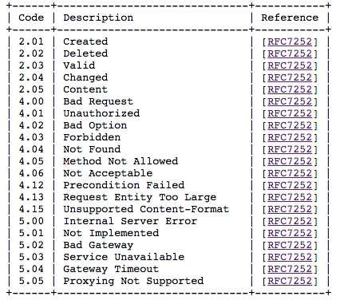

**Figure 23:** CoAP Response Codes defined in RFC 7252.

> **Note:** On the wire the Code is a single byte. For example `2.05 Content` is encoded as `010 00101` = `0x45` = `69`, while `GET` (`0.01`) is encoded as `0x01`. Some codes (e.g., `2.31 Continue`, `4.08 Request Entity Incomplete`) have been added by later specifications such as RFC 7959 for block-wise transfers.

---

## E.3 Message ID

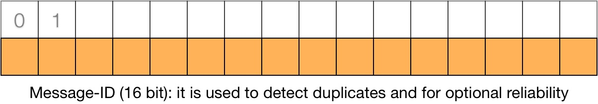

**Figure 24:** The Message ID field.

- **Message ID (16 bits):** used to **detect duplicates** and for **optional reliability** (matching CON messages with ACK/RST messages).
- It is generated by the sender and must not be reused with the same endpoint within the time a message could still be retransmitted (`EXCHANGE_LIFETIME`, about 247 seconds with default parameters).

---

## E.4 Token

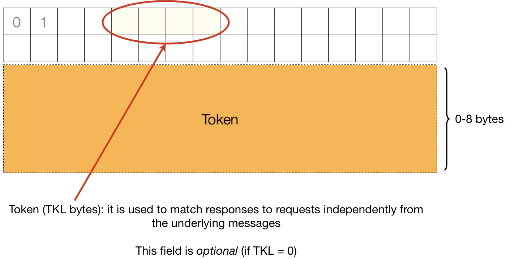

**Figure 25:** The Token field, whose length is defined by TKL.

- **Token (TKL bytes, 0-8):** used to **match responses to requests** independently from the underlying messages.
- The field is **optional**: if `TKL = 0` there is no Token.
- *Example (IoT):* A client that sends several concurrent requests to the same sensor uses a different Token for each request, so it can correctly associate each response (even separate ones) with the right request.

---

## E.5 Options, Payload Marker & Payload

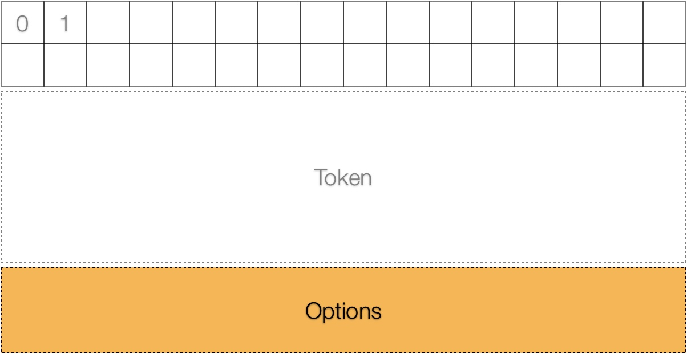

**Figure 26:** The Options field following the Token.

- **Options (0 or more):** carry optional (or default) request and response information, such as the URI and the payload media type (see [F. CoAP Options](#f-coap-options)).

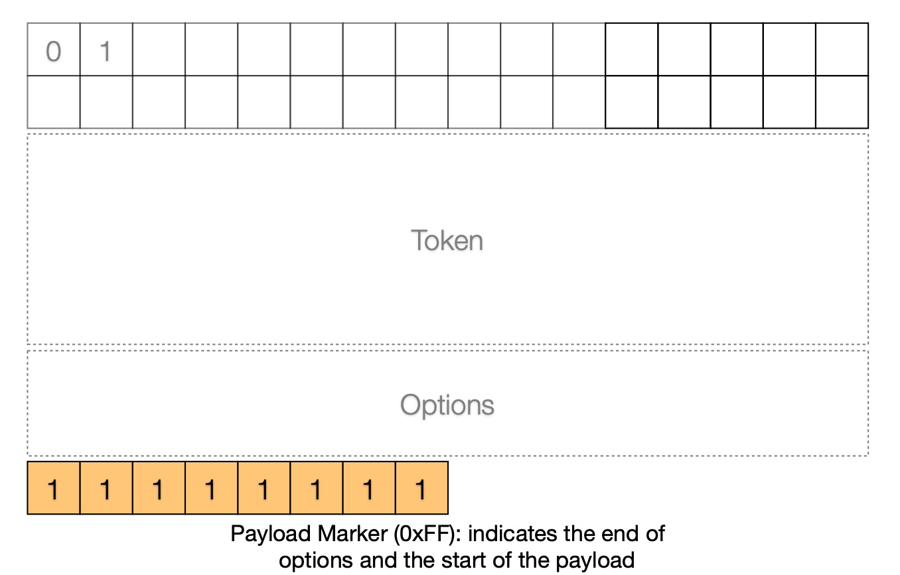

**Figure 27:** The Payload Marker.

- **Payload Marker (`0xFF`):** a byte with all bits set to `1` that indicates the **end of the options** and the **start of the payload**. It is present only if the message carries a payload.

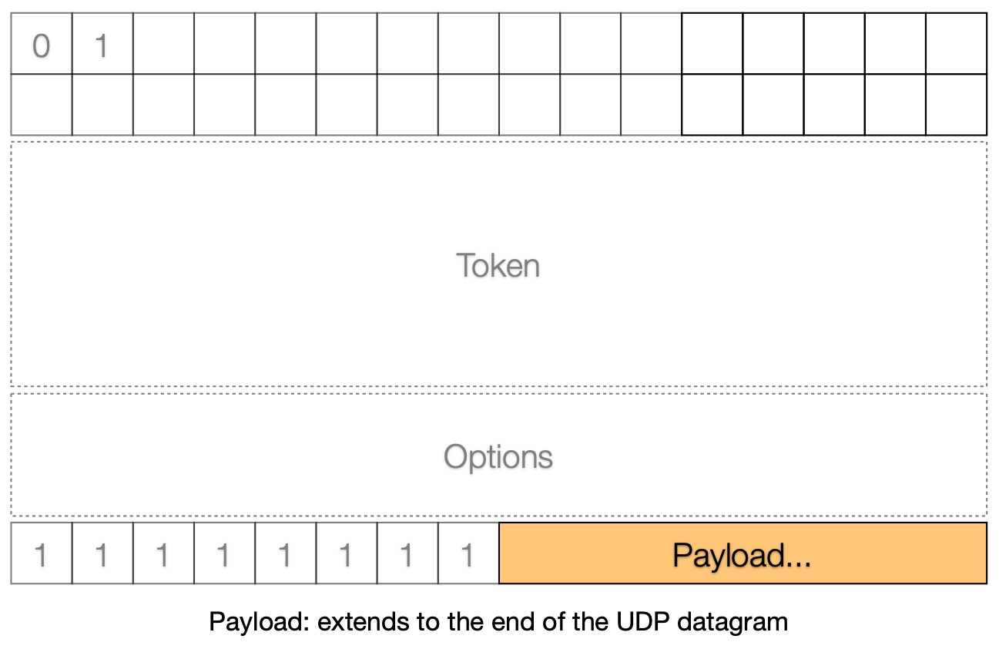

**Figure 28:** The Payload field.

- **Payload:** extends to the **end of the UDP datagram**, so no payload length field is needed.

> **Summary:** A minimal CoAP message (e.g., an empty ACK) is only **4 bytes** long, while a complete HTTP request typically requires hundreds of bytes. This compactness is a key enabler for constrained networks.

---

# F. CoAP Options

CoAP request and response **semantics** are carried in CoAP messages through the header and **options**:

- Optional (or default) request and response information, such as the **URI** and the **payload media type**, is carried as **CoAP options** (similar to **HTTP headers**).
- CoAP defines a number of options which can be included in a message.
- Each option instance in a message specifies:
  - The **Option Number** of the defined CoAP option.
  - The **length** of the Option Value.
  - The **Option Value** itself.
- In order to maximize compactness, options are encoded in a very efficient way, called **delta encoding**:
  - CoAP Options are identified by **numbers**, registered in an **IANA registry**.
  - Options are kept in **ascending order** of Option Number.
  - Each Option Number is encoded as a **delta** from the preceding option.

---

## F.1 Option Format & Delta Encoding

```
  0   1   2   3   4   5   6   7
+---------------+---------------+
|  Option Delta | Option Length |   1 byte
+---------------+---------------+
/         Option Delta          /   0-2 bytes
\          (extended)           \
+-------------------------------+
/         Option Length         /   0-2 bytes
\          (extended)           \
+-------------------------------+
\         Option Value          \   0 or more bytes
+-------------------------------+
```

**Figure 29:** CoAP option format (RFC 7252, Section 3.1).


**Figure 30:** The Option Delta field (first 4 bits of the option).

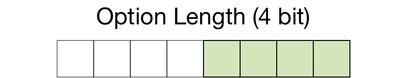

**Figure 31:** The Option Length field (last 4 bits of the first option byte).

- **Option Delta (4 bits):** the difference between the Option Number of this option and that of the previous option (or zero for the first option).
- The **Option Number** is calculated by simply **summing the Option Delta values** of this and all the previous options.
- **Option Length (4 bits):** the length of the Option Value in bytes.

**Example:** a message with the options `Uri-Host` (3), `Uri-Path` (11), `Uri-Path` (11) and `Content-Format` (12) is encoded with the deltas `3`, `8`, `0`, `1`. Repeated options simply have a delta equal to `0`.

---

## F.2 Extended Option Delta & Length

The 4-bit Option Delta can directly represent only small values. Larger values are encoded through **extended fields**:

- **0 to 12:** the delta is directly encoded in the 4 bits (no extended field).
- **13:** an **8-bit extended delta** follows the initial byte; the delta is `13 + extended value` (range **13-268**).
- **14:** a **16-bit extended delta** follows the initial byte; the delta is `269 + extended value` (range **269-65804**).
- **15:** **reserved** for the Payload Marker.

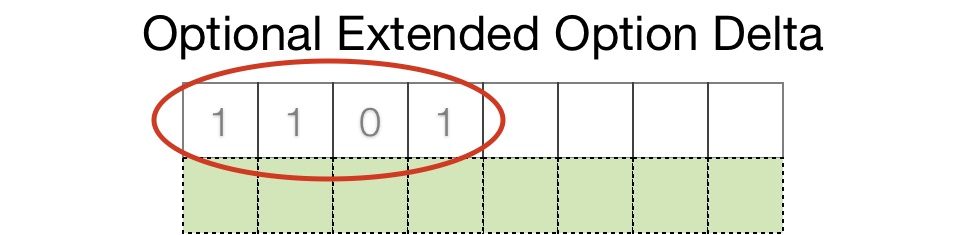

**Figure 32:** Option Delta equal to 13: one byte of extended delta follows. The Option Number is calculated as `13 + value of extended delta`.

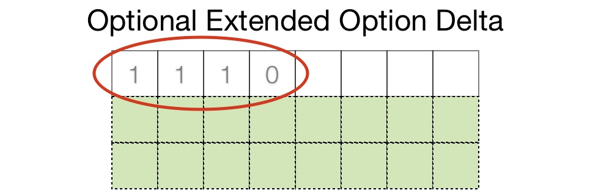

**Figure 33:** Option Delta equal to 14: two bytes of extended delta follow. The Option Number is calculated as `269 + value of extended delta`.

> **Note:** The same extension mechanism (values 13 and 14) applies to the **Option Length** field, allowing Option Values longer than 12 bytes.

---

## F.3 Option Value Formats

The Option Value is a sequence of exactly **Option Length** bytes. The length and format of the Option Value depend on the respective option, which may define **variable-length** values. Option values can be:

- **Empty:** a zero-length sequence of bytes.
- **Opaque:** an opaque sequence of bytes.
- **Uint:** a non-negative integer represented in network byte order using the number of bytes given by the Option Length field.
- **String:** a Unicode string encoded using UTF-8 (RFC 3629) in Net-Unicode form (RFC 5198).

---

## F.4 CoAP Options Registry

The main options defined by RFC 7252 are:

| No. | Name             | Format | Length (bytes) |
|-----|------------------|--------|----------------|
| 1   | If-Match         | opaque | 0-8            |
| 3   | Uri-Host         | string | 1-255          |
| 4   | ETag             | opaque | 1-8            |
| 5   | If-None-Match    | empty  | 0              |
| 7   | Uri-Port         | uint   | 0-2            |
| 8   | Location-Path    | string | 0-255          |
| 11  | Uri-Path         | string | 0-255          |
| 12  | Content-Format   | uint   | 0-2            |
| 14  | Max-Age          | uint   | 0-4            |
| 15  | Uri-Query        | string | 0-255          |
| 17  | Accept           | uint   | 0-2            |
| 20  | Location-Query   | string | 0-255          |
| 35  | Proxy-Uri        | string | 1-1034         |
| 39  | Proxy-Scheme     | string | 1-255          |
| 60  | Size1            | uint   | 0-4            |

Other options have been introduced by extensions, for example **Observe** (6, RFC 7641), **Block2** (23), **Block1** (27) and **Size2** (28) (RFC 7959).

> **Note:** The **Max-Age** option indicates the maximum time (in seconds, default 60) a response may be cached before it is considered not fresh, while **ETag** allows validating cached representations, similarly to HTTP caching.

---

## F.5 Uri-Host, Uri-Port, Uri-Path & Uri-Query

The **Uri-Host**, **Uri-Port**, **Uri-Path** and **Uri-Query** options are used to specify the **target resource** of a request to a CoAP origin server:

- **Uri-Host:** the Internet host of the resource being requested.
- **Uri-Port:** the transport layer port number of the resource.
- **Uri-Path:** each option specifies **one segment** of the absolute path to the resource (**repeatable**).
- **Uri-Query:** each option specifies **one argument** parameterizing the resource (**repeatable**).

Uri-Host and Uri-Port can be omitted when they match the destination IP address and UDP port of the request.

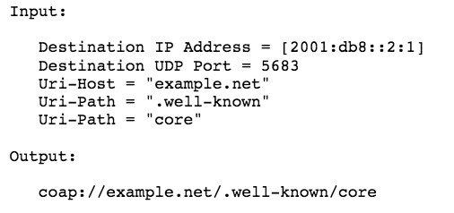

**Figure 34:** Example of URI built from the destination address and the Uri-Host and Uri-Path options: `coap://example.net/.well-known/core`.

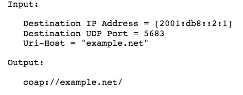

**Figure 35:** Example of URI built without any Uri-Path option: `coap://example.net/`.

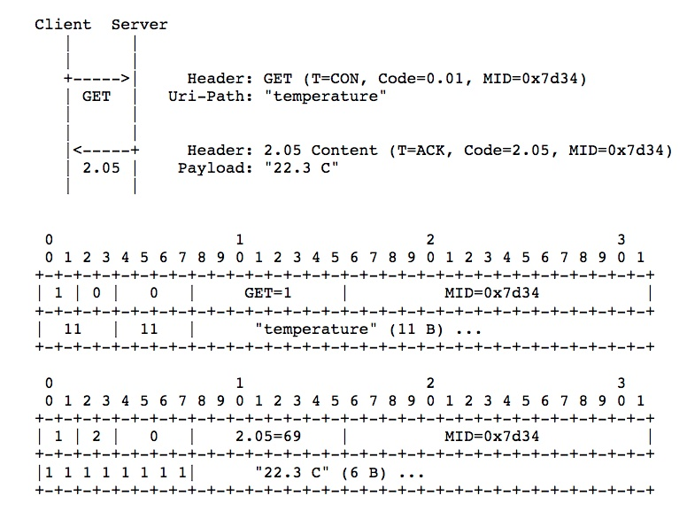

**Figure 36:** A `GET` request with the Uri-Path `temperature` and the corresponding piggy-backed `2.05 Content` response with payload `"22.3 C"`, together with their binary encoding.

In the example of Figure 38:

- The request header contains `Ver=1`, `T=0` (CON), `TKL=0`, `Code=0.01` (GET) and `MID=0x7d34`.
- The Uri-Path option is encoded with **delta 11** (Uri-Path is option number 11 and it is the first option) and **length 11** (`"temperature"`).
- The response header contains `Ver=1`, `T=2` (ACK), `Code=2.05` (`69`) and the **same MID** `0x7d34`; the Payload Marker `0xFF` is followed by the 6-byte payload `"22.3 C"`.

---

## F.6 Location-Path & Location-Query

- The **Location-Path** and **Location-Query** options together indicate a **relative URI** that consists of an absolute path, a query string, or both.
- A combination of these options is included in a **`2.01 Created`** response to indicate the **location of the resource created** as the result of a `POST` request (similarly to the HTTP `Location` header).

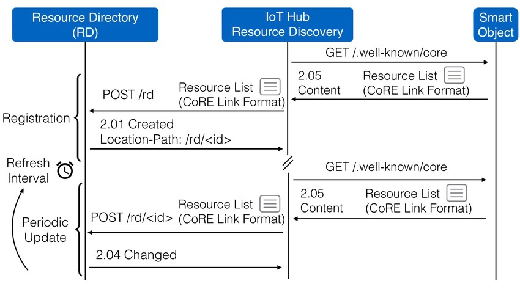

**Figure 37:** An IoT Hub discovers the resources of a Smart Object and registers them on a Resource Directory, which returns the location of the created registration through the Location-Path option.

**Example (IoT):** In Figure 39:

1. An **IoT Hub** discovers the resources of a **Smart Object** through `GET /.well-known/core`, receiving the resource list in **CoRE Link Format**.
2. The Hub registers the resource list on a **Resource Directory (RD)** with `POST /rd`.
3. The RD replies with `2.01 Created` and `Location-Path: /rd/<id>`, identifying the newly created registration.
4. Periodically (refresh interval), the Hub updates the registration with `POST /rd/<id>` and receives `2.04 Changed`.

---

## F.7 Content-Format & Accept

- The **Content-Format** option indicates the **representation format** of the message payload (similar to the HTTP `Content-Type` header).
- The **Accept** option can be used to indicate which Content-Format is **acceptable to the client** (similar to the HTTP `Accept` header).
- The representation format is given as a **numeric content format identifier**, defined in the **CoAP Content-Formats Registry**, instead of a textual media type, to save space.

| Media Type               | Encoding      | Content-Format ID |
|--------------------------|---------------|-------------------|
| `text/plain`             | charset=utf-8 | 0                 |
| `application/link-format`| -             | 40                |
| `application/xml`        | -             | 41                |
| `application/octet-stream`| -            | 42                |
| `application/exi`        | -             | 47                |
| `application/json`       | -             | 50                |
| `application/cbor`       | -             | 60                |
| `application/senml+json` | -             | 110               |

**Example (IoT):** A client that only understands JSON sends `GET /sensors/temperature` with `Accept: 50`; the server replies with `2.05 Content`, `Content-Format: 50` and the JSON payload, or with `4.06 Not Acceptable` if it cannot provide a JSON representation.

---

# G. IoT-Oriented Features

The IETF CoRE Working Group has defined other **IoT-oriented mechanisms** to extend CoAP:

- **Resource observation**
- **Block-wise transfers**
- **Multicast (group) communication**
- **Resource discovery**
- **HTTP/CoAP proxying**

---

## G.1 Resource Observation

The state of a resource on a CoAP server can **change over time**: how can clients always have the **most recent state**?

**Polling** (performing `GET` requests periodically) is **inefficient**:

- The resource may **not change** its state between two successive `GET` requests: **unnecessary requests** consume energy on the constrained CoAP server.
- The resource may **have changed** its state between two successive `GET` requests: for some time the client does **not have the most updated state**.

**The Observe Option (RFC 7641):**

- The **Observe** option has been introduced to **avoid polling**.
- When included in a `GET` request, it tells the server to **send notifications** to the client **whenever the state of the resource changes**.
- **Similar to a Pub/Sub model, but slightly different:** it is still **request/response**, but **many responses are sent after a single request**.
- Notifications are linked to the original request because they report the **same Token**.

**Observe Option Values:**

- In a **request**: `Observe = 0` **registers** the client as an observer, `Observe = 1` **deregisters** it.
- In a **notification**: the value is a **sequence number** that allows the client to **reorder** notifications and discard stale ones.

> **Note:** Notifications can be sent as **CON** or **NON** messages. A client can also stop an observation by replying to a notification with a **RST** message, or simply by "forgetting" the observation and rejecting further notifications with RST.

---

### G.1.1 The Observer Design Pattern

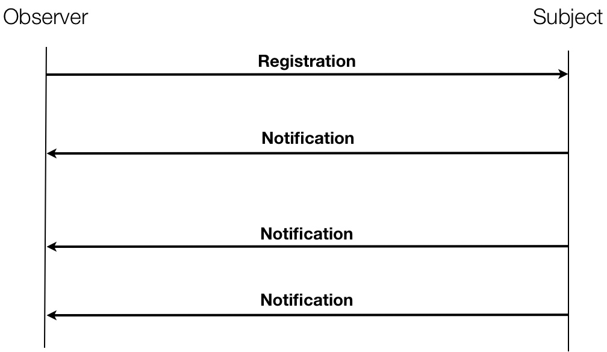

**Figure 38:** The Observer design pattern: the Observer registers with the Subject and receives notifications.

The Observe option implements the **Observer design pattern**:

- The **Subject** (the CoAP resource on the server) maintains a list of **Observers** (the CoAP clients).
- Each Observer performs a **registration** with the Subject.
- The Subject sends a **notification** to all registered Observers whenever its state changes.

---

### G.1.2 Observation Flow Example

**Step 1 - Registration:** the client sends a `GET` request with `Token: 0xabcd` and `Observe = 0` to register as an observer of the resource.

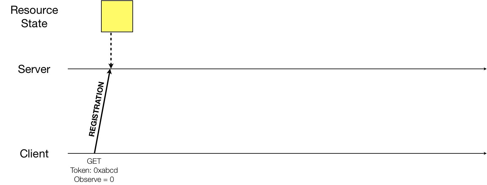

**Figure 39:** Registration of the client as an observer of the resource.

**Step 2 - First notification:** the server immediately replies with the current state of the resource (`2.05 Content`, `Token: 0xabcd`, `Observe = 8`, `17 °C`).

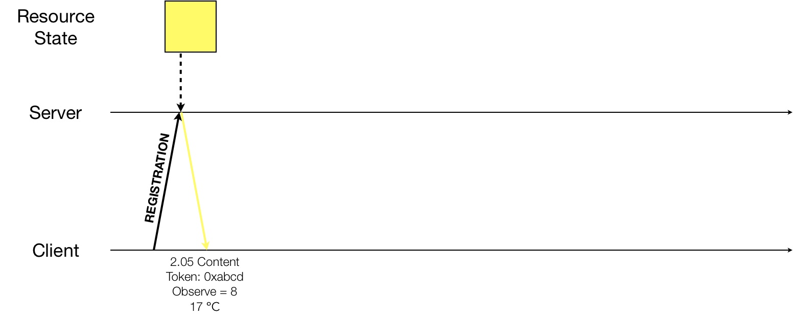

**Figure 40:** The first notification carries the current state of the resource.

**Step 3 - Notifications on state changes:** every time the state of the resource changes, the server sends a new notification with the **same Token** and an **increasing Observe sequence number** (`Observe = 9`, `18 °C`; `Observe = 10`, `19 °C`; ...).

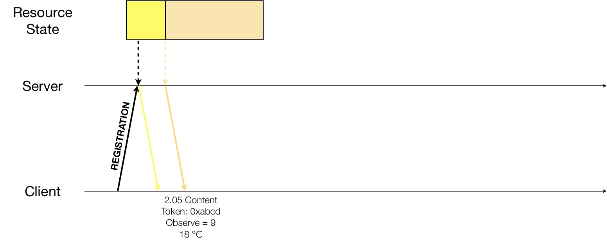

**Figure 41:** A new notification is sent as soon as the resource state changes.

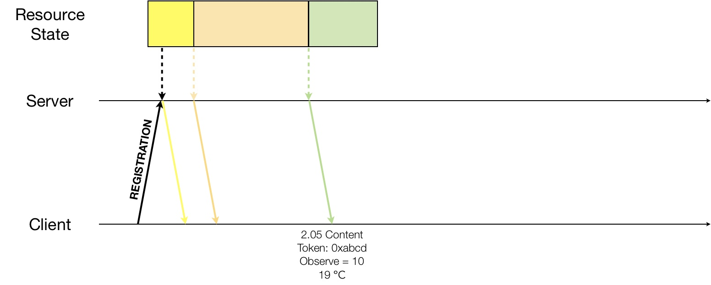

**Figure 42:** Further state changes generate further notifications.

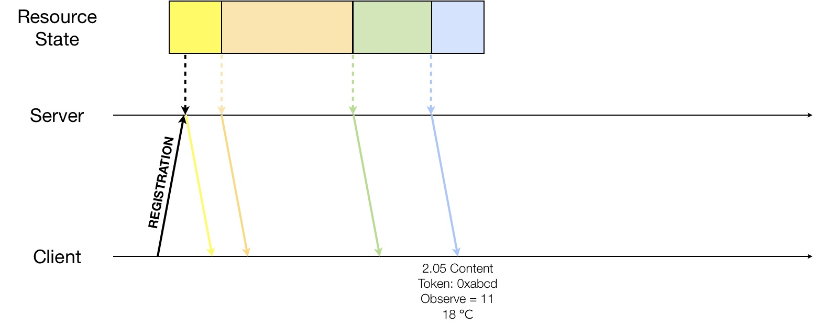

**Figure 43:** Notification with `Observe = 11`.

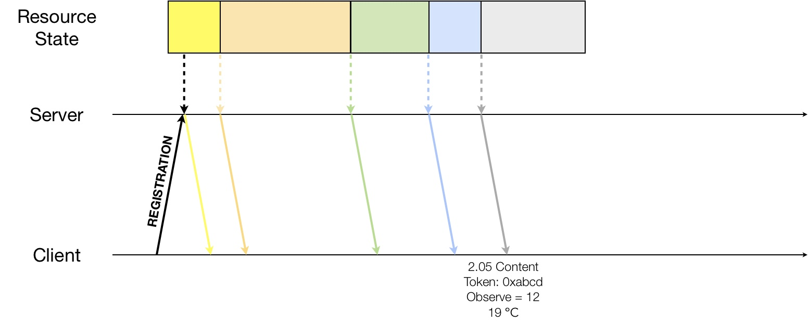

**Figure 44:** Notification with `Observe = 12`.

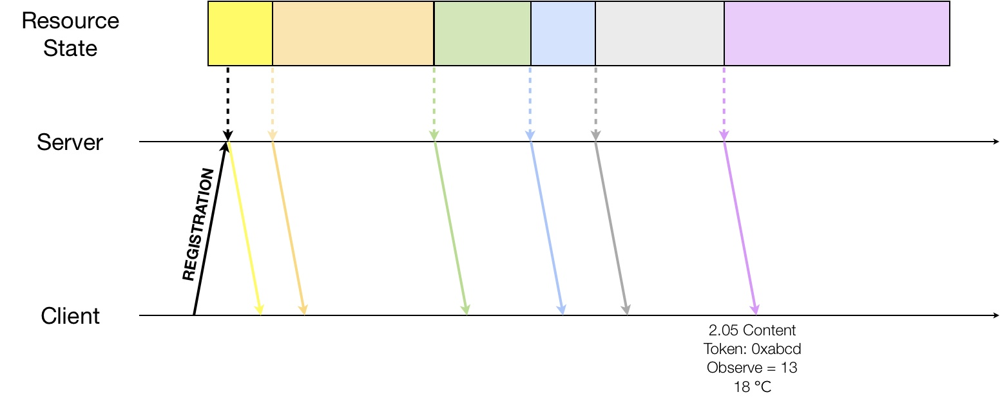

**Figure 45:** Each change of the resource state generates a notification (`Observe = 13`, `18 °C`).

**Step 4 - Deregistration:** when the client is no longer interested, it sends a `GET` request with the same Token and `Observe = 1` to **deregister**.

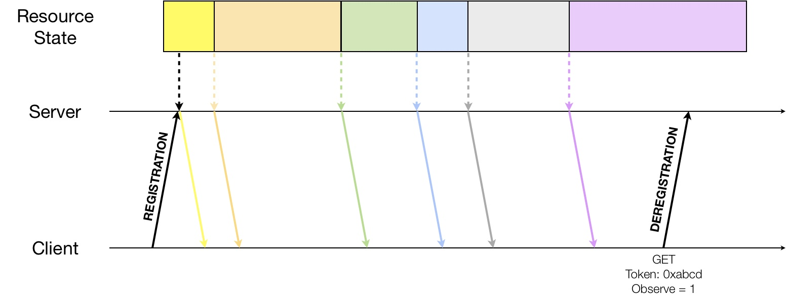

**Figure 46:** The client deregisters from the resource with `Observe = 1`.

**Key Points:**

- A **single request** generates **many responses**, all correlated through the **same Token**.
- Notifications are sent **only when the state changes**, eliminating unnecessary traffic.
- The approach preserves **REST semantics**: each notification is a complete representation of the current resource state.

**Comparison with MQTT:**

| Aspect | CoAP Observe | MQTT Pub/Sub |
|--------|--------------|--------------|
| Interaction | Client directly observes a resource on a server | Clients publish/subscribe to topics through a broker |
| Intermediary | Not required (proxies optional) | Broker required |
| Correlation | Token | Topic |
| Semantics | Eventual consistency of the latest state | Delivery of every published message (depending on QoS) |

---

## G.2 Block-wise Transfers

CoAP messages work well for **small payloads**, but:

- The size of CoAP messages is limited by the maximum size of **UDP datagrams** (and, in practice, by the much smaller link-layer frames of constrained networks to avoid IP fragmentation).
- **Applications may need to transfer larger payloads** (e.g., firmware images, configuration files, logs).
- **Constrained servers or clients may not be able to process payloads of arbitrary size**.
  - *Example (IoT):* A device whose buffer limits it to accept payloads of 128 bytes needs to receive 1 KB of data.

**Block-wise transfers** (RFC 7959) have been defined to divide large amounts of data into several **chunks (blocks)** of a given size, transferred through **multiple request/response pairs**.

---

### G.2.1 Block1 and Block2 Options

The **Block1** and **Block2** options provide a minimal way to transfer larger representations in a block-wise fashion:

- **Block1 (option number 27):** pertains to the **request payload** (useful with `POST`/`PUT` requests).
- **Block2 (option number 23):** pertains to the **response payload** (useful with `GET` requests).

**Descriptive vs. Control Usage:**

- If **Block1 is in the request** or **Block2 is in the response**, they describe how the payload of the message is **a part of a larger body** being transferred (**descriptive usage**).
- If **Block1 is in the response** or **Block2 is in the request**, they describe how the payload **will be formed** or **has been processed** (**control usage**).

Clients and servers can also indicate the total size of the resource representation through the **Size1** (request) and **Size2** (response) options.

---

### G.2.2 Anatomy of a Block Option Value

The value of a Block option is a **variable-size** unsigned integer (**0 to 3 bytes**) containing **3 fields**:

- **NUM:** the relative **number of the block** within a sequence of blocks with a given size (4, 12 or 20 bits).
- **M (1 bit):** the **"more" bit**, indicating whether **more blocks are following** (`M = 0` means this is the last block).
- **SZX (3 bits):** the **size exponent** of the block. SZX can be `0` to `6`; `7` is reserved and cannot be used.
  - The actual size of the block is computed as **2<sup>(SZX + 4)</sup>**, which means that blocks can have a size from **2<sup>4</sup> = 16** to **2<sup>10</sup> = 1024 bytes**.

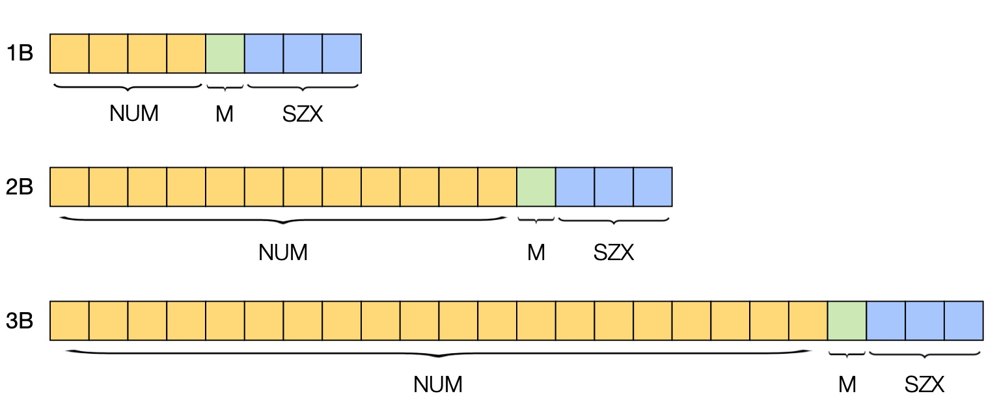

**Figure 47:** Structure of the Block option value encoded on 1, 2 or 3 bytes.

In the following examples the Block options are written as `<block>:<NUM>/<M>/<size>`; for example `2:0/1/128` means **Block2**, block number **0**, **more blocks** to come, block size **128 bytes** (SZX = 3).

---

### G.2.3 Block2 Example (Response Payload)

A client retrieves a large resource (`GET /status`) whose representation is split by the server into blocks of 128 bytes.

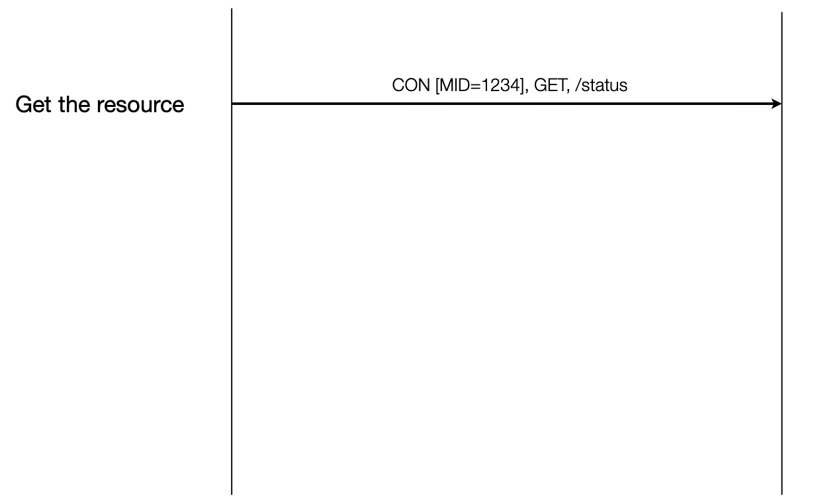

**Figure 48:** The client requests the resource with a CON `GET /status` request.

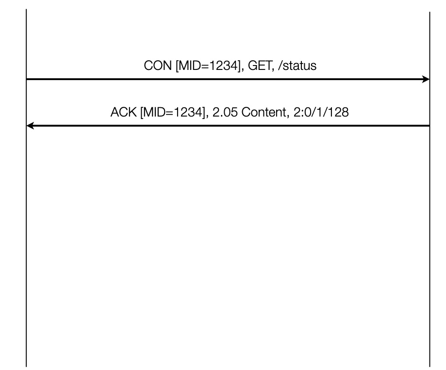

**Figure 49:** The server replies with a piggy-backed `2.05 Content` response carrying the option `Block2 2:0/1/128`.

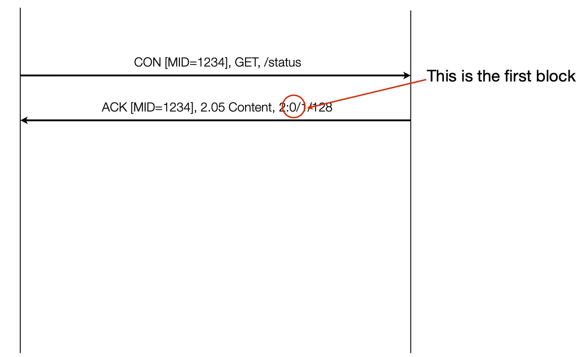

**Figure 50:** `NUM = 0`: this is the first block.

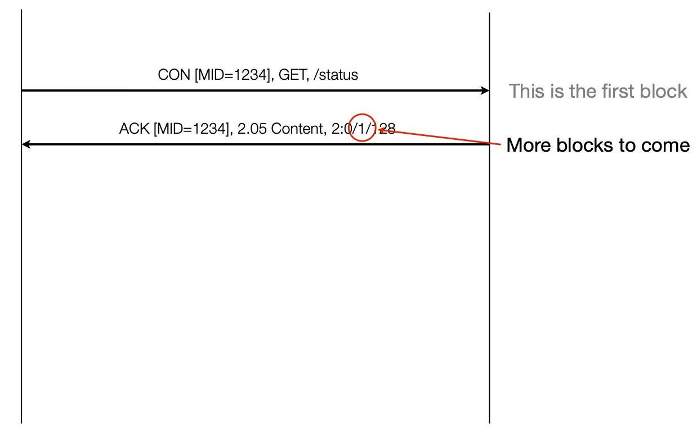

**Figure 51:** `M = 1`: more blocks are coming.

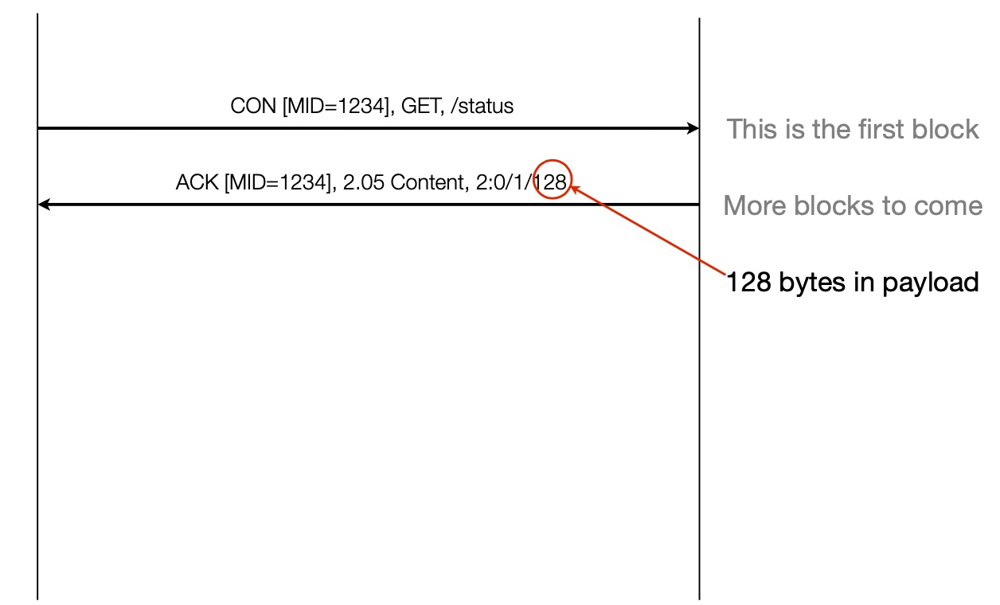

**Figure 52:** `size = 128`: the payload contains 128 bytes.

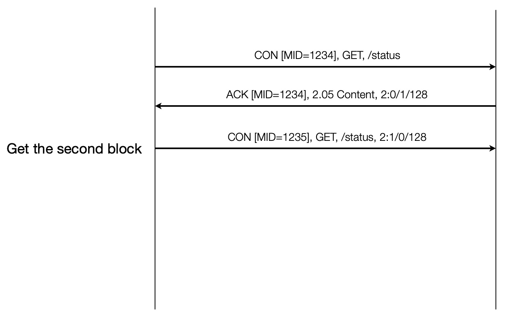

**Figure 53:** The client asks for the second block with `GET /status` and the option `Block2 2:1/0/128` (control usage).


**Figure 54:** The server replies with the second block (`2:1/1/128`): more blocks to come, 128 bytes in the payload.


**Figure 55:** The client asks for the third block (`2:2/0/128`).


**Figure 56:** The server replies with the third and last block (`2:2/0/128`, `M = 0`) with up to 128 bytes of payload.

**Key Points:**

- Each block is transferred through an **independent CON/ACK exchange** with its own **Message ID** (`1234`, `1235`, `1236`).
- The **client drives the transfer**, requesting the next block (`NUM + 1`) until it receives a block with `M = 0`.
- The client can also **negotiate a smaller block size** by specifying a smaller SZX in its Block2 request.

---

### G.2.4 Block1 Example (Request Payload)

A client sends a large representation to the server (`PUT /options`) splitting it into blocks of 128 bytes.


**Figure 57:** The client sends the first block with a CON `PUT /options` request carrying the option `Block1 1:0/1/128`.


**Figure 58:** `NUM = 0`: this is the first block.


**Figure 59:** `M = 1`: more blocks are coming.


**Figure 60:** `size = 128`: the payload contains 128 bytes.


**Figure 61:** The server acknowledges the reception of the first block.


**Figure 62:** The `2.31 Continue` response code indicates that the transfer of this block of the request body was successful and the server encourages sending further blocks.


**Figure 63:** The client sends the second block (`1:1/1/128`).


**Figure 64:** The server acknowledges the second block with `2.31 Continue`.


**Figure 65:** The client sends the third and last block (`1:2/0/128`, `M = 0`).


**Figure 66:** The server processes the complete request and replies with the final response `2.04 Changed`.

**Key Points:**

- Intermediate blocks are acknowledged with **`2.31 Continue`**, echoing the Block1 option (control usage).
- Only when the **last block** (`M = 0`) is received does the server **process the whole request** and send the **final response** (`2.04 Changed` in the example).
- If the server needs smaller blocks, it can reply with a smaller SZX; if blocks are missing or out of order it can reply with `4.08 Request Entity Incomplete`.

---

## G.3 Group Communication


**Figure 67:** A CoAP client sends a single request to a group of devices through IP multicast.

- CoAP supports **IP multicast** to target **multiple endpoints with a single request**.
- Group communication is possible because CoAP runs on top of **UDP** (it is not possible with TCP-based protocols such as HTTP).
- Multicast requests are typically **NON** messages, to avoid an "ACK implosion" at the client.
- *Example (IoT):* `POST coap://all-devices.floor1.west.bldg6.example.com/status/lights` switches on all the lights of the west wing of the first floor with a single request.
- The mechanisms to manage CoAP groups are defined in RFC 7390 and in its ongoing revision (`draft-ietf-core-groupcomm-bis`).

---

## G.4 Resource Discovery

In machine-to-machine scenarios, clients need to **discover** which resources are offered by a CoAP server without human intervention.

- Each CoAP server exposes the well-known resource **`/.well-known/core`**.
- A `GET /.well-known/core` request returns the list of hosted resources described in **CoRE Link Format** (RFC 6690, Content-Format `40`), including attributes such as the resource type (`rt`), the interface (`if`), the content format (`ct`) and whether the resource is observable (`obs`).
  - *Example:* `</sensors/temp>;rt="temperature-c";if="sensor";obs,</actuators/lamp>;rt="light";if="actuator"`
- Discovery can be combined with **multicast** (e.g., a `GET /.well-known/core` to all CoAP nodes) to discover devices on the local network.
- For large-scale or sleepy deployments, devices can register their resources on a **Resource Directory** (RFC 9176), which can be queried by clients (see [F.6 Location-Path & Location-Query](#f6-location-path--location-query)).

---

## G.5 HTTP/CoAP Proxying

Since CoAP shares the same REST model as HTTP, the two protocols can be **mapped** onto each other by **proxies** (RFC 8075):

- **Cross-protocol proxies** translate HTTP requests into CoAP requests (and vice versa), mapping methods, response codes and media types.
- **Reverse proxies** allow web applications to access constrained CoAP devices as if they were regular HTTP servers.
- **Forward proxies** can be addressed using the **Proxy-Uri** or **Proxy-Scheme** options.
- Proxies can also **cache** responses (using Max-Age and ETag), reducing the load on constrained devices.

> **Example (IoT):** A web dashboard sends `GET http://gateway.example.com/coap/sensor1/temperature`; the gateway translates the request into `GET coap://[sensor1]/temperature` on the 6LoWPAN network and returns the result as an HTTP `200 OK` response.

---

# H. Exercise: Building a CoAP Message Step by Step

In this section we put together the concepts described in [E. CoAP Message Format](#e-coap-message-format) and [F. CoAP Options](#f-coap-options) and we build, **bit by bit**, a complete CoAP message with the following characteristics:

- **Type:** NON (Non-confirmable)
- **Method:** GET
- **URI:** `coap://example.com:5683/sensors/temp/1`
- **Message ID:** 1036
- **Token:** 160

As a reference, the structure of the message to be built is the one described in RFC 7252:

```
 0                   1                   2                   3
 0 1 2 3 4 5 6 7 8 9 0 1 2 3 4 5 6 7 8 9 0 1 2 3 4 5 6 7 8 9 0 1
+-+-+-+-+-+-+-+-+-+-+-+-+-+-+-+-+-+-+-+-+-+-+-+-+-+-+-+-+-+-+-+-+
|Ver| T |  TKL  |      Code     |          Message ID           |
+-+-+-+-+-+-+-+-+-+-+-+-+-+-+-+-+-+-+-+-+-+-+-+-+-+-+-+-+-+-+-+-+
|   Token (if any, TKL bytes) ...
+-+-+-+-+-+-+-+-+-+-+-+-+-+-+-+-+-+-+-+-+-+-+-+-+-+-+-+-+-+-+-+-+
|   Options (if any) ...
+-+-+-+-+-+-+-+-+-+-+-+-+-+-+-+-+-+-+-+-+-+-+-+-+-+-+-+-+-+-+-+-+
|1 1 1 1 1 1 1 1|    Payload (if any) ...
+-+-+-+-+-+-+-+-+-+-+-+-+-+-+-+-+-+-+-+-+-+-+-+-+-+-+-+-+-+-+-+-+
```

> **Tip:** Try to build the message on your own before reading the solution, filling a 32-bit wide grid row by row as in the following figures.

---

## H.1 Header: Version, Type & Token Length

The first byte of the header contains three fields:

- **Ver (2 bits):** always `1` → `01`.
- **T (2 bits):** the specification requires a **NON** message → `1` → `01`.


**Figure 68:** The Version and Type fields: according to the specifications we use the NON (Non-confirmable) message type.

- **TKL (4 bits):** the Token `160 = 0xa0` fits in **1 byte** → Token Length = `1` → `0001`.


**Figure 69:** The Token Length field: the Token 160 (`0xa0`) fits in one byte.

**First byte:** `01 01 0001` = `0x51`.

---

## H.2 Header: Code

The Code is composed of a **3-bit class** and a **5-bit detail**:

- **Class:** the message is a **request** → `0` → `000`.
- **Detail:** the method is **GET** → `1` → `00001` (`1` GET, `2` POST, `3` PUT, `4` DELETE).


**Figure 70:** The Code field for a GET request (`0.01`).

**Second byte:** `000 00001` = `0x01`.

---

## H.3 Header: Message ID

The Message ID is a 16-bit unsigned integer in **network byte order** (big-endian):

- `1036` = `0x040c` = `00000100 00001100`.


**Figure 71:** The Message ID 1036 encoded on 16 bits.

**Third and fourth bytes:** `0x04 0x0c`. The 4-byte fixed header is complete: `51 01 04 0c`.

---

## H.4 Token

The Token follows the header and is exactly **TKL bytes** long:

- `160` = `0xa0` = `10100000` (1 byte, consistent with `TKL = 1`).


**Figure 72:** The 1-byte Token appended after the fixed header.

---

## H.5 Options: From the URI to Option Numbers & Deltas

The URI `coap://example.com:5683/sensors/temp/1` is decomposed into **URI options**:


**Figure 73:** The CoAP options used to represent the target URI of a request.

| URI Component | Option   | Option Number | Option Delta | Value         | Length |
|---------------|----------|---------------|--------------|---------------|--------|
| Host          | Uri-Host | 3             | 3 - 0 = **3**   | `example.com` | 11     |
| Port          | Uri-Port | 7             | 7 - 3 = **4**   | `5683`        | 2      |
| Path          | Uri-Path | 11            | 11 - 7 = **4**  | `sensors`     | 7      |
| Path          | Uri-Path | 11            | 11 - 11 = **0** | `temp`        | 4      |
| Path          | Uri-Path | 11            | 11 - 11 = **0** | `1`           | 1      |

**Key Points:**

- Options must be written in **ascending order** of Option Number.
- Each Option Delta is the **difference** with the previous Option Number (the first one is computed from `0`).
- **Repeated options** (the three Uri-Path segments) have a delta equal to `0` and must keep the **same order** of the path segments.
- The `scheme` (`coap://`) is not encoded in any option: it is implied by the protocol in use.

> **Note:** According to RFC 7252, Uri-Host and Uri-Port **can be omitted** when they are equal to the destination IP address and UDP port of the request (5683 is the default CoAP port). In this exercise they are explicitly included to practice the encoding of all the URI options.

---

## H.6 Options: Uri-Host

- **Option Delta:** `3` → `0011`.
- **Option Length:** `example.com` is **11 bytes** → `1011`.
- **Option Value:** the 11 UTF-8 bytes of `example.com`.


**Figure 74:** The Uri-Host option: delta 3, length 11, followed by the 11 bytes of `example.com`.

**Option byte:** `0011 1011` = `0x3b`, followed by `65 78 61 6d 70 6c 65 2e 63 6f 6d`.

---

## H.7 Options: Uri-Port

- **Option Delta:** `7 - 3 = 4` → `0100`.
- **Option Length:** `5683` is a `uint` that requires **2 bytes** → `0010`.
- **Option Value:** `5683` = `0x1633` = `00010110 00110011`.


**Figure 75:** The Uri-Port option: delta 4, length 2, followed by the value 5683 on 2 bytes.

**Option byte:** `0100 0010` = `0x42`, followed by `16 33`.

---

## H.8 Options: Uri-Path Segments

Each segment of the path is encoded as a separate Uri-Path option:

- **`sensors`:** delta `11 - 7 = 4` → `0100`, length `7` → `0111` → option byte `0x47`, followed by the 7 bytes of `sensors`.


**Figure 76:** The first Uri-Path option (`sensors`).

- **`temp`:** delta `0` → `0000`, length `4` → `0100` → option byte `0x04`, followed by the 4 bytes of `temp`.


**Figure 77:** The second Uri-Path option (`temp`) with delta 0.

- **`1`:** delta `0` → `0000`, length `1` → `0001` → option byte `0x01`, followed by the byte of the character `1` (`0x31`).


**Figure 78:** The third Uri-Path option (`1`) with delta 0.

> **Note:** The last path segment is the **string** `"1"` (UTF-8 byte `0x31`), not the integer value `1`, because Uri-Path options are of type `string`.

---

## H.9 Payload Marker & Complete Message

A GET request has **no payload**, so the **Payload Marker (`0xFF`) must not be included**: the message ends with the last option.


**Figure 79:** The complete CoAP message. Since there is no payload, the payload marker is not present.

**The complete message is 35 bytes long:**

| Field              | Bytes (hex)                              |
|--------------------|------------------------------------------|
| Header             | `51 01 04 0c`                            |
| Token              | `a0`                                     |
| Uri-Host           | `3b 65 78 61 6d 70 6c 65 2e 63 6f 6d`    |
| Uri-Port           | `42 16 33`                               |
| Uri-Path `sensors` | `47 73 65 6e 73 6f 72 73`                |
| Uri-Path `temp`    | `04 74 65 6d 70`                         |
| Uri-Path `1`       | `01 31`                                  |

```
51 01 04 0c a0 3b 65 78 61 6d 70 6c 65 2e 63 6f 6d 42 16 33 47 73 65 6e 73 6f 72 73 04 74 65 6d 70 01 31
```

> **Comparison:** The equivalent HTTP/1.1 request (`GET /sensors/temp/1 HTTP/1.1` + `Host: example.com:5683`) already requires 56 bytes without any additional header, while the CoAP message is 35 bytes and becomes only 20 bytes if the optional Uri-Host and Uri-Port are omitted.

---

# I. CoAP vs. HTTP vs. MQTT Summary

| Feature                 | CoAP                                   | HTTP                              | MQTT                                   |
|-------------------------|----------------------------------------|-----------------------------------|----------------------------------------|
| Paradigm                | Request/Response (+ Observe)           | Request/Response                  | Publish/Subscribe                      |
| Architectural Style     | REST                                   | REST                              | Broker-based messaging                 |
| Transport               | UDP (TCP/WebSockets with RFC 8323)     | TCP (QUIC with HTTP/3)            | TCP                                    |
| Encoding                | Binary (4-byte fixed header)           | Text (HTTP/1.1)                   | Binary (2-byte fixed header)           |
| Reliability             | CON/ACK at application layer           | Delegated to TCP                  | QoS 0, 1, 2 (on top of TCP)            |
| Multicast               | Yes                                    | No                                | No (fan-out through the broker)        |
| Discovery               | `/.well-known/core`, Resource Directory | Not native                       | Not native                             |
| Security                | DTLS (`coaps://`), OSCORE              | TLS (`https://`)                  | TLS                                    |
| Typical Use             | Constrained devices & networks         | Web & cloud services              | Telemetry & event distribution         |

**Summary:**
CoAP brings the **REST architectural style** to **constrained devices and networks**, offering a **compact binary format**, **optional reliability** over UDP, and **IoT-oriented features** such as **observation**, **block-wise transfers**, **multicast** and **resource discovery**, while remaining easy to integrate with the Web through **HTTP/CoAP proxies**.

---

# References

- Z. Shelby, K. Hartke, and C. Bormann, *The Constrained Application Protocol (CoAP)*, RFC 7252, IETF, June 2014 - [https://www.rfc-editor.org/rfc/rfc7252](https://www.rfc-editor.org/rfc/rfc7252)
- Z. Shelby, *Constrained RESTful Environments (CoRE) Link Format*, RFC 6690, IETF, August 2012 - [https://www.rfc-editor.org/rfc/rfc6690](https://www.rfc-editor.org/rfc/rfc6690)
- K. Hartke, *Observing Resources in the Constrained Application Protocol (CoAP)*, RFC 7641, IETF, September 2015 - [https://www.rfc-editor.org/rfc/rfc7641](https://www.rfc-editor.org/rfc/rfc7641)
- C. Bormann and Z. Shelby, *Block-Wise Transfers in the Constrained Application Protocol (CoAP)*, RFC 7959, IETF, August 2016 - [https://www.rfc-editor.org/rfc/rfc7959](https://www.rfc-editor.org/rfc/rfc7959)
- A. Rahman and E. Dijk, *Group Communication for the Constrained Application Protocol (CoAP)*, RFC 7390, IETF, October 2014 - [https://www.rfc-editor.org/rfc/rfc7390](https://www.rfc-editor.org/rfc/rfc7390)
- A. Castellani, S. Loreto, A. Rahman, T. Fossati and E. Dijk, *Guidelines for Mapping Implementations: HTTP to the Constrained Application Protocol (CoAP)*, RFC 8075, IETF, February 2017 - [https://www.rfc-editor.org/rfc/rfc8075](https://www.rfc-editor.org/rfc/rfc8075)
- C. Bormann et al., *CoAP (Constrained Application Protocol) over TCP, TLS, and WebSockets*, RFC 8323, IETF, February 2018 - [https://www.rfc-editor.org/rfc/rfc8323](https://www.rfc-editor.org/rfc/rfc8323)
- C. Amsüss, Z. Shelby, M. Koster, C. Bormann and P. van der Stok, *CoRE Resource Directory*, RFC 9176, IETF, April 2022 - [https://www.rfc-editor.org/rfc/rfc9176](https://www.rfc-editor.org/rfc/rfc9176)
- IETF CoRE Working Group Documents - [https://datatracker.ietf.org/wg/core/documents/](https://datatracker.ietf.org/wg/core/documents/)
- R. T. Fielding, *Architectural Styles and the Design of Network-based Software Architectures*, Ph.D. Thesis, University of California, Irvine, 2000 - [https://ics.uci.edu/~fielding/pubs/dissertation/top.htm](https://ics.uci.edu/~fielding/pubs/dissertation/top.htm)
- J. Webber, S. Parastatidis, I. Robinson, *REST in Practice*, O'Reilly Media, September 2010
- O. Vermesan and P. Friess (eds.), *Internet of Things Applications - From Research and Innovation to Market Deployment*, pp. 287-313, River Publishers, 2014. ISBN: 9788793102941
- M. Kovatsch, *CoAP: The Web-based Application-layer Protocol for the Internet of Things*, Internet of Things and Smart Cities Ph.D. School, Lerici (SP), Italy, September 2014
- Z. Shelby, *CoAP* (IAB presentation) - [https://www.iab.org/wp-content/IAB-uploads/2011/04/Shelby.pdf](https://www.iab.org/wp-content/IAB-uploads/2011/04/Shelby.pdf)
- CoAP Technology Website - [https://coap.space/](https://coap.space/)
