<!-- omit in toc -->
# IoT Smart Object Design

<!-- omit in toc -->
## Lecture Information

| **Lecture Title**   | IoT Smart Object Design                                                          |
|---------------------|----------------------------------------------------------------------------------|
| **Author**          | Prof. Marco Picone (marco.picone@unimore.it)                                     |
| **License**         | [Creative Commons Attribution 4.0](https://creativecommons.org/licenses/by/4.0/) | 


<!-- omit in toc -->
# Table of Contents

- [A. Designing an IoT Smart Object](#a-designing-an-iot-smart-object)
  - [A.1 Design Methodology](#a1-design-methodology)
  - [A.2 Resource-Oriented vs Message-Oriented Design](#a2-resource-oriented-vs-message-oriented-design)
- [B. CoAP Smart Object Design: the Smart Home Use Case](#b-coap-smart-object-design-the-smart-home-use-case)
  - [B.1 Application Use Case](#b1-application-use-case)
  - [B.2 Resource Hierarchy](#b2-resource-hierarchy)
    - [B.2.1 HVAC System](#b21-hvac-system)
    - [B.2.2 Thermostat](#b22-thermostat)
  - [B.3 Thermostat Behaviour](#b3-thermostat-behaviour)
    - [B.3.1 Heating Behaviour](#b31-heating-behaviour)
    - [B.3.2 Air Conditioning Behaviour](#b32-air-conditioning-behaviour)
  - [B.4 Interaction Example](#b4-interaction-example)
    - [B.4.1 Reading the Room Temperature](#b41-reading-the-room-temperature)
    - [B.4.2 Configuring the Thermostat](#b42-configuring-the-thermostat)
    - [B.4.3 Turning On the Thermostat](#b43-turning-on-the-thermostat)
    - [B.4.4 Driving the HVAC Unit: the Smart Object as a Client](#b44-driving-the-hvac-unit-the-smart-object-as-a-client)
    - [B.4.5 Summary of the CoAP Interactions](#b45-summary-of-the-coap-interactions)
  - [B.5 CoAP Resource Profiles](#b5-coap-resource-profiles)
    - [B.5.1 HVAC System Profiles](#b51-hvac-system-profiles)
    - [B.5.2 Thermostat Profiles](#b52-thermostat-profiles)
    - [B.5.3 Discovering the Smart Object](#b53-discovering-the-smart-object)
  - [B.6 CoAP \& SenML](#b6-coap--senml)
  - [B.7 Alternative Design: a Single Configuration Resource](#b7-alternative-design-a-single-configuration-resource)
- [C. MQTT Smart Object Design: the Fleet Monitoring Use Case](#c-mqtt-smart-object-design-the-fleet-monitoring-use-case)
  - [C.1 Application Use Case](#c1-application-use-case)
  - [C.2 Data \& Communication Channels](#c2-data--communication-channels)
  - [C.3 MQTT Topic Design](#c3-mqtt-topic-design)
  - [C.4 Message Design](#c4-message-design)
  - [C.5 MQTT Smart Object Modelling](#c5-mqtt-smart-object-modelling)
- [D. Software Libraries \& Development](#d-software-libraries--development)
- [E. CoAP vs MQTT Smart Object Design](#e-coap-vs-mqtt-smart-object-design)
- [References](#references)

# A. Designing an IoT Smart Object

An **IoT Smart Object** is a physical device equipped with sensors and/or actuators, processing capabilities and a
network interface, that exposes its **capabilities** (measurements, configuration parameters and actions) to other
applications through an application-layer protocol.

Designing a Smart Object is not only a matter of choosing a protocol: the same physical device can be exposed in very
different ways, and the quality of the design directly affects how easily it can be **discovered**, **understood**,
**integrated** and **evolved** by the applications that interact with it.

**Core Concepts:**

- **Capabilities, not hardware:** a Smart Object should expose *what it can do* (e.g., "measure the indoor temperature",
  "set the target temperature") and hide *how it does it* (e.g., the specific sensor chip or its driver).
- **Uniform modelling:** sensors, actuators and configuration parameters should be modelled in a consistent way, so that
  a consumer that knows how to interact with one of them can interact with all of them.
- **Standard data formats & semantics:** the exchanged data should use standard representations (e.g., SenML) and
  explicit semantic information (e.g., units of measurement and resource types), so that applications can interpret
  them without prior configuration.
- **Protocol-aware design:** the modelling must exploit the interaction pattern of the chosen protocol:
  - with **CoAP** (request/response, RESTful) the Smart Object is a **server exposing resources**;
  - with **MQTT** (publish/subscribe) the Smart Object is a **client publishing and receiving messages on topics**
    through a broker.

This lecture applies the design approach to two complete use cases: a **Smart Home** modelled with **CoAP**
and a **Fleet Monitoring** system modelled with **MQTT**.

---

## A.1 Design Methodology

The design of a Smart Object follows a sequence of steps that move from the application requirements to the
implementation:

1. **Use Case Presentation:** identify the application scenario, the involved devices, the actors interacting with them
   and the goals of the system.
2. **Resource, Data & Communication:** identify the information produced and consumed by each device (measurements,
   events, configuration parameters, commands), its type, unit and update frequency, and the communication flows among
   the actors.
3. **Messages & Topics Design** (message-oriented protocols such as MQTT): define the topic hierarchy and the structure
   of the messages exchanged on each topic.
4. **Smart Object Resource Modelling:** map the capabilities of the device onto the protocol abstractions, i.e.,
   resources, URIs, methods and descriptive attributes (CoAP) or topics, payloads, QoS and retained flags (MQTT).
5. **Software Libraries:** select the libraries implementing the protocol and the data formats on the target platform.
6. **Development:** implement, test and iteratively refine the Smart Object and the applications using it.

The first two steps are **protocol independent**: the same analysis of resources, data and communication flows can be
reused with different protocols. The protocol only enters the design from the third/fourth step onwards.

---

## A.2 Resource-Oriented vs Message-Oriented Design

The two protocols lead to two different ways of thinking about a Smart Object:

| Aspect                     | Resource-Oriented Design (CoAP)                                   | Message-Oriented Design (MQTT)                                         |
|----------------------------|-------------------------------------------------------------------|------------------------------------------------------------------------|
| Role of the Smart Object   | Server hosting resources                                          | Client connected to a broker                                           |
| Unit of modelling          | Resource identified by a URI                                      | Message published on a topic                                           |
| Interaction                | Request/Response (GET, POST, PUT, DELETE) + Observe               | Publish/Subscribe, decoupled in space and time                         |
| Reading data               | The consumer asks (GET) or observes the resource                  | The Smart Object publishes, the consumers subscribe                    |
| Acting on the device       | The consumer sends a request to an actuator/parameter resource    | The consumer publishes a command on a topic the Smart Object subscribes |
| Self-description           | CoRE Link Format attributes (`rt`, `if`, `ct`, `obs`) + `/.well-known/core` | Topic naming conventions + descriptive (retained) messages     |
| Addressing                 | Each device must be reachable (IP address + port)                 | Only the broker must be reachable                                      |

In both cases the outcome of the design is a **contract** between the Smart Object and its consumers: which data is
available, where (URI or topic), in which format and with which semantics.

---

# B. CoAP Smart Object Design: the Smart Home Use Case

## B.1 Application Use Case

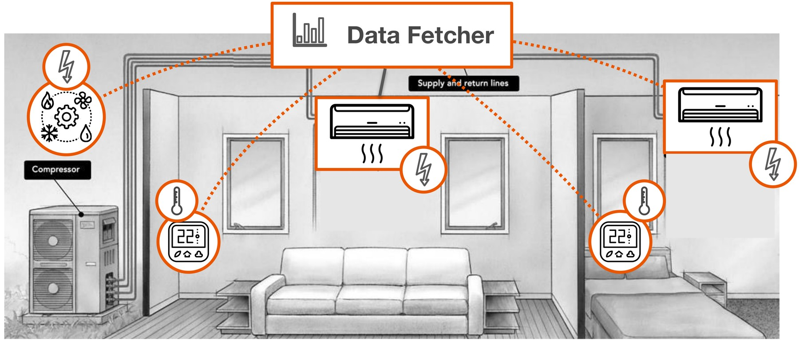

**Figure 1:** The Smart Home application scenario: a thermostat with a temperature sensor in each room, an HVAC system
composed of an outdoor compressor unit and one indoor unit for each room (each one with an energy consumption sensor),
and a Data Fetcher application collecting data from all the devices.

The target application scenario is a **Smart Home** with the following devices and actors:

- a **thermostat** in each room, with an **indoor temperature sensor**;
- an **HVAC** (Heating, Ventilation and Air Conditioning) appliance able to operate **independently in each room**,
  composed of an outdoor **compressor unit** and one indoor **unit for each room**;
- each device also provides an **energy monitoring sensor** to measure the consumed energy in real time;
- a **Data Fetcher** application that collects data from all the devices to **monitor and log the behavioural history**
  of the apartment.

**Design Considerations:**

- The devices are **heterogeneous** (thermostats and HVAC units, possibly from different manufacturers), but they must
  cooperate: the thermostat of a room has to drive the HVAC unit of the same room.
- The Data Fetcher must be able to collect data from **all** the devices, including devices added in the future,
  without being reconfigured for each new device: the Smart Objects must therefore be **self-describing**
  and **discoverable**.
- Both monitoring (energy, temperature) and control (switching on, setting temperature ranges, driving the HVAC engine)
  are required, so each Smart Object exposes **sensors**, **actuators** and **configuration parameters**.

---

## B.2 Resource Hierarchy

The first modelling step is to decompose each device into a **hierarchy of resources**, identifying for each one its
nature (sensor, actuator or parameter), the type of data it manages and its unit of measurement.

### B.2.1 HVAC System

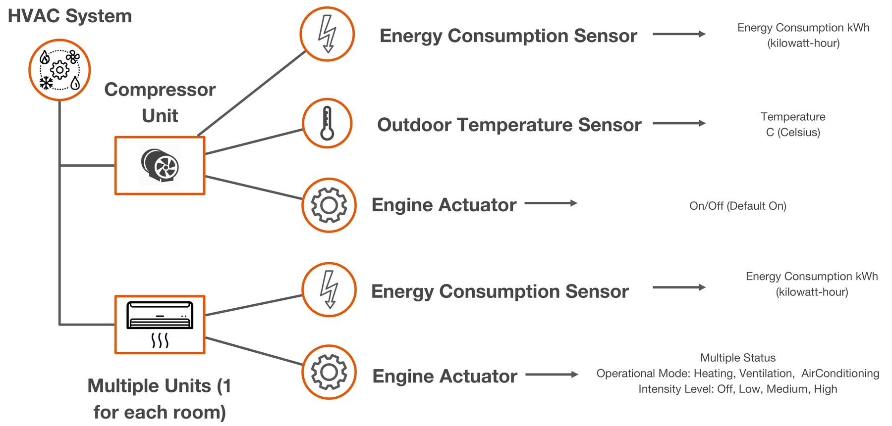

**Figure 2:** Resource hierarchy of the HVAC System: the compressor unit and the indoor units (one for each room), with
their sensors and actuators.

The **HVAC System** is composed of a **compressor unit** and **multiple indoor units** (one for each room):

| Component      | Resource                     | Type     | Data                                                                                                  |
|----------------|------------------------------|----------|-------------------------------------------------------------------------------------------------------|
| Compressor Unit| Energy Consumption Sensor    | Sensor   | Energy consumption in kWh (kilowatt-hour)                                                             |
| Compressor Unit| Outdoor Temperature Sensor   | Sensor   | Temperature in °C (Celsius)                                                                           |
| Compressor Unit| Engine Actuator              | Actuator | On/Off (default: On)                                                                                  |
| Room Unit      | Energy Consumption Sensor    | Sensor   | Energy consumption in kWh (kilowatt-hour)                                                             |
| Room Unit      | Engine Actuator              | Actuator | Multiple status: **operational mode** (Heating, Ventilation, Air Conditioning) and **intensity level** (Off, Low, Medium, High) |

**Observations:**

- The same **kind** of resource (e.g., the Energy Consumption Sensor) appears in different components: modelling it in
  the same way everywhere allows a consumer such as the Data Fetcher to handle all of them with the same code.
- The **Engine Actuator** of a room unit is not a simple On/Off switch: its state is composed of **two variables**
  (operational mode and intensity level). The representation of the resource must therefore carry both values.
- The hierarchy can be mapped onto CoAP in two ways: a single HVAC CoAP server exposing all the components with a
  path prefix (e.g., `/compressor/...` and `/units/<room_id>/...`), or an independent CoAP endpoint for each component.
  The examples of this lecture follow the second option, where each room unit exposes, e.g., `/hvac-unit/engine`.

### B.2.2 Thermostat

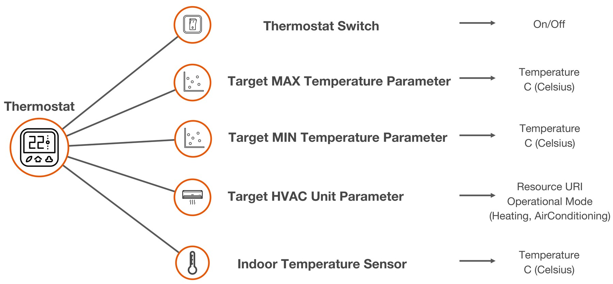

**Figure 3:** Resource hierarchy of the Thermostat: a switch, three configuration parameters and the indoor temperature
sensor.

Each **Thermostat** exposes the following resources:

| Resource                        | Type      | Data                                                                                 |
|---------------------------------|-----------|--------------------------------------------------------------------------------------|
| Thermostat Switch               | Actuator  | On/Off: enables or disables the automatic control of the room                       |
| Target MAX Temperature Parameter| Parameter | Temperature in °C: upper bound of the desired temperature range                     |
| Target MIN Temperature Parameter| Parameter | Temperature in °C: lower bound of the desired temperature range                     |
| Target HVAC Unit Parameter      | Parameter | **Resource URI** of the HVAC unit to drive + **operational mode** (Heating, Air Conditioning) |
| Indoor Temperature Sensor       | Sensor    | Temperature in °C (Celsius)                                                          |

**Observations:**

- The thermostat introduces a third category besides sensors and actuators: **configuration parameters**. A parameter
  is a value that can be read and changed by the user (e.g., the MIN and MAX temperatures), but it does not directly
  trigger an action on the physical world: it changes the **behaviour** of the device.
- The **Target HVAC Unit** parameter contains the **URI of a resource of another Smart Object**. This is the key element
  that allows two devices to cooperate **without hardcoding** their relationship: the thermostat of a room can be
  associated with the HVAC unit of the same room simply by configuring this parameter.

---

## B.3 Thermostat Behaviour

When the thermostat is switched **on**, it periodically compares the **indoor temperature** with the configured
**MIN** and **MAX** temperatures and decides the **intensity level** of the associated HVAC unit, according to the
configured **operational mode**.

### B.3.1 Heating Behaviour

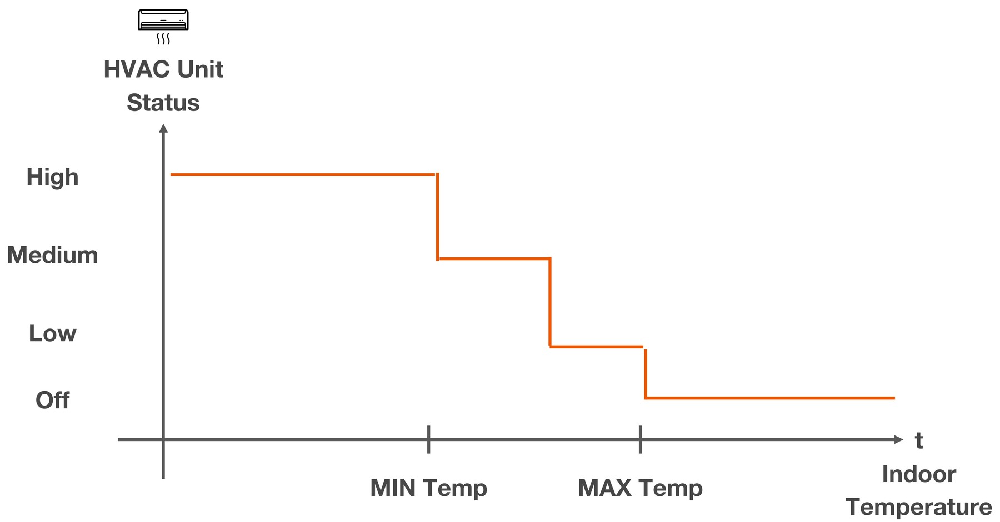

**Figure 4:** Heating behaviour: intensity level of the HVAC unit as a function of the indoor temperature.

In **Heating** mode the HVAC unit works harder the colder the room is:

| Indoor Temperature                    | HVAC Unit Intensity |
|---------------------------------------|---------------------|
| Below the MIN temperature             | High                |
| Between MIN and MAX (lower half)      | Medium              |
| Between MIN and MAX (upper half)      | Low                 |
| Above the MAX temperature             | Off                 |

### B.3.2 Air Conditioning Behaviour

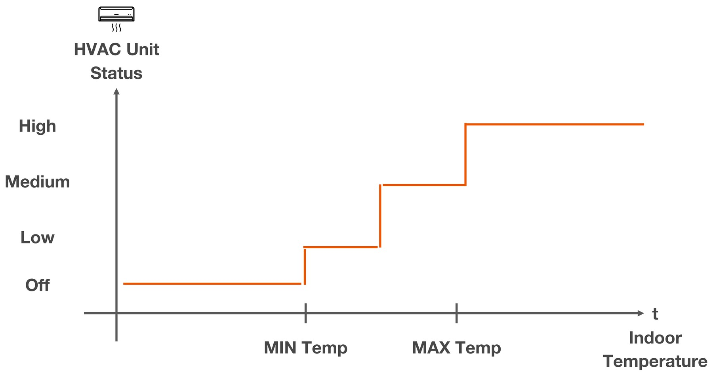

**Figure 5:** Air Conditioning behaviour: intensity level of the HVAC unit as a function of the indoor temperature.

In **Air Conditioning** mode the behaviour is mirrored: the HVAC unit works harder the warmer the room is:

| Indoor Temperature                    | HVAC Unit Intensity |
|---------------------------------------|---------------------|
| Below the MIN temperature             | Off                 |
| Between MIN and MAX (lower half)      | Low                 |
| Between MIN and MAX (upper half)      | Medium              |
| Above the MAX temperature             | High                |

**Design Considerations:**

- The control logic is **local** to the thermostat: it does not require a cloud service or the Data Fetcher, so the room
  keeps working even if the other applications are unavailable.
- The logic depends only on the values of the thermostat resources (indoor temperature, MIN, MAX, operational mode and
  switch status): changing a parameter through the network immediately changes the behaviour of the device.
- To avoid sending a request to the HVAC unit at every new measurement, the thermostat should send a new command only
  when the **computed intensity level changes**.

---

## B.4 Interaction Example

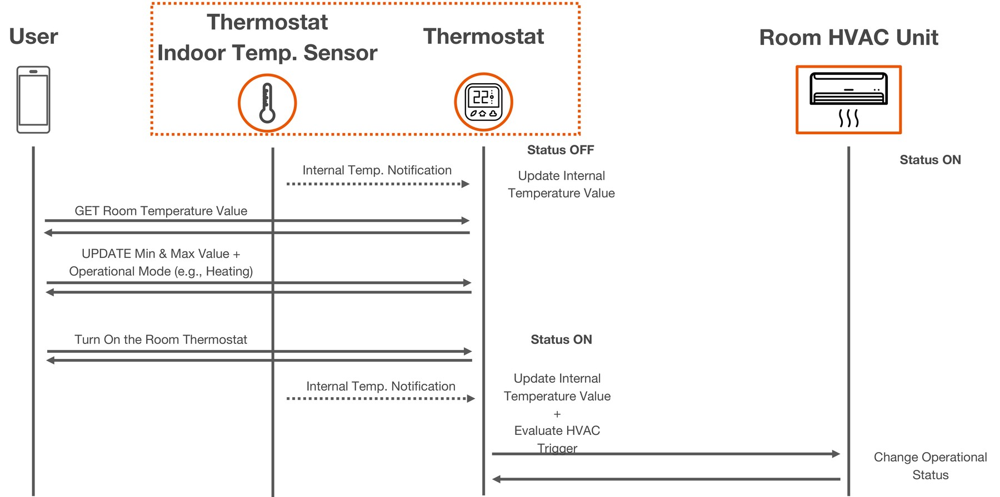

**Figure 6:** Example of interaction among the user, the thermostat (with its internal indoor temperature sensor) and the
HVAC unit of the room.

The figure shows a complete interaction between the **User** (e.g., a mobile application), the **Thermostat** (together
with its internal temperature sensor) and the **Room HVAC Unit**:

1. The thermostat is initially **off**: the internal sensor notifies new temperature values, and the thermostat only
   updates its internal temperature value.
2. The user reads the **room temperature**.
3. The user **configures** the thermostat: MIN and MAX temperatures and the operational mode (e.g., Heating).
4. The user **turns on** the thermostat.
5. At the next internal temperature notification, the thermostat (now **on**) updates its value and **evaluates the
   HVAC trigger**, applying the behaviour described in the previous section.
6. If a change is required, the thermostat sends a request to the **HVAC unit** to change its operational status.

The interaction between the internal sensor and the thermostat logic is **internal** to the device (e.g., a function
call or an internal event), while the interactions with the user and with the HVAC unit go through the network and are
mapped onto **CoAP** requests, as described in the following sections.

### B.4.1 Reading the Room Temperature

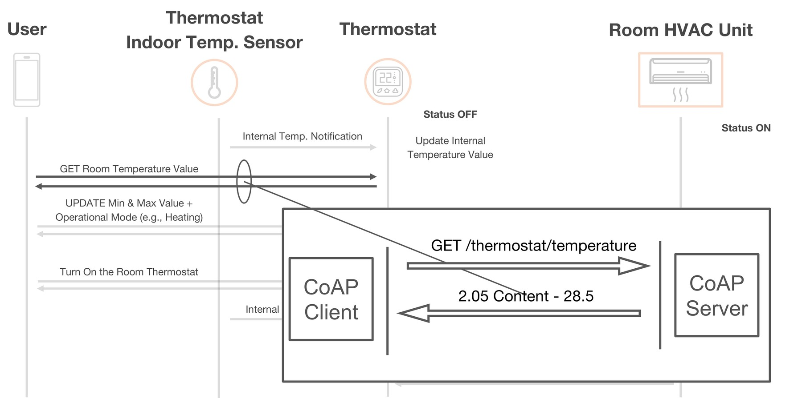

**Figure 7:** The "GET Room Temperature Value" interaction mapped onto CoAP.

The application of the user acts as a **CoAP client**, while the thermostat is a **CoAP server** exposing the indoor
temperature as a resource:

```
GET /thermostat/temperature
2.05 Content - 28.5
```

If the user application needs to display the temperature continuously, it can **observe** the resource
(GET with the Observe option) instead of polling it periodically: the thermostat sends a notification every time it
updates its internal temperature value.

### B.4.2 Configuring the Thermostat

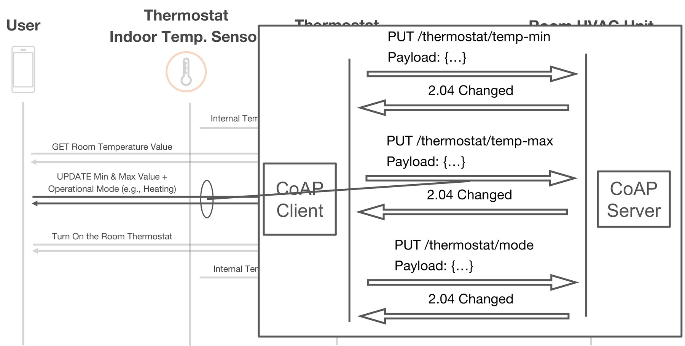

**Figure 8:** The "UPDATE Min & Max Value + Operational Mode" interaction mapped onto CoAP.

Each configuration parameter is a distinct resource, updated with a **PUT** request carrying the new value in the
payload:

```
PUT /thermostat/temp-min    Payload: {...}    ->  2.04 Changed
PUT /thermostat/temp-max    Payload: {...}    ->  2.04 Changed
PUT /thermostat/mode        Payload: {...}    ->  2.04 Changed
```

**PUT** is the right method because each request **replaces the state** of an existing resource and is **idempotent**:
if the response is lost and the client retransmits the request, the final state of the thermostat is the same.
The response code `2.04 Changed` confirms that the state of the resource has been updated.

> With fine-grained resources, a single user action ("configure the thermostat") requires **three requests**. The
> alternative design described in the [Alternative Design](#b7-alternative-design-a-single-configuration-resource)
> section groups the parameters into a single resource.

### B.4.3 Turning On the Thermostat

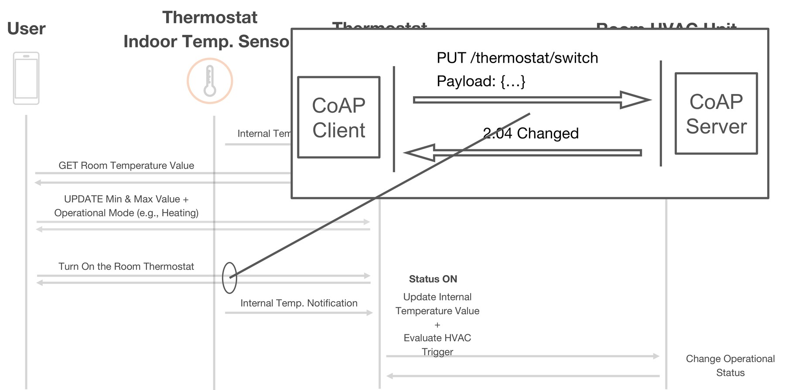

**Figure 9:** The "Turn On the Room Thermostat" interaction mapped onto CoAP.

The switch is an **actuator** resource and its new status is set with a PUT request:

```
PUT /thermostat/switch    Payload: {...}    ->  2.04 Changed
```

From this moment the thermostat is **on** and starts evaluating the HVAC trigger at each new temperature value.

### B.4.4 Driving the HVAC Unit: the Smart Object as a Client

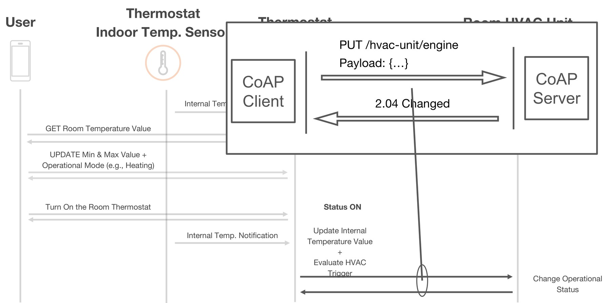

**Figure 10:** The "Change Operational Status" interaction: the thermostat acts as a CoAP client of the HVAC unit.

When the evaluation of the trigger requires a change, the **thermostat itself becomes a CoAP client** and sends a
request to the engine actuator of the HVAC unit, whose URI is stored in the **Target HVAC Unit** parameter:

```
PUT /hvac-unit/engine    Payload: {...}    ->  2.04 Changed
```

This is a fundamental aspect of Smart Object design: a Smart Object is often **both a server and a client**. It exposes
its own resources to the other actors (CoAP server) and, at the same time, it consumes the resources of other Smart
Objects (CoAP client) to implement **device-to-device** cooperation without any intermediary.

### B.4.5 Summary of the CoAP Interactions

| Step | Client       | Server       | Request                          | Response       |
|------|--------------|--------------|----------------------------------|----------------|
| 1    | User App     | Thermostat   | `GET /thermostat/temperature`    | `2.05 Content` |
| 2    | User App     | Thermostat   | `PUT /thermostat/temp-min`       | `2.04 Changed` |
| 3    | User App     | Thermostat   | `PUT /thermostat/temp-max`       | `2.04 Changed` |
| 4    | User App     | Thermostat   | `PUT /thermostat/mode`           | `2.04 Changed` |
| 5    | User App     | Thermostat   | `PUT /thermostat/switch`         | `2.04 Changed` |
| 6    | Thermostat   | HVAC Unit    | `PUT /hvac-unit/engine`          | `2.04 Changed` |

---

## B.5 CoAP Resource Profiles

Once the resources and their interactions are defined, each resource is given a **profile** that makes it
**self-describing**, using the CoRE Link Format attributes:

- **`rt` (Resource Type):** the application-specific semantic type of the resource (e.g., `iot.demo.sensor.temperature`).
  Resources with the same meaning share the same `rt`, regardless of the device hosting them.
- **`if` (Interface Description):** the interaction model of the resource, following the CoRE Interfaces:
  - `core.s` **Sensor**: the resource can be read (GET) and possibly observed;
  - `core.a` **Actuator**: the resource can be read and changed to act on the physical world (GET, PUT, POST);
  - `core.p` **Parameter**: a configuration value that can be read and changed (GET, PUT).
- **`ct` (Content-Format):** the representations supported by the resource. All the resources of the Smart Home support
  both `text/plain` (Content-Format `0`), useful for simple tools and debugging, and `application/senml+json`
  (Content-Format `110`), the standard representation used by the applications. In the CoRE Link Format multiple
  Content-Formats are listed separated by a space (e.g., `ct="0 110"`), and the client selects one with the
  **Accept** option.

### B.5.1 HVAC System Profiles

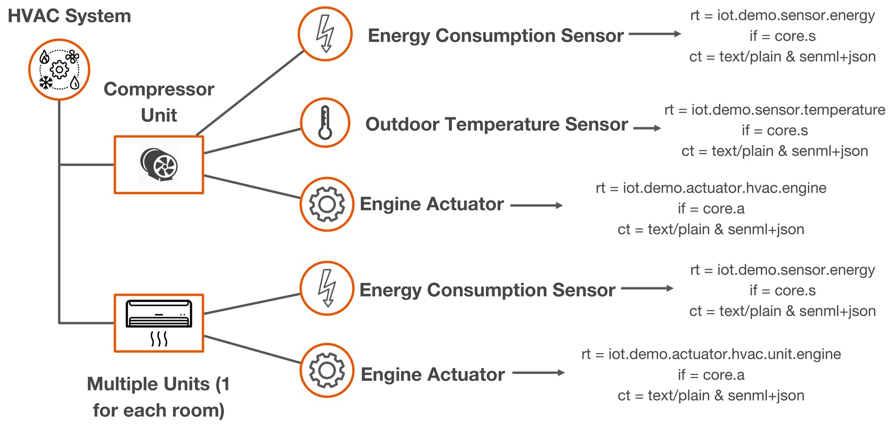

**Figure 11:** CoAP resource profiles of the HVAC System.

| Component       | Resource                   | `rt`                                | `if`     | `ct`                     |
|-----------------|----------------------------|-------------------------------------|----------|--------------------------|
| Compressor Unit | Energy Consumption Sensor  | `iot.demo.sensor.energy`            | `core.s` | text/plain & senml+json  |
| Compressor Unit | Outdoor Temperature Sensor | `iot.demo.sensor.temperature`       | `core.s` | text/plain & senml+json  |
| Compressor Unit | Engine Actuator            | `iot.demo.actuator.hvac.engine`     | `core.a` | text/plain & senml+json  |
| Room Unit       | Energy Consumption Sensor  | `iot.demo.sensor.energy`            | `core.s` | text/plain & senml+json  |
| Room Unit       | Engine Actuator            | `iot.demo.actuator.hvac.unit.engine`| `core.a` | text/plain & senml+json  |

Note that:

- the two energy sensors share the same `rt`: the Data Fetcher can find **all** the energy sensors of the apartment
  with a single query on the resource type;
- the engine of the compressor and the engine of a room unit have **different** `rt` values, since they have different
  semantics (a simple On/Off vs operational mode and intensity level), and a client must not confuse them.

### B.5.2 Thermostat Profiles

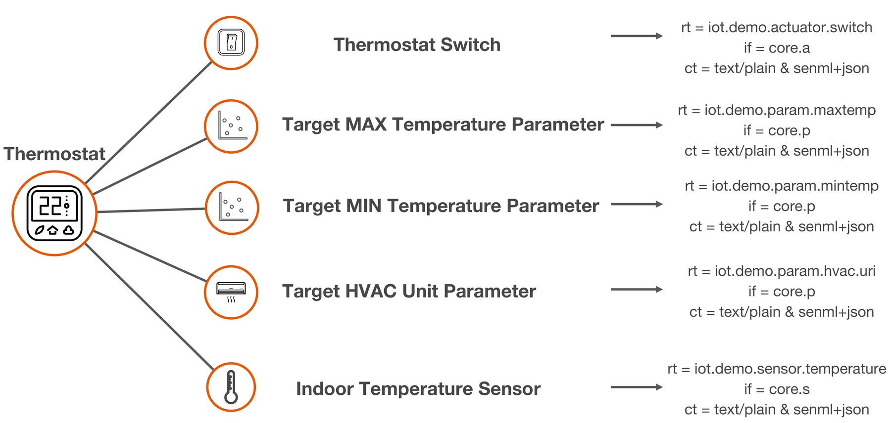

**Figure 12:** CoAP resource profiles of the Thermostat.

| Resource                         | `rt`                          | `if`     | `ct`                    |
|----------------------------------|-------------------------------|----------|-------------------------|
| Thermostat Switch                | `iot.demo.actuator.switch`    | `core.a` | text/plain & senml+json |
| Target MAX Temperature Parameter | `iot.demo.param.maxtemp`      | `core.p` | text/plain & senml+json |
| Target MIN Temperature Parameter | `iot.demo.param.mintemp`      | `core.p` | text/plain & senml+json |
| Target HVAC Unit Parameter       | `iot.demo.param.hvac.uri`     | `core.p` | text/plain & senml+json |
| Indoor Temperature Sensor        | `iot.demo.sensor.temperature` | `core.s` | text/plain & senml+json |

The indoor temperature sensor of the thermostat and the outdoor temperature sensor of the compressor share the same
`rt` (`iot.demo.sensor.temperature`): they measure the same physical quantity, and their different role (indoor vs
outdoor) is given by the device and the path hosting them.

### B.5.3 Discovering the Smart Object

With the profiles in place, a client that knows nothing about a thermostat can discover its resources through the
standard `/.well-known/core` resource. An example of response of a thermostat (with the temperature sensor also marked
as observable):

```
</thermostat/temperature>;rt="iot.demo.sensor.temperature";if="core.s";ct="0 110";obs,
</thermostat/switch>;rt="iot.demo.actuator.switch";if="core.a";ct="0 110",
</thermostat/temp-max>;rt="iot.demo.param.maxtemp";if="core.p";ct="0 110",
</thermostat/temp-min>;rt="iot.demo.param.mintemp";if="core.p";ct="0 110",
</thermostat/hvac>;rt="iot.demo.param.hvac.uri";if="core.p";ct="0 110"
```

The Data Fetcher can use query filters to retrieve only the resources it needs, e.g.:

- `GET /.well-known/core?rt=iot.demo.sensor.energy` to find the energy sensors;
- `GET /.well-known/core?if=core.s` to find all the sensors to observe and log.

In a larger deployment, the Smart Objects can also register their resources to a **CoRE Resource Directory**, so that
the Data Fetcher can find all the devices of the apartment with a single lookup (see the Resource & Service Discovery
lecture).

---

## B.6 CoAP & SenML

Each modelled resource should use the **SenML + JSON** media type (`application/senml+json`) **both for reading
measurements and for the actuation part**: using the same data model for sensors, actuators and parameters allows a
client to read the current state of a resource and to send a new state with the same structure.

The following example, adapted from the SenML specification (RFC 8428), shows how SenML can be used to **set the
current set point** of a typical residential thermostat with a temperature set point:

```json
[
    {"bn": "urn:dev:ow:10e2073a01080063:"},
    {"n": "temp", "u": "Cel", "v": 23.1}
]
```

- `bn` (**Base Name**) identifies the device: the full name of the value is `urn:dev:ow:10e2073a01080063:temp`.
- `n`, `u` and `v` are the **name**, the **unit** (`Cel`, degrees Celsius) and the **numeric value** of the set point.

The same structure is used to **read** the value with a GET (response payload) and to **write** it with a PUT
(request payload). Applied to the Smart Home resources:

```
GET /thermostat/temperature   (Accept: application/senml+json)
2.05 Content
[{"bn": "urn:dev:thermostat-room-01:", "n": "temperature", "u": "Cel", "v": 21.4, "t": 1730000000}]

PUT /thermostat/temp-max      (Content-Format: application/senml+json)
[{"bn": "urn:dev:thermostat-room-01:", "n": "temp-max", "u": "Cel", "v": 23.0}]
2.04 Changed
```

The engine actuator of a room unit, whose state is composed of two variables, can be represented with two Records using
**string values** (`vs`):

```json
[
    {"bn": "urn:dev:hvac-unit-room-01:engine:", "n": "mode", "vs": "heating"},
    {"n": "intensity", "vs": "medium"}
]
```

> **Units of measurement:** SenML defines a registry of units. Temperatures use `Cel`, while energy is expressed in
> joule (`J`) as primary unit; secondary units such as `kWh` are defined by the additional SenML units specification
> (RFC 8798). Using registered units allows any consumer to interpret the values correctly.

---

## B.7 Alternative Design: a Single Configuration Resource

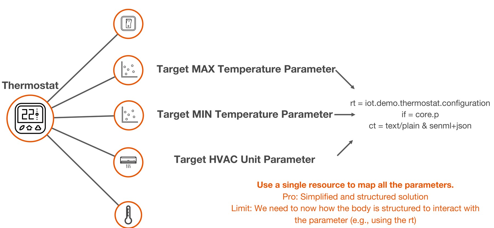

**Figure 13:** Alternative design of the Thermostat: the MAX temperature, MIN temperature and target HVAC unit parameters
are mapped onto a single configuration resource.

The configuration parameters of the thermostat can also be mapped onto a **single resource**:

| Resource                    | `rt`                              | `if`     | `ct`                    |
|-----------------------------|-----------------------------------|----------|-------------------------|
| Thermostat Configuration    | `iot.demo.thermostat.configuration` | `core.p` | text/plain & senml+json |

- **Pro:** a simplified and structured solution: the whole configuration is read with a single GET and changed with a
  single PUT, reducing the number of messages over a constrained network and keeping the parameters **consistent**
  (e.g., MIN and MAX are always updated together).
- **Limit:** the client must know **how the body is structured** to interact with a specific parameter, e.g.,
  identifying the structure through the `rt` of the resource.

SenML naturally supports this design, since a Pack can contain **multiple Records**. The following example, also adapted
from RFC 8428, sets the temperature set point of a thermostat, a switch to turn on and off the heat and a switch for the
fan:

```json
[
    {"bn": "urn:dev:ow:10e2073a01080063:"},
    {"n": "temp", "u": "Cel", "v": 23.1},
    {"n": "heat", "u": "/", "v": 1},
    {"n": "fan", "u": "/", "v": 0}
]
```

The unit `/` denotes a dimensionless ratio, used here for values that are either `0` (off) or `1` (on).
The **same structure and model** can be used to **read** the current configuration with a GET.

**Fine-grained vs coarse-grained resources:**

| Aspect                         | One resource per parameter (B.5)               | Single configuration resource (B.7)                     |
|--------------------------------|------------------------------------------------|---------------------------------------------------------|
| Messages to change N parameters| N requests                                     | 1 request                                               |
| Consistency of related values  | Intermediate states are visible (e.g., MIN updated, MAX not yet) | Values updated atomically                |
| Discoverability                | Each parameter has its own `rt`                | A single `rt`, the structure of the body must be known  |
| Observability                  | Each parameter can be observed separately      | Any change notifies the whole configuration             |
| Simplicity of the client       | Simple payloads (single value)                 | Requires parsing a structured payload                   |

Both designs are valid: the choice depends on how the parameters are typically used. Parameters that are always changed
together are good candidates for a single resource, while independent values benefit from fine-grained resources.

---

# C. MQTT Smart Object Design: the Fleet Monitoring Use Case

## C.1 Application Use Case

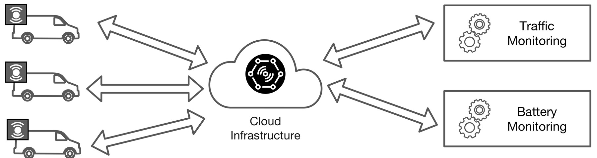

**Figure 14:** The Fleet Monitoring application scenario: the vehicles of the fleet communicate with a cloud
infrastructure, used by the Traffic Monitoring and Battery Monitoring applications.

The goal of the application is to **monitor in real time the electric vehicles of a company's fleet** while they are
moving during the working hours:

- each vehicle is equipped with sensors to monitor its **GPS position** and its **battery level**;
- two centralized applications receive the data in real time:
  - **Traffic Monitoring:** provides traffic information feedback if a vehicle is close to a **traffic jam**;
  - **Battery Monitoring:** analyzes the battery level to suggest a set of possible **charging stations** to the vehicle.

**Why MQTT:**

- Vehicles are **mobile** and connected through cellular networks: they are not reachable at a stable IP address, so
  they can not act as servers. With MQTT, the vehicles (and the applications) only need to open an **outgoing
  connection** to the broker.
- The data flow is mainly **one-to-many** and **event-driven**: each vehicle publishes its data once, and any number of
  applications can receive it, now and in the future, without any change on the vehicles.
- Producers and consumers are **decoupled**: new monitoring applications can be added by simply subscribing to the
  existing topics.

---

## C.2 Data & Communication Channels

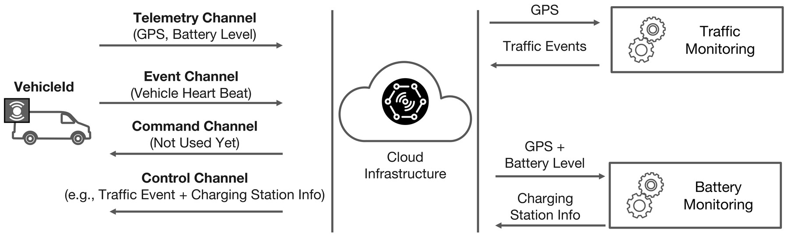

**Figure 15:** Data and communication channels between a vehicle, the cloud infrastructure and the monitoring
applications.

The data exchanged by each vehicle (identified by its **VehicleId**) is organized into four logical **channels**, each
one with a specific direction and purpose:

| Channel       | Direction           | Content                                                      | Typical Frequency            |
|---------------|---------------------|--------------------------------------------------------------|------------------------------|
| **Telemetry** | Vehicle -> Cloud    | Periodic measurements of the sensors (GPS, Battery Level)    | High (e.g., every few seconds) |
| **Event**     | Vehicle -> Cloud    | Status information and events, e.g., the vehicle **heart beat** | Low / on change           |
| **Command**   | Cloud -> Vehicle    | Requests to perform an action on the vehicle (not used yet)  | On demand                    |
| **Control**   | Cloud -> Vehicle    | Feedback and information for the vehicle, e.g., **traffic events** and **charging station info** | On demand |

On the application side:

- **Traffic Monitoring** receives the **GPS** data and sends back **Traffic Events**;
- **Battery Monitoring** receives **GPS + Battery Level** (both are needed to suggest the closest charging stations)
  and sends back **Charging Station Info**.

**Design Considerations:**

- Separating **Telemetry** from **Events** allows the consumers to subscribe only to what they need, and to handle the
  two flows with different delivery guarantees (see the next section).
- **Command** and **Control** are both directed to the vehicle, but with a different meaning: a *command* asks the
  vehicle to **do something** (actuation), while *control* messages provide **information** that the vehicle (or the
  driver) can use. Keeping them separate makes the authorization rules and the handling logic simpler.
- The **heart beat** event allows the applications to know which vehicles are active. It can be complemented by the MQTT
  **Last Will and Testament**, which notifies an unexpected disconnection of a vehicle.
- At this stage **security and authentication** of the vehicles are not considered; in a real deployment each vehicle
  must authenticate to the broker and be authorized to publish and subscribe only to its own topics.

---

## C.3 MQTT Topic Design

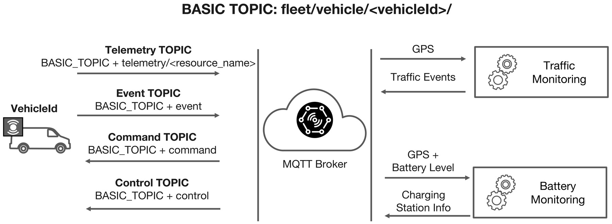

**Figure 16:** MQTT design overview: the four channels mapped onto topics sharing the basic topic of the vehicle.

Each channel is mapped onto an MQTT **topic**. All the topics of a vehicle share a common prefix, the **basic topic**,
that contains the identifier of the vehicle:

```
BASIC_TOPIC = fleet/vehicle/<vehicleId>/
```

| Channel   | Topic                                         | Example                                    |
|-----------|-----------------------------------------------|--------------------------------------------|
| Telemetry | `BASIC_TOPIC + telemetry/<resource_name>`     | `fleet/vehicle/vehicle-0001/telemetry/gps` |
| Telemetry | `BASIC_TOPIC + telemetry/<resource_name>`     | `fleet/vehicle/vehicle-0001/telemetry/battery` |
| Event     | `BASIC_TOPIC + event`                         | `fleet/vehicle/vehicle-0001/event`         |
| Command   | `BASIC_TOPIC + command`                       | `fleet/vehicle/vehicle-0001/command`       |
| Control   | `BASIC_TOPIC + control`                       | `fleet/vehicle/vehicle-0001/control`       |

**Why this structure:**

- **Hierarchical and predictable:** from general (`fleet`) to specific (`<resource_name>`), so the topic of any data can
  be built from the vehicle identifier and the resource name.
- **Wildcard friendly:** consumers can select exactly the data they need with the MQTT wildcards:

| Subscriber          | Subscription                              | Receives                                       |
|---------------------|-------------------------------------------|------------------------------------------------|
| Traffic Monitoring  | `fleet/vehicle/+/telemetry/gps`           | GPS position of all the vehicles               |
| Battery Monitoring  | `fleet/vehicle/+/telemetry/#`             | GPS and battery level of all the vehicles      |
| Fleet Dashboard     | `fleet/vehicle/+/event`                   | Heart beat and status events of all the vehicles |
| Vehicle `vehicle-0001` | `fleet/vehicle/vehicle-0001/command` and `fleet/vehicle/vehicle-0001/control` | Commands and control messages for itself only |

- **One topic per telemetry resource:** a new sensor (e.g., the vehicle speed) only adds a new topic
  (`telemetry/speed`), without changing the existing messages and consumers.
- **Identity in the topic:** the publisher of a message is identified by the topic itself, and the broker access
  control lists can easily restrict each vehicle to its own `fleet/vehicle/<vehicleId>/#` sub-tree.

The topics do not start with `/`: a leading slash would create an empty first topic level, which adds no information.

---

## C.4 Message Design

Besides the topic, each channel requires the definition of its **payload** and of the MQTT delivery options.

**Payload format.** Telemetry data can reuse the **SenML** data model, adding units and timestamps to the values.
SenML defines registered units for geographic coordinates (`lat`, `lon`) and for the battery level (`%EL`, percentage
of remaining battery energy):

```
Topic: fleet/vehicle/vehicle-0001/telemetry/gps
[
    {"bn": "urn:dev:vehicle-0001:", "bt": 1730000000, "n": "latitude", "u": "lat", "v": 44.6471},
    {"n": "longitude", "u": "lon", "v": 10.9252}
]

Topic: fleet/vehicle/vehicle-0001/telemetry/battery
[
    {"bn": "urn:dev:vehicle-0001:", "bt": 1730000000, "n": "battery", "u": "%EL", "v": 78.5}
]
```

Event and control messages are usually structured application messages, e.g., in JSON:

```
Topic: fleet/vehicle/vehicle-0001/event
{"type": "heartbeat", "timestamp": 1730000000000, "status": "moving"}

Topic: fleet/vehicle/vehicle-0001/control
{"type": "charging_stations", "timestamp": 1730000060000,
 "stations": [{"id": "cs-12", "latitude": 44.6502, "longitude": 10.9301, "distance_km": 1.2}]}
```

**Delivery options.** Each channel has different requirements, reflected in the choice of the QoS level and of the
retained flag. A typical configuration is:

| Channel   | QoS     | Retained | Rationale                                                                                   |
|-----------|---------|----------|---------------------------------------------------------------------------------------------|
| Telemetry | 0       | No       | Frequent values: a lost message is soon replaced by the next one                            |
| Event     | 1       | Yes / No | Events must not be lost; retaining the last status lets new subscribers know it immediately |
| Command   | 1       | No       | The command must reach the vehicle; a retained command could be re-executed unexpectedly    |
| Control   | 1       | No       | The information must reach the vehicle, but it is relevant only when it is sent             |

These choices are design decisions, not fixed rules: for example, telemetry used for billing or safety purposes may
require QoS 1.

---

## C.5 MQTT Smart Object Modelling

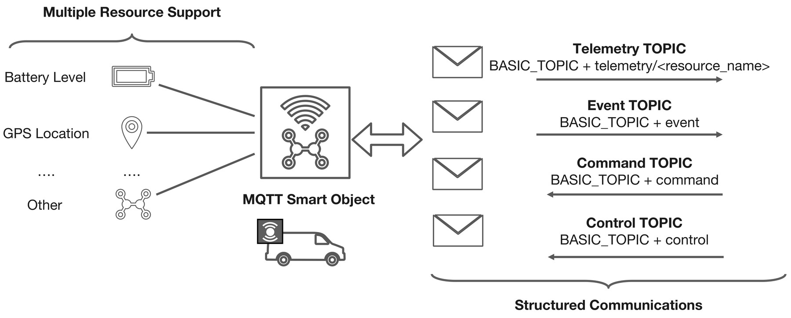

**Figure 17:** Modelling of an MQTT Smart Object: multiple resources (battery level, GPS location, others) and
structured communications on the four topics.

The design leads to a general model of an **MQTT Smart Object**, that can be reused for any device and not only for
vehicles:

- **Multiple Resource Support:** the Smart Object manages a list of **resources** (e.g., Battery Level, GPS Location
  and any other sensor). Each resource generates data independently, and adding a new resource does not require
  changing the communication logic: it only adds a new telemetry topic.
- **Structured Communications:** the communication is organized on the four standard topics (telemetry, event,
  command, control) under the basic topic of the object:
  - the Smart Object **publishes** on the **telemetry** topics (one for each resource) and on the **event** topic;
  - the Smart Object **subscribes** to the **command** and **control** topics to receive incoming messages.

**Lifecycle of the MQTT Smart Object:**

1. Connect to the broker (with its unique client id and, in production, its credentials), possibly setting a **Last Will**
   message on the event topic.
2. Subscribe to the **command** and **control** topics.
3. Publish an initial **event** (e.g., the device is online, possibly retained).
4. Start the resources: each one periodically publishes its data on its **telemetry** topic.
5. Handle the incoming **commands** (acting on the resources) and **control** messages (e.g., notifying the driver).
6. On shutdown, publish a final event and disconnect gracefully.

With this model, the code of the Smart Object is split into **resources** (the data sources, independent of MQTT) and a
**communication layer** that maps resources and messages onto topics: the same structure can be reused for different
devices simply by changing the list of resources.

---

# D. Software Libraries & Development

The last steps of the methodology are the selection of the software libraries and the development of the Smart Objects
and of the applications. Common open-source libraries are:

| Purpose                       | Python                              | Java                                     |
|-------------------------------|-------------------------------------|------------------------------------------|
| CoAP client and server        | aiocoap                             | Eclipse Californium                      |
| MQTT client                   | Eclipse Paho MQTT Python            | Eclipse Paho MQTT Java, HiveMQ MQTT Client |
| SenML serialization           | kpn-senml                           | SenML libraries / custom JSON mapping    |
| MQTT broker (testing)         | Eclipse Mosquitto                   | Eclipse Mosquitto, HiveMQ CE             |

**Development guidelines:**

- **Separate the model from the protocol:** implement sensors, actuators and parameters as plain classes (the emulated
  or real device) and keep the CoAP resources or the MQTT communication layer as a thin adapter on top of them.
- **Start from the contract:** implement the resource profiles (CoAP) or the topic and message design (MQTT) exactly as
  defined in the design phase, since they are what the other applications rely on.
- **Test each interaction in isolation** with generic tools (e.g., a CoAP command line client or an MQTT client tool)
  before developing the complete applications.
- **Emulate devices** to develop and test the applications without the physical hardware, and to simulate many devices
  (e.g., a whole fleet) at the same time.

---

# E. CoAP vs MQTT Smart Object Design

| Aspect                     | CoAP Smart Object (Smart Home)                                    | MQTT Smart Object (Fleet Monitoring)                              |
|----------------------------|-------------------------------------------------------------------|-------------------------------------------------------------------|
| Main abstraction           | Resources with URIs                                               | Topics and messages                                               |
| Role of the device         | Server (and client towards other devices)                         | Client of the broker                                              |
| Typical deployment         | Local network, devices reachable at known addresses               | Mobile/remote devices, reachable only through the broker          |
| Reading data               | GET or Observe on sensor resources                                | Subscription to telemetry topics                                  |
| Changing the device state  | PUT/POST on actuator and parameter resources                      | Publication on command/control topics                             |
| Self-description           | CoRE Link Format (`rt`, `if`, `ct`, `obs`) and `/.well-known/core` | Topic naming conventions (e.g., `telemetry/<resource_name>`)     |
| Device-to-device interaction | Direct (the thermostat sends requests to the HVAC unit)         | Mediated by the broker                                            |
| One-to-many distribution   | Observe (each observer is served by the device)                   | Native (the broker distributes each message to all subscribers)   |
| Data format                | SenML for sensors, actuators and parameters                       | SenML for telemetry, structured messages for events and control   |

**Summary:**
Designing an IoT Smart Object means turning the capabilities of a device into a **clear, self-describing and reusable
contract**. The analysis of resources, data and communication flows is independent of the protocol, while the modelling
exploits its interaction pattern: **resources, profiles and methods** with CoAP, **channels, topics and messages** with
MQTT. In both cases, standard data formats such as **SenML** and consistent naming allow heterogeneous devices and
applications to interoperate without prior configuration.

---

# References

- Z. Shelby, K. Hartke, C. Bormann, *The Constrained Application Protocol (CoAP)*, RFC 7252, IETF, June 2014 - [https://www.rfc-editor.org/rfc/rfc7252](https://www.rfc-editor.org/rfc/rfc7252)
- K. Hartke, *Observing Resources in the Constrained Application Protocol (CoAP)*, RFC 7641, IETF, September 2015 - [https://www.rfc-editor.org/rfc/rfc7641](https://www.rfc-editor.org/rfc/rfc7641)
- Z. Shelby, *Constrained RESTful Environments (CoRE) Link Format*, RFC 6690, IETF, August 2012 - [https://www.rfc-editor.org/rfc/rfc6690](https://www.rfc-editor.org/rfc/rfc6690)
- Z. Shelby, M. Koster, C. Groves, J. Zhu, B. Silverajan, *Reusable Interface Definitions for Constrained RESTful Environments* (CoRE Interfaces), Internet Draft `draft-ietf-core-interfaces` - [https://datatracker.ietf.org/doc/draft-ietf-core-interfaces/](https://datatracker.ietf.org/doc/draft-ietf-core-interfaces/)
- C. Amsüss, Z. Shelby, M. Koster, C. Bormann, P. van der Stok, *CoRE Resource Directory*, RFC 9176, IETF, April 2022 - [https://www.rfc-editor.org/rfc/rfc9176](https://www.rfc-editor.org/rfc/rfc9176)
- C. Jennings, Z. Shelby, J. Arkko, A. Keränen, C. Bormann, *Sensor Measurement Lists (SenML)*, RFC 8428, IETF, August 2018 - [https://www.rfc-editor.org/rfc/rfc8428](https://www.rfc-editor.org/rfc/rfc8428)
- C. Bormann, *Additional Units for Sensor Measurement Lists (SenML)*, RFC 8798, IETF, June 2020 - [https://www.rfc-editor.org/rfc/rfc8798](https://www.rfc-editor.org/rfc/rfc8798)
- OASIS, *MQTT Version 3.1.1*, OASIS Standard, October 2014 - [https://docs.oasis-open.org/mqtt/mqtt/v3.1.1/mqtt-v3.1.1.html](https://docs.oasis-open.org/mqtt/mqtt/v3.1.1/mqtt-v3.1.1.html)
- OASIS, *MQTT Version 5.0*, OASIS Standard, March 2019 - [https://docs.oasis-open.org/mqtt/mqtt/v5.0/mqtt-v5.0.html](https://docs.oasis-open.org/mqtt/mqtt/v5.0/mqtt-v5.0.html)
- aiocoap - The Python CoAP library - [https://aiocoap.readthedocs.io/](https://aiocoap.readthedocs.io/)
- Eclipse Californium - [https://eclipse.dev/californium/](https://eclipse.dev/californium/)
- Eclipse Paho - [https://eclipse.dev/paho/](https://eclipse.dev/paho/)
- Eclipse Mosquitto - [https://mosquitto.org/](https://mosquitto.org/)
