<!-- omit in toc -->
# Resource & Service Discovery

<!-- omit in toc -->
## Lecture Information

| **Lecture Title**   | Resource & Service Discovery                                                     |
|---------------------|----------------------------------------------------------------------------------|
| **Author**          | Prof. Marco Picone (marco.picone@unimore.it)                                     |
| **License**         | [Creative Commons Attribution 4.0](https://creativecommons.org/licenses/by/4.0/) | 


<!-- omit in toc -->
# Table of Contents

- [A. Resource Discovery](#a-resource-discovery)
- [B. CoAP Resource Discovery \& CoRE Link Format](#b-coap-resource-discovery--core-link-format)
  - [B.1 Web Linking](#b1-web-linking)
  - [B.2 CoRE Link Format (RFC 6690)](#b2-core-link-format-rfc-6690)
  - [B.3 Unicast \& Multicast Discovery](#b3-unicast--multicast-discovery)
  - [B.4 Link Format Syntax](#b4-link-format-syntax)
  - [B.5 CoRE Link Attributes](#b5-core-link-attributes)
    - [B.5.1 Resource Type 'rt' Attribute](#b51-resource-type-rt-attribute)
    - [B.5.2 Interface Description 'if' Attribute](#b52-interface-description-if-attribute)
    - [B.5.3 Maximum Size Estimate 'sz' Attribute](#b53-maximum-size-estimate-sz-attribute)
    - [B.5.4 Observable 'obs' Attribute](#b54-observable-obs-attribute)
  - [B.6 Query Filtering](#b6-query-filtering)
  - [B.7 Resource Discovery Examples](#b7-resource-discovery-examples)
- [C. CoRE Interfaces](#c-core-interfaces)
  - [C.1 Interface Types](#c1-interface-types)
  - [C.2 Sensor](#c2-sensor)
  - [C.3 Parameter \& Read-only Parameter](#c3-parameter--read-only-parameter)
  - [C.4 Actuator](#c4-actuator)
- [D. CoRE Resource Directory](#d-core-resource-directory)
  - [D.1 Architecture](#d1-architecture)
  - [D.2 Finding the Resource Directory](#d2-finding-the-resource-directory)
  - [D.3 URI Discovery](#d3-uri-discovery)
  - [D.4 Registration](#d4-registration)
  - [D.5 Registration Management](#d5-registration-management)
  - [D.6 Lookup Interface](#d6-lookup-interface)
    - [D.6.1 Resource Lookup](#d61-resource-lookup)
    - [D.6.2 Resource Lookup with Observation](#d62-resource-lookup-with-observation)
    - [D.6.3 Paginated Lookup](#d63-paginated-lookup)
    - [D.6.4 Endpoint Lookup](#d64-endpoint-lookup)
- [E. Service Discovery](#e-service-discovery)
  - [E.1 Service Discovery in IoT Networks](#e1-service-discovery-in-iot-networks)
  - [E.2 Service Discovery in CoAP](#e2-service-discovery-in-coap)
  - [E.3 ZeroConf: mDNS \& DNS-SD](#e3-zeroconf-mdns--dns-sd)
  - [E.4 UPnP - Universal Plug and Play](#e4-upnp---universal-plug-and-play)
  - [E.5 URI Beacons \& the Physical Web](#e5-uri-beacons--the-physical-web)
- [F. Discovery Mechanisms Summary](#f-discovery-mechanisms-summary)
- [References](#references)

# A. Resource Discovery

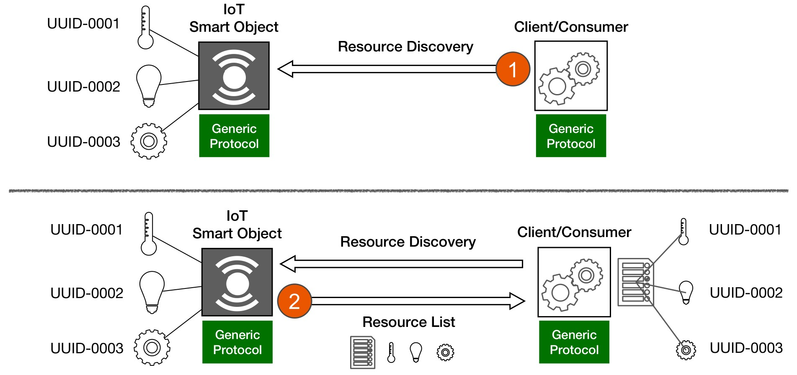

**Figure 1:** Generic Resource Discovery flow: (1) a Client/Consumer asks an IoT Smart Object for its resources; (2) the Smart Object replies with the list of the resources it hosts.

**Resource Discovery** is the possibility for a **consumer/client application**, through a specific application protocol, to **find the list of available resources** hosted and managed by an **IoT Smart Object**.

**Core Concepts:**

- **Goal:**
  - Simplify and **automate** the seamless interaction and interoperability among objects **without any prior knowledge**, configuration or human intervention.
  - *Example (IoT):* A building management application connects to a new smart thermostat and automatically learns that it exposes a temperature sensor, a humidity sensor and a set-point parameter.
- **Resource-Oriented Design:**
  - Modelling and designing IoT applications around the concept of **resources** is mostly associated with **RESTful protocols** (such as **CoAP** and **HTTP**).
  - However, resource discoverability can be conceptually **generalized to any IoT protocol**.
- **Native Support in CoAP:**
  - CoAP natively includes in the standard a **communication pattern** to support Resource Discovery in any standard CoAP Smart Object.
- **Other Protocols:**
  - Designing a similar flow for other protocols, such as **MQTT**, is at the same time **challenging** and **fundamental** for a seamless interaction between heterogeneous things, people and services.
  - *Example (IoT):* An MQTT device may publish a description of its topics and capabilities on a dedicated (retained) topic, so that new subscribers can discover what it offers.

**Resource Discovery vs. Service Discovery:**

| Aspect | Resource Discovery | Service Discovery |
|--------|--------------------|-------------------|
| Question answered | *Which resources does this endpoint host?* | *Which endpoints/services are available in the network?* |
| Prerequisite | The address of the endpoint is known | No prior knowledge of endpoints |
| Examples | `GET /.well-known/core`, Resource Directory lookup | mDNS/DNS-SD, UPnP, multicast, URI beacons |

> **Note:** The two mechanisms are complementary: **service discovery** is typically used first to find an endpoint (e.g., its IP address and port), then **resource discovery** is used to learn which resources that endpoint offers.

---

# B. CoAP Resource Discovery & CoRE Link Format

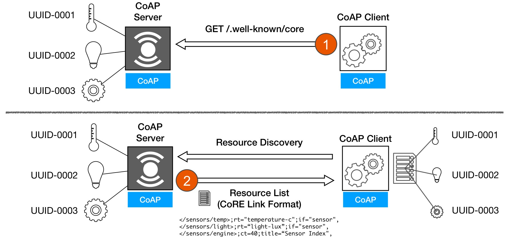

**Figure 2:** CoAP Resource Discovery: (1) the CoAP Client sends `GET /.well-known/core` to the CoAP Server; (2) the server replies with the resource list in CoRE Link Format.

In CoAP, **resource discovery** is based on discovering **links to resources** hosted by a CoAP service endpoint.

**Key Concepts:**

- **Standard Link Representations:**
  - **Web Linking** (RFC 5988, now RFC 8288).
  - **CoRE Link Format** (RFC 6690).
- Each link is composed of a **URI** and a **list of attributes** (e.g., `obs` means *observable*, `rt` indicates the *resource type*).
- **Well-known Entry Point:**
  - The well-known relative URI **`/.well-known/core`** is defined as the **default entry point** for requesting the list of links about the resources hosted by a server.
  - A `GET` request to any CoAP server for `/.well-known/core` results in a response that includes a **list of links** formatted according to the **CoRE Link Format**.
- **Protocol Independence:**
  - The specification is applicable to **CoAP**, **HTTP**, or any other suitable web transfer protocol.

**Example (IoT):**

```
REQ: GET /.well-known/core

RES: 2.05 Content (application/link-format)
</sensors/temp>;rt="temperature-c";if="sensor",
</sensors/light>;rt="light-lux";if="sensor",
</sensors/engine>;ct=40;title="Sensor Index"
```

---

## B.1 Web Linking

**Web Linking** is a framework for indicating the **relationships between web resources**. A typed link consists of:

- **Context URI:** what the link is *from*.
- **Relation Type:** indicates the **semantics** of the link (e.g., `copyright`, `author`, `chapter`, `service`).
- **Target URI:** what the link is *to*.
- **Attributes:** key/value pairs describing the link or its target (e.g., language, media type, title).

**Example (HTTP Link Header format):**

```
Link: <http://example.com/TheBook/chapter2>; rel="previous"; title="previous chapter"
```

In this example the context is the current page, the relation type is `previous`, the target is `http://example.com/TheBook/chapter2`, and `title` is an attribute.

---

## B.2 CoRE Link Format (RFC 6690)

The **Constrained RESTful Environments (CoRE)** Working Group brings the **REST architecture** to a version suitable for **constrained Smart Objects and networks**.

- The **discovery of resources** hosted by a server is fundamental for **machine-to-machine (M2M)** scenarios.
- The **CoRE Link Format** specification (RFC 6690) defines the discovery of resources hosted by a constrained web server, their attributes and other resource relations as **CoRE Resource Discovery**.
- The main function of the discovery mechanism is to provide the **URIs (called links)** of the resources hosted by the Smart Object.
- The resources are complemented by **attributes** about those resources and possible further **link relations**.
- In CoRE, this collection of links is represented as a **resource of its own** (`/.well-known/core`), different from the HTTP approach where links are delivered as headers of a specific resource.

**Format:**

- The CoRE Link Format defines the Internet media type **`application/link-format`** (CoAP **Content-Format `40`**), encoded as **UTF-8**.
- UTF-8 data can be **compared bitwise**, which allows values to contain UTF-8 data without any added complexity for constrained nodes.
- `GET /.well-known/core?optional_query_string` returns a **link-header style** format containing URLs, relation types, resource types, interfaces, content types, etc.

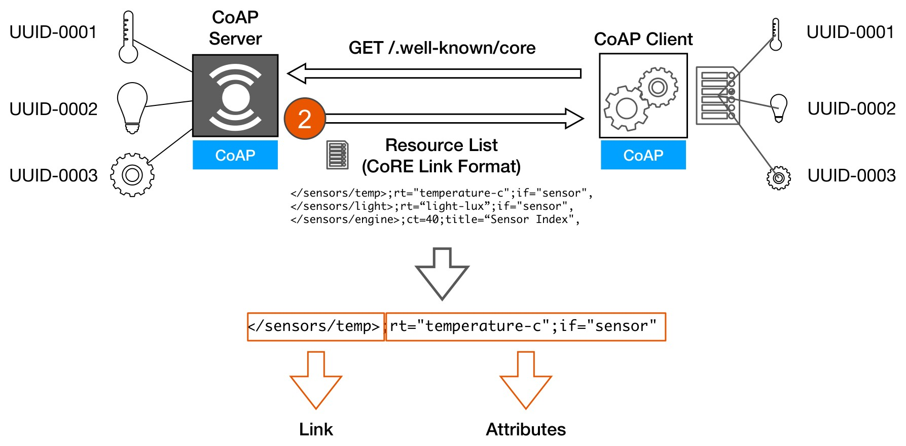

**Figure 3:** Structure of a CoRE Link Format entry: the **link** (target URI in angle brackets) followed by a list of **attributes** separated by `;`.

---

## B.3 Unicast & Multicast Discovery

Resource Discovery can be performed either **unicast** or **multicast**:

- **Unicast Discovery:**
  - Used when the server's IP address is **already known**, either a priori or resolved via the **Domain Name System (DNS)**.
  - The client sends a `GET /.well-known/core` to the server, which returns a payload in CoRE Link Format.
- **Multicast Discovery:**
  - The client sends `GET /.well-known/core` to the **"All CoAP Nodes"** multicast address (`224.0.1.187` for IPv4, `ff02::fd` link-local and `ff05::fd` site-local for IPv6), and every CoAP server in the group replies with its own links.
  - *Example (IoT):* A gateway discovers all the CoAP devices of a smart home network with a single request.

Once the links are received, the client **matches** the appropriate **Resource Type**, **Interface Description** and possibly **media type** for its application. These attributes may also be included in the **query string** to **filter** the links returned in a response (see [B.6 Query Filtering](#b6-query-filtering)).

---

## B.4 Link Format Syntax

The CoRE Link Format is defined by the following ABNF grammar (RFC 6690, simplified):

```
Link            = link-value-list
link-value-list = [ link-value *[ "," link-value ]]
link-value      = "<" URI-Reference ">" *( ";" link-param )
link-param      = ( ( "rel" "=" relation-types )
                / ( "anchor" "=" DQUOTE URI-Reference DQUOTE )
                / ( "rev" "=" relation-types )
                / ( "hreflang" "=" Language-Tag )
                / ( "media" "=" ( MediaDesc / ( DQUOTE MediaDesc DQUOTE ) ) )
                / ( "title" "=" quoted-string )
                / ( "title*" "=" ext-value )
                / ( "type" "=" ( media-type / quoted-mt ) )
                / ( "rt" "=" relation-types )
                / ( "if" "=" relation-types )
                / ( "sz" "=" cardinal )
                / ( link-extension ) )
```

**Key Points:**

- A link-format document is a **comma-separated list** of links.
- Each link is a **URI reference** enclosed in `<` and `>`, followed by **zero or more parameters** separated by `;`.
- Without an explicit `rel` parameter, the **default relation type is `hosts`**: the server that served `/.well-known/core` (the context) *hosts* the target resource.

---

## B.5 CoRE Link Attributes

**CoRE Link Attributes** describe information useful for accessing the target link of the relation and, in some cases, can use the syntactical form of a URI.

RFC 6690 defines **simple semantics for machines**, with an **IANA registry** for the values of the `rt=` and `if=` parameters:

- **Resource Type (`rt=`):** *What is this resource and what is it for?*
  - *Example:* a device model could be `rt="ipso.dev.mdl"`.
- **Interface Description (`if=`):** *How do I access this resource?*
  - *Example:* a sensor resource accessible with `GET` could be `if="core.s"`.
- **Content Type (`ct=`):** *What is the data format of the resource payloads?*
  - *Example:* `ct=0` for `text/plain`, `ct=50` for `application/json`.

---

### B.5.1 Resource Type 'rt' Attribute

- The Resource Type `rt` attribute is an **opaque string** used to assign an **application-specific semantic type** to a resource.
- **Multiple Resource Types** may be included in the value of this parameter, each **separated by a space**, similarly to the relation attribute.
- The Resource Type attribute is **not meant to be used to assign a human-readable name** to a resource: the `title` attribute defined by Web Linking is meant for that purpose.
- The Resource Type attribute **must not appear more than once** in a link.

**Example:** a hierarchical organization where the `/sensors` resource lists its sub-resources:

```
REQ: GET /sensors

RES: 2.05 Content
</sensors/temp>;rt="temperature-c";if="sensor",
</sensors/light>;rt="light-lux";if="sensor"
```

---

### B.5.2 Interface Description 'if' Attribute

- The Interface Description `if` attribute is an **opaque string** used to provide a **name or URI** indicating a specific **interface definition** used to interact with the target resource.
- It describes the **generic REST interface** to interact with a resource or a set of resources.
- A single Interface Description can be **reused by different Resource Types**.
  - *Example:* the Resource Types `outdoor-temperature`, `dew-point` and `rel-humidity` could all be accessible using the same Interface Description, defining how to interact with that group of sensors.
- **Multiple Interface Descriptions** may be included in the value, each separated by a space.
- The Interface Description could be, for example, the URI of a **WADL** (Web Application Description Language) definition of the target resource, or a short name defined by the **CoRE Interfaces** specification (see [C. CoRE Interfaces](#c-core-interfaces)).
- The Interface Description attribute **must not appear more than once** in a link.

---

### B.5.3 Maximum Size Estimate 'sz' Attribute

- The maximum size estimate attribute `sz` gives an indication of the **maximum size** (in bytes) of the resource representation returned by performing a `GET` on the target URI.
- For links to CoAP resources, it is **not expected for small resources** that can comfortably be carried in a single **MTU** (Maximum Transmission Unit), but it **should be included for larger resources**, so that the client knows in advance that a **block-wise transfer** will be needed.
- It **must not appear more than once** in a link.
- There is **no defined upper limit**: implementations must be prepared to accept large values.

**Example (IoT):** a client looking for a firmware image learns its size before downloading it:

```
REQ: GET /.well-known/core?rt=firmware

RES: 2.05 Content
</firmware/v2.1>;rt="firmware";sz=262144
```

---

### B.5.4 Observable 'obs' Attribute

The **Observe** extension of CoAP (RFC 7641) defines the `obs` target attribute:

- A web link to a resource accessible over CoAP (for example, in a link-format document) **may include the target attribute `obs`**.
- The `obs` attribute, when present, is a **hint** indicating that the destination of a link is **useful for observation** (and thus, for example, should have a suitable graphical representation in a user interface).
- It is **only a hint**, not a promise that the Observe option can actually be used: a client may need to **resort to polling** if the Observe option is not returned in the response to the `GET` request.
- **No value** must be given for the `obs` attribute (any present value must be ignored), and it **must not appear more than once** in a link.

**Example:**

```
REQ: GET /.well-known/core?rt=light-lux

RES: 2.05 Content
</sensors/light>;obs;rt="light-lux";if="sensor"
```

---

## B.6 Query Filtering

A server implementing CoAP Resource Discovery can recognize the **query part** of a resource discovery URI as a **filter** on the resources to be returned. The path and query components together should conform to the following URI Template (RFC 6570):

```
/.well-known/core{?search*}
```

where the variable `search` is a single **name/value pair**:

- **name** is either `href` (the link target) or any other **link attribute** name (e.g., `rt`, `if`, `ct`).
- **value** is either a **complete value string** (exact match) or a **prefix value string followed by `*`** (prefix match).

**Examples of valid query URIs:**

| Query | Matches |
|-------|---------|
| `?href=/foo` | links whose target is equal to `/foo` |
| `?href=/foo*` | links whose target starts with `/foo` |
| `?foo=bar` | links with an attribute `foo` with the exact value `bar` |
| `?foo=bar*` | links with an attribute `foo` whose value starts with `bar` |
| `?foo=*` | links that have an attribute named `foo` (any value) |

> **Note:** Relation-type attributes like `rt`, `if` and `rel` can have **multiple values separated by spaces**. A query filter matches a link if it matches **any one** of those values.

---

## B.7 Resource Discovery Examples

**Example 1 - Simple discovery:** links to two different sensors sharing the same Interface Description.

```
REQ: GET /.well-known/core

RES: 2.05 Content
</sensors/temp>;if="sensor",
</sensors/light>;if="sensor"
```

Without the line feeds inserted for readability, the payload actually looks as follows:

```
</sensors/temp>;if="sensor",</sensors/light>;if="sensor"
```

Since there is no `rel` attribute, the default relation type `hosts` applies: the origin server from which `/.well-known/core` was requested **hosts** the resources `/sensors/temp` and `/sensors/light`.

**Example 2 - Hierarchical discovery:** the entry point includes a link to a sub-resource (with Content-Format `40`, i.e., `application/link-format`) that contains the links about the sensors.

```
REQ (1): GET /.well-known/core

RES (1): 2.05 Content
</sensors>;ct=40

REQ (2): GET /sensors

RES (2): 2.05 Content
</sensors/temp>;rt="temperature-c";if="sensor",
</sensors/light>;rt="light-lux";if="sensor"
```

**Example 3 - Query filtering:**

```
REQ: GET /.well-known/core?rt=light-lux

RES: 2.05 Content
</sensors/light>;rt="light-lux";if="sensor"
```

The filter also matches when the attribute has multiple values, one of which is `light-lux`:

```
REQ: GET /.well-known/core?rt=light-lux

RES: 2.05 Content
</sensors/light>;rt="light-lux core.sen-light";if="sensor"
```

**Example 4 - Discovery followed by resource access:**

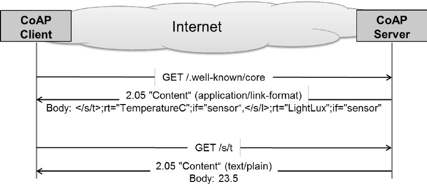

**Figure 4:** A CoAP client discovers the resources of a server through `/.well-known/core` and then reads the temperature resource `/s/t`.

**Example 5 - Discovery over a CON/ACK exchange:**

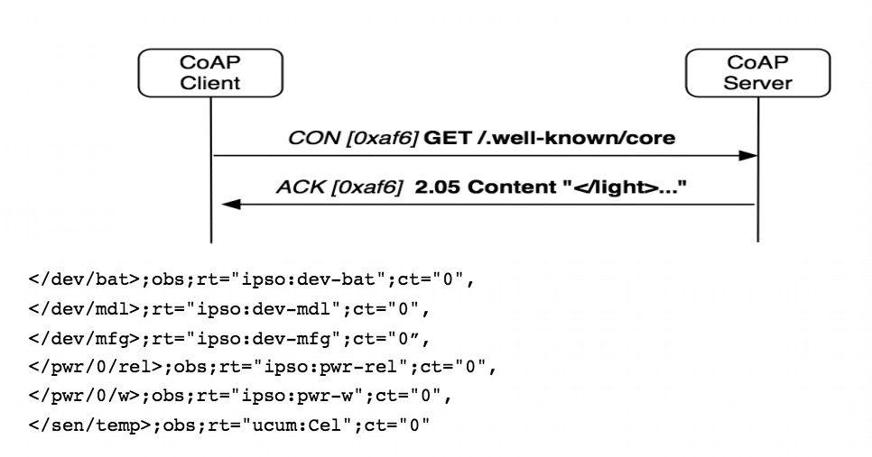

**Figure 5:** Discovery of a device exposing resources described with IPSO resource types (battery, model, manufacturer, power and temperature), several of them observable.

---

# C. CoRE Interfaces

The **CoRE Interfaces** specification (`draft-ietf-core-interfaces`) defines **well-known REST interface descriptions** for constrained web servers using the CoRE Link Format.

- The main interface types are **Batch**, **Sensor**, **Parameter** and **Actuator**.
- A **short reference** is defined for each type, which can be efficiently included in the **interface description (`if`) attribute** of the CoRE Link Format.
- These descriptions are intended for **general use** in resource designs or for inclusion in more specific **interface profiles**.
- The document also defines the concepts of:
  - **Function Set:** the basic element to create **RESTful profiles** (a group of related resources, e.g., all the sensors of a device).
  - **Binding:** helps the configuration of **links between resources** located on one or more endpoints (e.g., a light switch bound to a lamp).

> **Note:** CoRE Interfaces has remained an Internet Draft and has not been published as an RFC. However, its interface names (e.g., `core.s`, `core.a`) are widely used in examples and implementations, and similar concepts have been adopted by other IoT standards such as OMA LwM2M and OCF.

---

## C.1 Interface Types

| Interface           | `if=`     | Methods                  | Content-Formats          |
|---------------------|-----------|--------------------------|--------------------------|
| Link List           | `core.ll` | GET                      | link-format              |
| Batch               | `core.b`  | GET, PUT, POST           | senml                    |
| Linked Batch        | `core.lb` | GET, PUT, POST, DELETE   | link-format, senml       |
| Sensor              | `core.s`  | GET                      | senml, text/plain        |
| Parameter           | `core.p`  | GET, PUT                 | senml, text/plain        |
| Read-only Parameter | `core.rp` | GET                      | senml, text/plain        |
| Actuator            | `core.a`  | GET, PUT, POST           | senml, text/plain        |

The following is an example of links in CoRE Link Format using these interface descriptions, based on a simple device profile. The links are used in the examples of the next sections.

```
REQ: GET /.well-known/core

RES: 2.05 Content (application/link-format)
</s>;rt="simple.sen";if="core.b",
</s/lt>;rt="simple.sen.lt";if="core.s",
</s/tmp>;rt="simple.sen.tmp";if="core.s";obs,
</s/hum>;rt="simple.sen.hum";if="core.s",
</a>;rt="simple.act";if="core.b",
</a/1/led>;rt="simple.act.led";if="core.a",
</a/2/led>;rt="simple.act.led";if="core.a",
</d>;rt="simple.dev";if="core.ll",
</l>;if="core.lb"
```

---

## C.2 Sensor

The **Sensor** interface (`core.s`) allows the value of a sensor resource to be **read** (`GET`).

- The media type of the resource can be either **plain text** or **SenML**.
- **Plain text** may be used for a **single measurement** that does not require metadata.
- For a measurement with **metadata** such as a unit or a timestamp, **SenML should be used**.
- A resource with this interface may use SenML to return **multiple measurements** in the same representation (e.g., a list of recent measurements).

**Examples:**

```
Req: GET /s/humidity (Accept: text/plain)
Res: 2.05 Content (text/plain)
80
```

```
Req: GET /s/humidity (Accept: application/senml+json)
Res: 2.05 Content (application/senml+json)
[{"n":"humidity","v":80,"u":"%RH"}]
```

> **Note:** Earlier drafts of SenML used an object with an `"e"` (entries) array (e.g., `{"e":[{"n":"humidity","v":80,"u":"%RH"}]}`). The format standardized in RFC 8428 (Sensor Measurement Lists - SenML) uses a plain **array of records**.

---

## C.3 Parameter & Read-only Parameter

The **Parameter** interface (`core.p`) allows **configurable parameters** and other information to be modelled as a resource. The value can be **read** (`GET`) or **set** (`PUT`). Plain text or SenML media types may be used.

```
Req: GET /d/name
Res: 2.05 Content (text/plain)
node5

Req: PUT /d/name (text/plain)
outdoor
Res: 2.04 Changed
```

The **Read-only Parameter** interface (`core.rp`) allows configuration parameters to be **read** (`GET`) but **not set**.

```
Req: GET /d/model
Res: 2.05 Content (text/plain)
SuperNode200
```

---

## C.4 Actuator

The **Actuator** interface (`core.a`) is used by resources that model different kinds of **actuators**, i.e., resources whose value change has an **effect on the environment**.

- Examples of actuators include **LEDs**, **relays**, **motor controllers** and **light dimmers**.
- The current value of the actuator can be **read** (`GET`) or a new value can be **set** (`PUT`).
- The interface defines the use of **`POST` (with no body)** to **toggle** an actuator between its possible values.
- Plain text or SenML media types may be used; SenML can include multiple values (e.g., a list of recent actuator values or a list of values to set).

**Example (turning on and toggling a LED):**

```
Req: GET /a/1/led
Res: 2.05 Content (text/plain)
0

Req: PUT /a/1/led (text/plain)
1
Res: 2.04 Changed

Req: POST /a/1/led (text/plain)
Res: 2.04 Changed

Req: GET /a/1/led
Res: 2.05 Content (text/plain)
0
```

---

# D. CoRE Resource Directory

Sometimes the **direct discovery** of resources through `/.well-known/core` is **not practical**:

- **Sleeping nodes:** devices that spend most of the time in low-power mode cannot answer discovery requests.
- **Networks where multicast traffic is inefficient** or not supported (e.g., multi-hop wireless networks, cellular networks).
- **Large deployments**, where querying every device is too expensive.

A **Resource Directory (RD)** is a CoAP endpoint used as a **registry** to **register, maintain, look up and remove** resource descriptions. It has been standardized in **RFC 9176**.

- The RD contains **CoRE Links** to resources hosted on other endpoints.
- It supports a **function set to be populated** (registration interface).
- It supports a **function set to be looked up** (lookup interface), where queries can filter on the basis of link attributes.

---

## D.1 Architecture

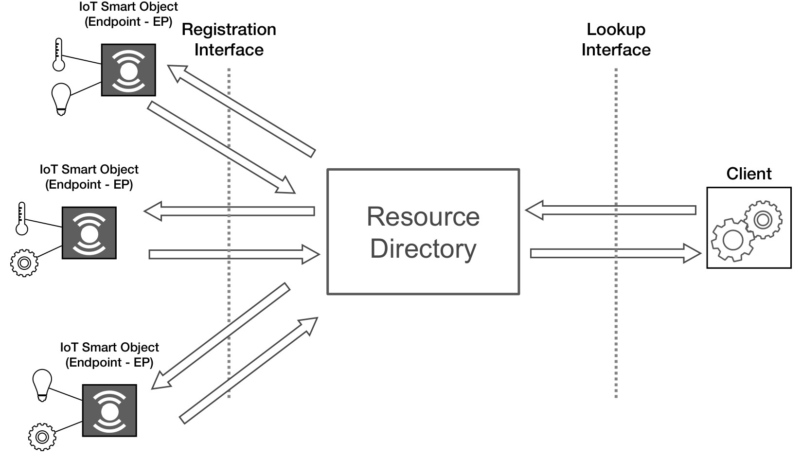

**Figure 6:** CoRE Resource Directory architecture: IoT Smart Objects (Endpoints) use the Registration Interface, while Clients use the Lookup Interface.

- The RD is a **repository of registrations** describing resources hosted on other web servers, called **endpoints (EP)**.
- An endpoint is a web server associated with a **scheme, IP address and port** (e.g., `coap://192.168.1.127:5683`). A physical node may host **one or more endpoints**.
- The RD implements a set of **REST interfaces**:
  - A **Registration Interface** for endpoints to register and maintain their registrations.
  - A **Lookup Interface** for clients to discover the links stored in the RD, using the **CoRE Link Format**.
- **Registrations are soft state:** they have a **lifetime** and need to be **periodically refreshed**, otherwise they are removed.
- At the first registration of an endpoint, a **registration resource** is created and its location is returned to the registering endpoint, which uses it to manage its registration.
- It is also possible for an RD to **fetch Web Links from endpoints** and add their content to the registrations.

---

## D.2 Finding the Resource Directory

Before using an RD, an endpoint must find it. The main options are:

- **Static IP address:** the endpoint is configured with a specific IP address of the RD. The address may also be an **anycast** address, allowing the network to forward RD requests to an RD that is **topologically close**.
- **DNS name:** the endpoint is configured with a DNS name of the RD and uses DNS to resolve its IP address.
- **Service discovery:** the endpoint uses a service discovery mechanism such as **DNS-SD** (RFC 6763), for example looking for the service name `rd._sub._coap._udp` within the domain of the querying node (see [E.3 ZeroConf: mDNS & DNS-SD](#e3-zeroconf-mdns--dns-sd)).
- **Multicast:** the endpoint sends a multicast `GET /.well-known/core?rt=core.rd*` request.

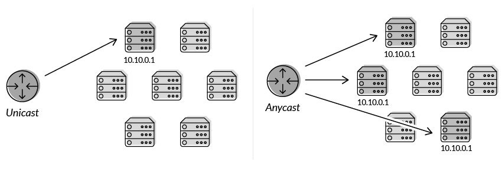

**Figure 7:** Unicast addressing (a single destination) vs. anycast addressing (the same address assigned to multiple nodes, the request is routed to the closest one).

> **Anycast** is a network addressing and routing methodology in which a single destination address has **multiple routing paths** to two or more endpoint destinations. Routers select the path on the basis of number of hops, distance, cost, latency or congestion. Anycast is widely used by **Content Delivery Networks (CDNs)** to bring content closer to the end users.

---

## D.3 URI Discovery

Before an endpoint can use an RD, it must know the RD's **address and port** and the **URI paths of its REST APIs**. These URIs are discovered using the well-known interface of the CoRE Link Format:

- The endpoint sends a (multicast or unicast) `GET` request to `/.well-known/core` including the Resource Type filter **`rt=core.rd*`**.

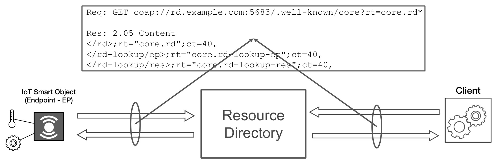

**Figure 8:** Discovery of the RD interfaces through `/.well-known/core`.

```
Req: GET coap://rd.example.com:5683/.well-known/core?rt=core.rd*

Res: 2.05 Content
</rd>;rt="core.rd";ct=40,
</rd-lookup/ep>;rt="core.rd-lookup-ep";ct=40,
</rd-lookup/res>;rt="core.rd-lookup-res";ct=40
```

| Resource Type | Interface |
|---------------|-----------|
| `core.rd` | Registration interface |
| `core.rd-lookup-ep` | Endpoint lookup interface |
| `core.rd-lookup-res` | Resource lookup interface |

---

## D.4 Registration

After discovering the RD, an endpoint (or a Commissioning Tool on its behalf) **registers its resources** using the **registration interface**:

- The endpoint sends a **`POST`** request containing the **list of its resources** in **CoRE Link Format** as payload.
- **Query parameters** indicate the **endpoint name** (`ep`, mandatory) and optionally the **sector** (`d`), the **lifetime** (`lt`, in seconds) and the **base URI** (`base`) of the registration.
- The RD replies with **`2.01 Created`** and a **`Location-Path`** option identifying the **registration resource**.

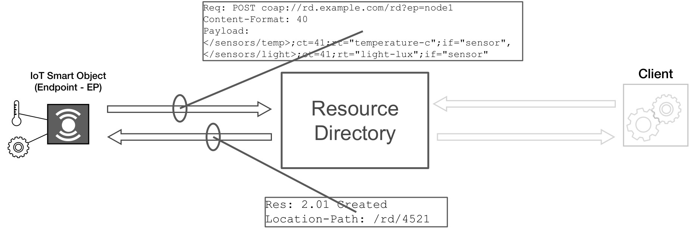

**Figure 9:** An endpoint registers its resources on the RD and receives the location of its registration resource.

```
Req: POST coap://rd.example.com/rd?ep=node1
Content-Format: 40
Payload:
</sensors/temp>;ct=41;rt="temperature-c";if="sensor",
</sensors/light>;ct=41;rt="light-lux";if="sensor"

Res: 2.01 Created
Location-Path: /rd/4521
```

---

## D.5 Registration Management

The RD specification defines further interactions to manage registrations:

- **Simple Registration:**
  - For very constrained endpoints, the endpoint sends an **empty `POST`** to `/.well-known/rd?ep=<name>`; the RD then **fetches** the links by sending a `GET /.well-known/core` to the endpoint.
- **Third-party Registration:**
  - A **Commissioning Tool (CT)** registers the resources **on behalf of** an endpoint (e.g., an endpoint that is unable to register itself), using the `base` parameter to indicate the endpoint address.
- **Registration Update:**
  - The endpoint sends a **`POST`** to its registration resource (e.g., `POST /rd/4521`), optionally with a new `lt` or `base`, to **refresh** the registration before its lifetime expires. The RD replies with `2.04 Changed`.
- **Registration Removal:**
  - The endpoint sends a **`DELETE`** to its registration resource (e.g., `DELETE /rd/4521`) when it leaves the network. The RD replies with `2.02 Deleted`.

> **Note:** Since registrations are **soft state**, an endpoint that disappears without removing its registration (e.g., because its battery is depleted) is automatically removed from the RD when its lifetime expires.

---

## D.6 Lookup Interface

To discover the resources registered in the RD, a **lookup interface** is provided:

- RD Lookup allows lookups for **endpoints** and **resources** using attributes defined both by the RD specification and by the CoRE Link Format.
- The result of a lookup request is the **list of links** (if any) corresponding to the type of lookup:
  - An **endpoint lookup** returns a list of **endpoints** (registration resources).
  - A **resource lookup** returns a list of **links to resources**.

| Lookup Type | Resource Type          | Mandatory |
|-------------|------------------------|-----------|
| Resource    | `core.rd-lookup-res`   | Mandatory |
| Endpoint    | `core.rd-lookup-ep`    | Mandatory |

---

### D.6.1 Resource Lookup

A resource lookup returns links that are **semantically equivalent** to the links submitted to the RD, except that the **targets are fully resolved** (absolute URIs including the endpoint address). Lookup **filtering** can be applied to target a specific group of resources.

```
Req: GET /rd-lookup/res?rt=temperature

Res: 2.05 Content
<coap://[2001:db8:3::123]:61616/temp>;rt="temperature"
```

---

### D.6.2 Resource Lookup with Observation

A client that wants to be **notified of new resources** as they show up can **observe** the lookup resource.

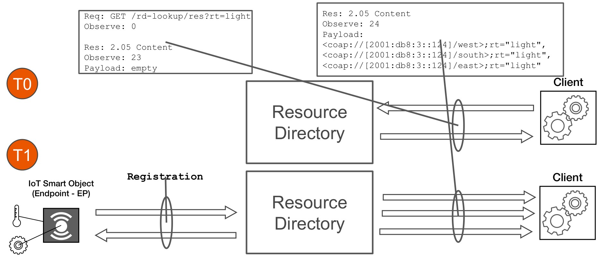

**Figure 10:** At T0 the client observes the resource lookup for `rt=light` and receives an empty list; at T1 a new endpoint registers light resources and the client receives a notification with the new links.

```
T0 - Req: GET /rd-lookup/res?rt=light
          Observe: 0

     Res: 2.05 Content
          Observe: 23
          Payload: empty

T1 - (an endpoint registers three light resources)

     Res: 2.05 Content
          Observe: 24
          Payload:
          <coap://[2001:db8:3::124]/west>;rt="light",
          <coap://[2001:db8:3::124]/south>;rt="light",
          <coap://[2001:db8:3::124]/east>;rt="light"
```

---

### D.6.3 Paginated Lookup

A client can perform a **paginated** resource lookup using the `page` (page index) and `count` (page length) parameters:

```
Req: GET /rd-lookup/res?page=0&count=5

Res: 2.05 Content
<coap://[2001:db8:3::123]:61616/res/0>;rt=sensor;ct=60,
<coap://[2001:db8:3::123]:61616/res/1>;rt=sensor;ct=60,
<coap://[2001:db8:3::123]:61616/res/2>;rt=sensor;ct=60,
<coap://[2001:db8:3::123]:61616/res/3>;rt=sensor;ct=60,
<coap://[2001:db8:3::123]:61616/res/4>;rt=sensor;ct=60
```

> **Note:** Pagination is particularly important for constrained clients, which may not be able to receive or process the complete list of links registered in a large RD.

---

### D.6.4 Endpoint Lookup

The endpoint lookup returns **registration resources**, which can only be manipulated by the registering endpoint. They are annotated with:

- The **endpoint name** (`ep`).
- The **sector** (`d`), if present.
- The **registration base URI** (`base`), reporting the registrant endpoint's address.
- The **endpoint type** (`et`).
- A constant resource type `rt="core.rd-ep"`.

The **lifetime** (`lt`) is not reported.

```
Req: GET /rd-lookup/ep?et=oic.d.sensor

Res: 2.05 Content
</rd/1234>;base="coap://[2001:db8:3::127]:61616";ep="node5";
  et="oic.d.sensor";ct=40;rt="core.rd-ep",
</rd/4521>;base="coap://[2001:db8:3::129]:61616";ep="node7";
  et="oic.d.sensor";ct=40;d="floor-3";rt="core.rd-ep"
```

---

# E. Service Discovery

## E.1 Service Discovery in IoT Networks

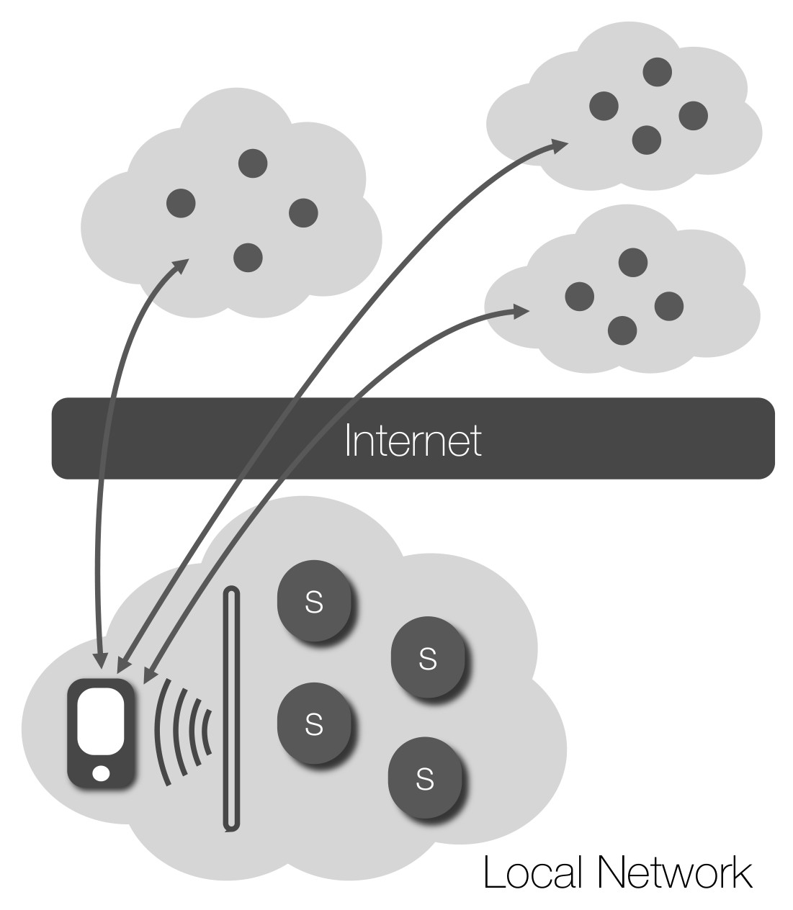

**Figure 11:** Service discovery can target services available in the local network or in other networks reachable through the Internet.

**Service Discovery (SD)** is a fundamental component in **dynamic environments**, allowing consumer devices and applications to **find and interact with available services**.

**Scope:**

- **In the local network:**
  - *Example:* automatically discovering the printers, displays and smart devices of a building after connecting to its Wi-Fi network.
- **Across different networks:**
  - *Example:* *"Which services are available around me now?"* within a target geographic region.

**Technologies:**

- **Central infrastructure or repository** (e.g., a Resource Directory, a DNS server).
- **Distributed or peer-to-peer architectures.**
- **Multicast-based protocols** (e.g., mDNS, SSDP, CoAP multicast).

---

## E.2 Service Discovery in CoAP

As part of discovering the services offered by a CoAP server, a client has to learn about the **endpoint** used by the server:

- A server is discovered by a client **knowing or learning a URI** that references a resource in the namespace of the server.
- The **default CoAP port 5683 must be supported** by a server that offers resources for resource discovery and **should be supported** for providing access to other resources.
- The **default port 5684** for **DTLS-secured CoAP** may be supported for resource discovery and for providing access to other resources.
- Other endpoints may be hosted at other ports (e.g., in the dynamic port space).

**How can a CoAP client find out which services are available?**

- Service discovery aims at obtaining the **host and port** of the CoAP servers in the network.
- Clients can discover services in many ways, such as by sending a **multicast message** to the **"All CoAP Nodes"** group.
- Several service discovery mechanisms have been defined and extensively treated in the literature: **UPnP**, **Service Location Protocol (SLP)**, **ZeroConf**, etc.

---

## E.3 ZeroConf: mDNS & DNS-SD

**ZeroConf** (Zero-configuration networking) is a set of technologies that allows hosts to be **automatically interconnected** with **no prior configuration**. It implements three main functionalities:

- **Automatic network address assignment** (e.g., link-local addresses, RFC 3927 for IPv4).
- **Automatic distribution and resolution of host names** through **Multicast DNS (mDNS, RFC 6762)**:
  - mDNS uses the **semantics of unicast DNS** to provide host name resolution in the local network (`.local` domain) **without a DNS server**, sending queries to a multicast address (`224.0.0.251` / `ff02::fb`, UDP port 5353).
- **Automatic location of network services** through **DNS-Based Service Discovery (DNS-SD, RFC 6763)**:
  - DNS-SD allows discovering a **list of services in a domain** through **standard DNS queries** (`PTR`, `SRV` and `TXT` records).

Well-known implementations are **Apple Bonjour** and **Avahi** (Linux).

**ZeroConf Service Types:**

- Service types have the form `_<service_name>._<protocol>.<domain>`:
  - `_http._tcp.local` for HTTP servers.
  - `_coap._udp.local` for CoAP servers.
- A **CoAP server** advertises its presence by sending an **mDNS message** for the service type `_coap._udp.local` in the network.
- An **HTTP-to-CoAP proxy** can similarly advertise its presence with a dedicated service type (e.g., `_httpcoap._udp.local`).
- **mDNS resolution** allows finding the **host and port** (IP address and port) of the advertised service.
- Once the host and port are known, the list of resources can be retrieved by sending a CoAP **`GET /.well-known/core`** request.
- Lightweight formats such as **JSON** can be used in TXT records or dedicated resources to further **describe services and resources**.

> **Summary:** ZeroConf combines **service discovery** (finding the CoAP server) with CoAP **resource discovery** (finding its resources) in a fully automatic way within the local network.

---

## E.4 UPnP - Universal Plug and Play

With an intent similar to ZeroConf, the **Universal Plug and Play (UPnP)** protocol suite provides a way to perform **dynamic and seamless discovery of devices** in a network, without relying on DHCP and DNS servers.

- UPnP has been defined by the **UPnP Forum** (now part of the Open Connectivity Foundation).
- It uses **HTTP over UDP** and **HTTP over multicast UDP** (**SSDP** - Simple Service Discovery Protocol, on `239.255.255.250:1900`) for discovery, **XML** for device and service descriptions, and **SOAP** for control.
- UPnP suits **home appliances** rather than enterprise-level deployments, due to its **security and efficiency issues**.
- Many consumer-oriented smart objects, such as **Philips Hue** bridges, have used UPnP/SSDP as a zero-configuration discovery mechanism.

---

## E.5 URI Beacons & the Physical Web

The **Physical Web**, a concept promoted by **Google**, is a different approach to provide seamless discovery of and interaction with smart objects.

- **Assumption:** the web itself provides all the necessary means for a fruitful interaction with any endpoint, be it a website or an object.
- The only operation needed to merge the physical world and the web is to **discover the URL** of a web resource linked to a smart object.
- After that, a **web browser** (or a client) can deliver a **user interface** to the end user, who uses it to interact with the object (mediated by a **backend** that is actually connected to the object).

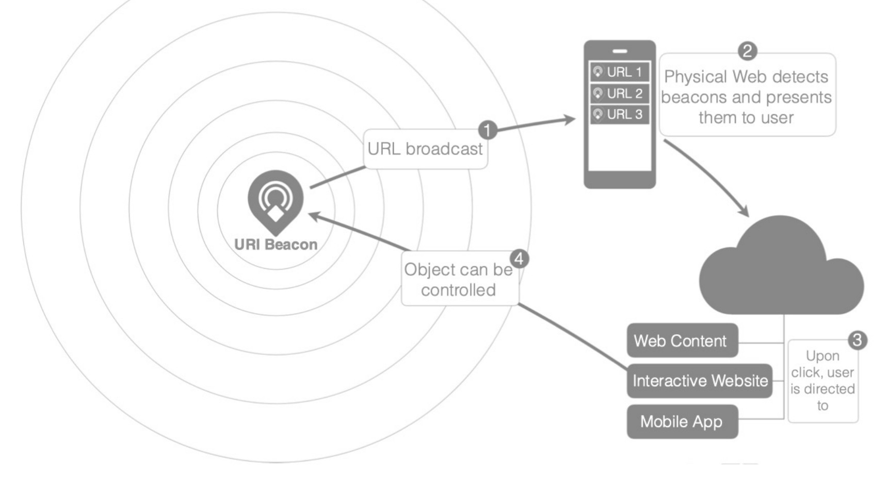

**Figure 12:** The Physical Web flow: (1) a URI Beacon broadcasts a URL; (2) the user device detects the beacons and presents them to the user; (3) upon click the user is directed to web content, an interactive website or a mobile app; (4) the object can be controlled.

**URI Beacons & Eddystone:**

- The discovery mechanism of the Physical Web is based on **URI beacons**, i.e., **Bluetooth Low Energy (BLE)** devices **broadcasting URLs**.
- The format for data broadcasting over BLE is **Eddystone**, designed by Google, which defines four packet types:
  - **Eddystone-UID:** contains a beacon identifier.
  - **Eddystone-URL:** broadcasts a (compressed) URL.
  - **Eddystone-TLM:** sends telemetry information (e.g., battery level, temperature).
  - **Eddystone-EID:** carries ephemeral, rotating IDs to protect against replay attacks and spoofing.

**Advantages & Drawbacks:**

- **Advantage:** objects can be discovered and used **even if the user device is not connected to the same network**.
- **Drawback:** the interaction might **not take into account context information** related to the association of the user device with the network.
- **Security:** openly broadcasting object URLs may be **unsafe** in some scenarios, and it may be impossible to **restrict discovery** to authorized devices only.
- The Physical Web is therefore particularly suited to **public spaces**, where no restricted access to objects is needed (e.g., museums, bus stops, shops).

> **Note:** Google discontinued the Physical Web support in Chrome and the related Nearby Notifications service in 2018. The approach remains a relevant design pattern, and BLE beacons (e.g., Eddystone, Apple iBeacon) are still widely used for proximity-based discovery and indoor localization.

---

# F. Discovery Mechanisms Summary

| Mechanism | Type | Scope | Infrastructure | Typical Use |
|-----------|------|-------|----------------|-------------|
| `/.well-known/core` (CoRE Link Format) | Resource discovery | Single endpoint (unicast) or local group (multicast) | None | Learning the resources of a known CoAP/HTTP server |
| CoRE Resource Directory | Resource discovery | Local or global | RD server | Sleepy nodes, large deployments, lookup with filters and observation |
| CoAP multicast ("All CoAP Nodes") | Service & resource discovery | Local network | None | Finding CoAP servers in the local network |
| ZeroConf (mDNS + DNS-SD) | Service discovery | Local network (DNS-SD also global) | None (mDNS) / DNS server | Finding CoAP/HTTP servers and proxies by service type |
| UPnP (SSDP) | Service discovery | Local network | None | Home appliances and consumer devices |
| URI Beacons (Eddystone) | Service discovery | Physical proximity (BLE) | Web backend | Public spaces, proximity-based interaction |

**Summary:**
Resource and service discovery are the building blocks that allow IoT systems to be **dynamic**, **self-configuring** and **interoperable**: **service discovery** finds the endpoints available in a network, **resource discovery** (CoRE Link Format and Resource Directory) describes what they offer through **machine-understandable links and attributes**, and standard data formats such as **SenML** allow consumers to interpret the exchanged data without prior configuration.

---

# References

- Z. Shelby, *Constrained RESTful Environments (CoRE) Link Format*, RFC 6690, IETF, August 2012 - [https://www.rfc-editor.org/rfc/rfc6690](https://www.rfc-editor.org/rfc/rfc6690)
- M. Nottingham, *Web Linking*, RFC 8288, IETF, October 2017 (obsoletes RFC 5988) - [https://www.rfc-editor.org/rfc/rfc8288](https://www.rfc-editor.org/rfc/rfc8288)
- K. Hartke, *Observing Resources in the Constrained Application Protocol (CoAP)*, RFC 7641, IETF, September 2015 - [https://www.rfc-editor.org/rfc/rfc7641](https://www.rfc-editor.org/rfc/rfc7641)
- Z. Shelby, M. Koster, C. Groves, J. Zhu, B. Silverajan, *Reusable Interface Definitions for Constrained RESTful Environments* (CoRE Interfaces), Internet Draft `draft-ietf-core-interfaces` - [https://datatracker.ietf.org/doc/draft-ietf-core-interfaces/](https://datatracker.ietf.org/doc/draft-ietf-core-interfaces/)
- C. Jennings, Z. Shelby, J. Arkko, A. Keränen, C. Bormann, *Sensor Measurement Lists (SenML)*, RFC 8428, IETF, August 2018 - [https://www.rfc-editor.org/rfc/rfc8428](https://www.rfc-editor.org/rfc/rfc8428)
- C. Amsüss, Z. Shelby, M. Koster, C. Bormann, P. van der Stok, *CoRE Resource Directory*, RFC 9176, IETF, April 2022 - [https://www.rfc-editor.org/rfc/rfc9176](https://www.rfc-editor.org/rfc/rfc9176)
- Z. Shelby, K. Hartke, C. Bormann, *The Constrained Application Protocol (CoAP)*, RFC 7252, IETF, June 2014 - [https://www.rfc-editor.org/rfc/rfc7252](https://www.rfc-editor.org/rfc/rfc7252)
- S. Cheshire, M. Krochmal, *Multicast DNS*, RFC 6762, IETF, February 2013 - [https://www.rfc-editor.org/rfc/rfc6762](https://www.rfc-editor.org/rfc/rfc6762)
- S. Cheshire, M. Krochmal, *DNS-Based Service Discovery*, RFC 6763, IETF, February 2013 - [https://www.rfc-editor.org/rfc/rfc6763](https://www.rfc-editor.org/rfc/rfc6763)
- J. Gregorio et al., *URI Template*, RFC 6570, IETF, March 2012 - [https://www.rfc-editor.org/rfc/rfc6570](https://www.rfc-editor.org/rfc/rfc6570)
- Open Connectivity Foundation - UPnP Device Architecture - [https://openconnectivity.org/developer/specifications/upnp-resources/upnp/](https://openconnectivity.org/developer/specifications/upnp-resources/upnp/)
- Google - Eddystone Format - [https://github.com/google/eddystone](https://github.com/google/eddystone)
- Google - The Physical Web - [https://google.github.io/physical-web/](https://google.github.io/physical-web/)
- IETF CoRE Working Group Documents - [https://datatracker.ietf.org/wg/core/documents/](https://datatracker.ietf.org/wg/core/documents/)
