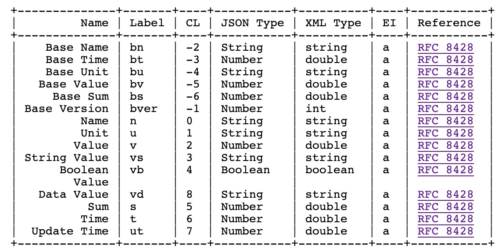
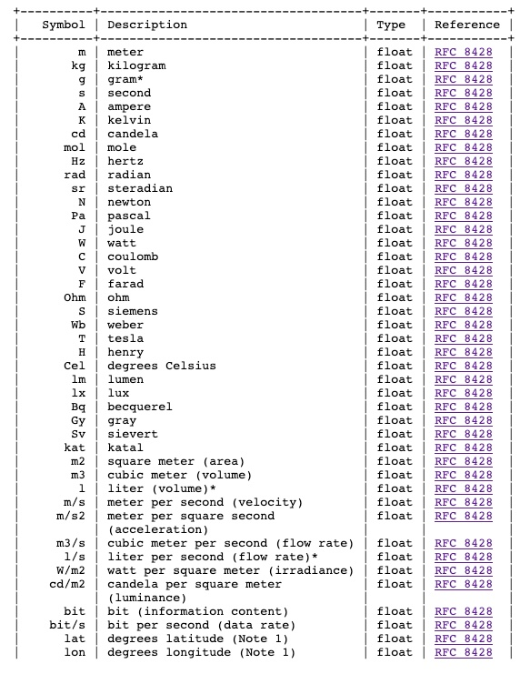

<!-- omit in toc -->
# Sensor Measurement Lists (SenML)

<!-- omit in toc -->
## Lecture Information

| **Lecture Title**   | Sensor Measurement Lists (SenML)                                                 |
|---------------------|----------------------------------------------------------------------------------|
| **Author**          | Prof. Marco Picone (marco.picone@unimore.it)                                     |
| **License**         | [Creative Commons Attribution 4.0](https://creativecommons.org/licenses/by/4.0/) | 


<!-- omit in toc -->
# Table of Contents

- [A. Introduction to SenML](#a-introduction-to-senml)
  - [A.1 Why a Standard for Measurements](#a1-why-a-standard-for-measurements)
  - [A.2 Media Types](#a2-media-types)
- [B. Terminology](#b-terminology)
- [C. Structure \& Semantics](#c-structure--semantics)
  - [C.1 Base Fields](#c1-base-fields)
  - [C.2 Regular Fields](#c2-regular-fields)
  - [C.3 Time](#c3-time)
  - [C.4 Resolving a SenML Pack](#c4-resolving-a-senml-pack)
- [D. SenML Labels](#d-senml-labels)
- [E. SenML Units](#e-senml-units)
- [F. Examples](#f-examples)
  - [F.1 Single Data Point](#f1-single-data-point)
  - [F.2 Multiple Data Points](#f2-multiple-data-points)
  - [F.3 Multiple Measurements](#f3-multiple-measurements)
  - [F.4 Multiple Data Types](#f4-multiple-data-types)
  - [F.5 Collection of Resources](#f5-collection-of-resources)
  - [F.6 Energy Meter](#f6-energy-meter)
- [G. Actuation](#g-actuation)
- [H. Extensibility](#h-extensibility)
- [I. Encodings \& Size Comparison](#i-encodings--size-comparison)
  - [I.1 SenML-CBOR](#i1-senml-cbor)
- [J. Python: Creating and Parsing SenML](#j-python-creating-and-parsing-senml)
  - [J.1 Create a SenML Message](#j1-create-a-senml-message)
  - [J.2 Parse and Resolve a SenML Message](#j2-parse-and-resolve-a-senml-message)
  - [J.3 Encode and Decode SenML-CBOR](#j3-encode-and-decode-senml-cbor)
- [K. Common Pitfalls](#k-common-pitfalls)
- [References](#references)

# A. Introduction to SenML

Connecting sensors to the Internet is not new, and many protocols have been designed to facilitate it. **Sensor Measurement Lists (SenML)**, standardized in **RFC 8428**, defines a data model and a set of media types for carrying **simple sensor measurements** and **device parameters** in protocols such as **HTTP**, **CoAP** and **MQTT**.

**Design Goals:**

- Processors with **very limited capabilities** can easily **encode** a sensor measurement.
- A server parsing the data can **efficiently collect** a large number of sensor measurements.

**Data Model & Serializations:**

- A SenML message, called **Pack**, is a **single array** containing a series of **SenML Records**.
- Each Record can contain fields such as a **unique identifier** for the sensor, the **time** of the measurement, the **unit** and the current **value**, using **short field names** (e.g., `n`, `u`, `v`, `t`).
- The common data model is serialized in **JSON**, **CBOR**, **XML** and **EXI** (Efficient XML Interchange).

**Example:** a measurement from a temperature gauge encoded in JSON:

```json
[
  {"n":"urn:dev:ow:10e2073a01080063","u":"Cel","v":23.1}
]
```

The array has a single SenML Record meaning: *the sensor `urn:dev:ow:10e2073a01080063` measured 23.1 degrees Celsius, now*.

SenML is used, for example, by the **OMA LwM2M** device management protocol, it is the payload format of the CoRE Interfaces for sensors and actuators, and it is a common payload option for **CoAP** and **MQTT** telemetry.

---

## A.1 Why a Standard for Measurements

With plain JSON, different developers often define **different structures for the same information**:

```json
{"device_id": "temp-sensor-01", "value": 21.5, "unit": "C", "timestamp": 1727535600000}
```

```json
{"sensor": "temp-sensor-01", "temperature": 21.5, "ts": "2024-09-28T15:00:00Z"}
```

Both are valid JSON, but a consumer typically needs to know each specific structure (field names, unit symbols, time format) to understand them. SenML standardizes these choices:

- **Standard field names** (`n`, `v`, `u`, `t`, ...).
- **Standard unit symbols** (`Cel`, `%RH`, `W`, `lx`, ...), registered by IANA.
- **Standard time representation** (seconds since the Unix epoch, as a number).
- **Base values** to avoid repeating the same information in every record, keeping messages small.
- The **same data model** can be encoded in JSON, CBOR, XML and EXI.

> **Summary:** SenML allows devices from different vendors and applications written by different teams to exchange measurements **without prior agreement** on a custom message structure.

---

## A.2 Media Types

| Media Type                  | CoAP Content-Format |
|-----------------------------|---------------------|
| `application/senml+json`    | 110                 |
| `application/senml+cbor`    | 112                 |
| `application/senml+xml`     | 310                 |
| `application/senml-exi`     | 311                 |

Using the specific media type (e.g., in the CoAP `Content-Format` option or in the HTTP `Content-Type` header) tells the receiver that the payload is not just generic JSON or CBOR, but a SenML Pack.

---

# B. Terminology

- **SenML Record:** one measurement or configuration instance in time, represented using the SenML data model.
- **SenML Pack:** one or more SenML Records in an array structure.
- **SenML Label:** a short name used in SenML Records to denote different SenML fields (e.g., `v` for *value*).
- **SenML Field:** a component of a Record that associates a value to a SenML Label.
- **SenSML:** Sensor **Streaming** Measurement List.
- **SenSML Stream:** one or more SenML Records to be processed as a stream.

---

# C. Structure & Semantics

Each SenML Pack carries a **single array** representing a set of measurements and/or parameters. Records contain two kinds of fields:

- **Base Fields:** apply to the entries in the Record **and to all the following Records**, up to (but not including) the next Record that contains the same base field. All base fields are optional.
- **Regular Fields:** apply **only to the Record** in which they appear.

---

## C.1 Base Fields

| Field  | Name         | Type   | Meaning |
|--------|--------------|--------|---------|
| `bn`   | Base Name    | String | String **prepended** to the names found in the entries (e.g., the device identifier). |
| `bt`   | Base Time    | Number | Base time **added** to the time found in an entry. |
| `bu`   | Base Unit    | String | Unit assumed for all entries, unless a Record contains its own Unit. |
| `bv`   | Base Value   | Number | Base value **added** to the value found in an entry, similar to Base Time. |
| `bs`   | Base Sum     | Number | Base sum **added** to the sum found in an entry. |
| `bver` | Base Version | Number | Version number of the media type format; optional positive integer that **defaults to 10**. |

**Example - Base Name:** to keep messages small, the name does not have to be repeated in each Record:

```json
[
  {"n":"urn:dev:ow:10e2073a01080063","u":"Cel","t":1.276020076e+09,"v":23.5},
  {"n":"urn:dev:ow:10e2073a01080063","u":"Cel","t":1.276020091e+09,"v":23.6}
]
```

can be written in a more compact form as:

```json
[
  {"bn":"urn:dev:ow:10e2073a01080063","u":"Cel","t":1.276020076e+09,"v":23.5},
  {"u":"Cel","t":1.276020091e+09,"v":23.6}
]
```

Here the Base Name is in the `bn` field and the `n` fields are empty strings, so they are omitted.

---

## C.2 Regular Fields

| Field | Name          | Type    | Meaning |
|-------|---------------|---------|---------|
| `n`   | Name          | String  | Name of the sensor or parameter. Concatenated with the Base Name, it must result in a **globally unique identifier**. |
| `u`   | Unit          | String  | Unit of the measurement (from the SenML Units registry). |
| `v`   | Value         | Number  | Numeric value. |
| `vs`  | String Value  | String  | Text value. |
| `vb`  | Boolean Value | Boolean | Boolean value. |
| `vd`  | Data Value    | String  | Binary data encoded in **base64url**. |
| `s`   | Sum           | Number  | Integrated sum of the values over time (e.g., total energy). |
| `t`   | Time          | Number  | Time of the measurement in seconds. |
| `ut`  | Update Time   | Number  | Maximum time before the sensor will provide an updated reading. |

According to RFC 8428, a Record has a (resolved) name and **exactly one value field** among `v`, `vs`, `vb`, `vd` (or a sum `s`).

---

## C.3 Time

Time is a number in **seconds** (floating-point values are allowed for sub-second precision):

- Values **≥ 2<sup>28</sup>** (268,435,456) are **absolute** times: seconds since 1970-01-01 (Unix epoch).
- Values **< 2<sup>28</sup>** are **relative** to the current time: `0` (or missing) means *now*, `-5` means *5 seconds ago*.

> **Note:** SenML times are in **seconds**, not milliseconds: this is a common mistake when the timestamp comes from JavaScript `Date.now()` or from other systems using milliseconds.

---

## C.4 Resolving a SenML Pack

**Resolving** a Pack means applying the base fields to every Record, obtaining **self-contained Records**:

- **name** = `bn` + `n`
- **time** = `bt` + `t` (and, if the result is relative, converted to absolute)
- **unit** = `u` if present, otherwise `bu`
- **value** = `bv` + `v`

For example, the following time series of the same sensor (where `bt`, `bu` and relative `t` keep each Record very small):

```json
[
  {"bn": "urn:dev:mac:0024befffe804ff1:temperature", "bt": 1727535600, "bu": "Cel", "v": 21.5, "t": 0},
  {"v": 21.7, "t": 10},
  {"v": 21.4, "t": 20},
  {"v": 21.3, "t": 30}
]
```

resolves to:

```json
[
  {"n": "urn:dev:mac:0024befffe804ff1:temperature", "u": "Cel", "v": 21.5, "t": 1727535600},
  {"n": "urn:dev:mac:0024befffe804ff1:temperature", "u": "Cel", "v": 21.7, "t": 1727535610},
  {"n": "urn:dev:mac:0024befffe804ff1:temperature", "u": "Cel", "v": 21.4, "t": 1727535620},
  {"n": "urn:dev:mac:0024befffe804ff1:temperature", "u": "Cel", "v": 21.3, "t": 1727535630}
]
```

> **Summary:** The **compact form** is used on the network, while the **resolved form** is easier to process and store (e.g., in a database or in a CSV file).

---

# D. SenML Labels

| Name          | Label  | CBOR Label | JSON Type | XML Type |
|---------------|--------|------------|-----------|----------|
| Base Name     | `bn`   | -2         | String    | string   |
| Base Time     | `bt`   | -3         | Number    | double   |
| Base Unit     | `bu`   | -4         | String    | string   |
| Base Value    | `bv`   | -5         | Number    | double   |
| Base Sum      | `bs`   | -6         | Number    | double   |
| Base Version  | `bver` | -1         | Number    | int      |
| Name          | `n`    | 0          | String    | string   |
| Unit          | `u`    | 1          | String    | string   |
| Value         | `v`    | 2          | Number    | double   |
| String Value  | `vs`   | 3          | String    | string   |
| Boolean Value | `vb`   | 4          | Boolean   | boolean  |
| Data Value    | `vd`   | 8          | String    | string   |
| Sum           | `s`    | 5          | Number    | double   |
| Time          | `t`    | 6          | Number    | double   |
| Update Time   | `ut`   | 7          | Number    | double   |



**Figure 1:** The SenML Labels IANA registry (RFC 8428).

**SenML Labels Registry:**

- IANA maintains a registry for SenML Labels called the **"SenML Labels" registry**, whose initial content is the table above.
- New entries must define the **Name**, **Label** and **XML Type**; the **CBOR label** should be left empty, as CBOR will use the string encoding for new labels.
- The **EI** column contains the EXI schemaId value of the first schema that includes the label.
- The **JSON, CBOR and EXI types are derived from the XML type**: all XML numeric types (double, float, integer, int) become a JSON Number; XML boolean and string become a JSON Boolean and String.

> **Note:** **CBOR labels are small integers** instead of strings: this is one of the reasons why the CBOR serialization is much more compact than the JSON one.

---

# E. SenML Units

IANA also maintains a **"SenML Units" registry** of unit symbols. Its primary purpose is to make sure that **symbols uniquely map to a type of measurement**.

- Most units are **unscaled SI units** (e.g., `m`, `kg`, `s`, `A`, `K`, `Cel`, `W`, `V`, `lx`, `Pa`).
- Additional units cover common IoT quantities (e.g., `%RH` relative humidity, `%EL` remaining battery level, `dBW`, `count`, `/` for ratios such as the value of a switch, `lat` and `lon` for geographic coordinates).
- Units marked with an asterisk are **not recommended** to be produced by new implementations, but are in active use and **should be implemented by consumers**.

**Some common units:**

| Unit  | Meaning                            | Unit  | Meaning                               |
|-------|------------------------------------|-------|---------------------------------------|
| `Cel` | degrees Celsius                    | `%RH` | relative humidity (%)                 |
| `K`   | kelvin                             | `%EL` | remaining battery energy level (%)    |
| `Pa`  | pascal (pressure)                  | `lx`  | lux (illuminance)                     |
| `W`   | watt (power)                       | `J`   | joule (energy)                        |
| `V`   | volt                               | `A`   | ampere                                |
| `m`   | meter                              | `m/s` | meters per second                     |
| `s`   | second                             | `/`   | ratio (e.g., 0.5)                     |
| `lat` | degrees latitude                   | `lon` | degrees longitude                     |
| `Hz`  | hertz (frequency)                  | `%`   | percent                               |

> **Note:** Celsius is `Cel`, not `C` (which is the symbol of the **coulomb**!).



**Figure 2:** An excerpt of the SenML Units IANA registry (RFC 8428).

---

# F. Examples

## F.1 Single Data Point

A temperature reading taken approximately *"now"* by a 1-wire sensor device with the unique 1-wire address `10e2073a01080063`:

```json
[
  {"n":"urn:dev:ow:10e2073a01080063","u":"Cel","v":23.1}
]
```

---

## F.2 Multiple Data Points

Voltage and current *"now"*, i.e., at an unspecified time:

```json
[
  {"bn":"urn:dev:ow:10e2073a01080063:","n":"voltage","u":"V","v":120.1},
  {"n":"current","u":"A","v":1.2}
]
```

The next example is similar, but it shows the current at `Tue Jun 8 18:01:16.001 UTC 2010` and at each second for the previous 5 seconds (**relative times** with respect to the Base Time):

```json
[
  {"bn":"urn:dev:ow:10e2073a0108006:","bt":1.276020076001e+09,
   "bu":"A","bver":5,
   "n":"voltage","u":"V","v":120.1},
  {"n":"current","t":-5,"v":1.2},
  {"n":"current","t":-4,"v":1.3},
  {"n":"current","t":-3,"v":1.4},
  {"n":"current","t":-2,"v":1.5},
  {"n":"current","t":-1,"v":1.6},
  {"n":"current","v":1.7}
]
```

---

## F.3 Multiple Measurements

Humidity measurements from a mobile device with 1-wire address `10e2073a01080063`, starting at `Mon Oct 31 13:24:24 UTC 2011`. The device also provides **position data** in the same array as separate entries: **time is used to correlate** data that belongs together (e.g., a measurement and the position at which it was taken). The device also reports its **battery status** at a separate time.

```json
[
  {"bn":"urn:dev:ow:10e2073a01080063","bt":1.320067464e+09,
   "bu":"%RH","v":20},
  {"u":"lon","v":24.30621},
  {"u":"lat","v":60.07965},
  {"t":60,"v":20.3},
  {"u":"lon","t":60,"v":24.30622},
  {"u":"lat","t":60,"v":60.07965},
  {"t":120,"v":20.7},
  {"u":"lon","t":120,"v":24.30623},
  {"u":"lat","t":120,"v":60.07966},
  {"u":"%EL","t":150,"v":98},
  {"t":180,"v":21.2},
  {"u":"lon","t":180,"v":24.30628},
  {"u":"lat","t":180,"v":60.07967}
]
```

---

## F.4 Multiple Data Types

A sensor that returns **different data types** (number, string, boolean and binary data):

```json
[
  {"bn":"urn:dev:ow:10e2073a01080063:","n":"temp","u":"Cel","v":23.1},
  {"n":"label","vs":"Machine Room"},
  {"n":"open","vb":false},
  {"n":"nfc-reader","vd":"aGkgCg"}
]
```

---

## F.5 Collection of Resources

The result of a query to one device that **aggregates measurements from other devices**. A client fetched information from the device at `2001:db8::2` (at `Mon Oct 31 16:27:09 UTC 2011`), obtaining a temperature and a humidity measurement, together with the results from another device at `2001:db8::1`:

```json
[
  {"bn":"2001:db8::2/","bt":1.320078429e+09,
   "n":"temperature","u":"Cel","v":25.2},
  {"n":"humidity","u":"%RH","v":30},
  {"bn":"2001:db8::1/","n":"temperature","u":"Cel","v":12.3},
  {"n":"humidity","u":"%RH","v":67}
]
```

> **Note:** The last Record uses the **Base Name of the third Record** (`2001:db8::1/`) but the **Base Time of the first Record**, since a base field applies until a new value for the same base field is found.

---

## F.6 Energy Meter

An energy meter reporting both the **instantaneous power** (value) and the **cumulative energy** (sum):

```json
[
  {"bn": "urn:dev:mac:0024befffe804ff2:", "n": "power", "u": "W", "v": 1250.5},
  {"n": "energy", "u": "J", "s": 45810000}
]
```

---

# G. Actuation

SenML can also be used to **send commands** to actuators.

**Example 1 - Thermostat:** setting the set point of a residential thermostat that has a temperature set point, a switch to turn the heat on and off, and a switch to turn on the fan override:

```json
[
  {"bn":"urn:dev:ow:10e2073a01080063:"},
  {"n":"temp","u":"Cel","v":23.1},
  {"n":"heat","u":"/","v":1},
  {"n":"fan","u":"/","v":0}
]
```

**Example 2 - Synchronized lights (deterministic network):** two lights are turned on at the same time. The network guarantees the delivery of the messages within 15 ms (e.g., using IEEE 802.1BA and 802.1AS for time synchronization), so the controller sets the time at which the lights must switch on 20 ms in the future: both lights receive the message, wait until that time and then switch on simultaneously.

```json
[
  {"bt":1.320078429e+09,"bu":"/","n":"2001:db8::3","v":1},
  {"n":"2001:db8::4","v":1}
]
```

**Example 3 - Perceived synchronization (non-deterministic network):** two lights are turned off using a network that has high odds of delivering a message in less than 100 ms and uses NTP for time synchronization. Both lights are **immediately dimmed to 50%** to give the user instant feedback, and **100 ms later** both lights go off at the same time.

```json
[
  {"bt":1.320078429e+09,"bu":"/","n":"2001:db8::3","v":0.5},
  {"n":"2001:db8::4","v":0.5},
  {"n":"2001:db8::3","t":0.1,"v":0},
  {"n":"2001:db8::4","t":0.1,"v":0}
]
```

The instant (but not synchronized) dimming gives the sensation of a quick response, while the timed switch-off gives the perception of both lights going off at the same time.

---

# H. Extensibility

- The SenML format can be **extended with custom fields**: both new **base** and **regular** fields are allowed (following the Labels Registry rules).
- Implementations **must ignore fields they do not recognize**, unless the label name **ends with the `_` character**: in this case an **error must be generated** (*must-understand* fields).
- All SenML Records in a Pack **must have the same version number**, typically by adding a Base Version field only to the first Record or by using the default value.
- Systems reading a Pack **must check the Base Version**: if it is larger than the version they understand, they **must not use** the Pack.
- New version numbers can only be defined in an RFC that updates the SenML specification.

---

# I. Encodings & Size Comparison

The same SenML Pack (the *Multiple Measurements* example of [F.3](#f3-multiple-measurements)) has a very different size depending on the serialization:

| Encoding | Size (bytes) | Compressed Size (bytes) |
|----------|--------------|-------------------------|
| JSON     | 573          | 206                     |
| XML      | 649          | 235                     |
| CBOR     | 254          | 196                     |
| EXI      | 161          | 184                     |

> **Summary:** Binary serializations (**CBOR**, **EXI**) are significantly more compact than textual ones (**JSON**, **XML**) and are preferred on constrained devices and networks, while JSON remains convenient for debugging and integration with web applications.

---

## I.1 SenML-CBOR

For constrained devices the **CBOR** representation (`application/senml+cbor`, CoAP Content-Format `112`) is usually more compact, because **field names are replaced by small integers** (the CBOR labels of [D. SenML Labels](#d-senml-labels)):

| JSON label | `bver` | `bn` | `bt` | `bu` | `bv` | `bs` | `n` | `u` | `v` | `vs` | `vb` | `s` | `t` | `ut` | `vd` |
|------------|--------|------|------|------|------|------|-----|-----|-----|------|------|-----|-----|------|------|
| CBOR label | -1     | -2   | -3   | -4   | -5   | -6   | 0   | 1   | 2   | 3    | 4    | 5   | 6   | 7    | 8    |

For example, the Pack:

```json
[
  {"bn": "env-node-01:", "bt": 1727535600, "n": "temperature", "u": "Cel", "v": 21.5},
  {"n": "humidity", "u": "%RH", "v": 48.7}
]
```

is represented in SenML-CBOR (shown in CBOR diagnostic notation) as:

```text
[{-2: "env-node-01:", -3: 1727535600, 0: "temperature", 1: "Cel", 2: 21.5}, {0: "humidity", 1: "%RH", 2: 48.7}]
```

> **Note:** SenML-CBOR (`application/senml+cbor`, `112`) is a **different media type** than generic CBOR (`application/cbor`, `60`): the receiver needs to know that the integer keys are SenML labels.

---

# J. Python: Creating and Parsing SenML

No special library is needed to work with SenML-JSON: a SenML Pack is a **list of dictionaries** serialized with the standard `json` module. The `cbor2` library (`pip install "cbor2>=5.6,<6"`) is used for SenML-CBOR.

---

## J.1 Create a SenML Message

```python
import json
import time

def build_senml_pack(device_id, measurements):
    """measurements: list of (name, value, unit) tuples measured at the same instant."""
    pack = []
    for i, (name, value, unit) in enumerate(measurements):
        record = {"n": name}
        if unit is not None:
            record["u"] = unit
        # choose the value field according to the Python type (bool must be checked before int!)
        if isinstance(value, bool):
            record["vb"] = value
        elif isinstance(value, (int, float)):
            record["v"] = value
        else:
            record["vs"] = str(value)
        if i == 0:   # base fields only in the first record
            record = {"bn": f"{device_id}:", "bt": int(time.time()), **record}
        pack.append(record)
    return pack

pack = build_senml_pack("urn:dev:mac:0024befffe804ff1", [
    ("temperature", 21.5, "Cel"),
    ("humidity", 48.7, "%RH"),
    ("door-open", False, None),
])

payload = json.dumps(pack)
print(payload)
```

Example output:

```json
[{"bn": "urn:dev:mac:0024befffe804ff1:", "bt": 1727535600, "n": "temperature", "u": "Cel", "v": 21.5}, {"n": "humidity", "u": "%RH", "v": 48.7}, {"n": "door-open", "vb": false}]
```

The payload can now be published, for example, on an MQTT topic or returned by a CoAP resource with Content-Format `application/senml+json` (`110`).

---

## J.2 Parse and Resolve a SenML Message

The following function implements the resolution rules described in [C.4 Resolving a SenML Pack](#c4-resolving-a-senml-pack):

```python
import json
import time

SENML_RELATIVE_TIME_LIMIT = 2 ** 28   # times below this value are relative to "now"
VALUE_FIELDS = ("v", "vs", "vb", "vd", "s")

def resolve_senml(pack, now=None):
    """Applies base fields to every record and returns a list of self-contained records."""
    now = time.time() if now is None else now
    base_name, base_time, base_unit, base_value = "", 0, None, 0
    resolved = []
    for record in pack:
        # update the base values (they also apply to the following records)
        base_name = record.get("bn", base_name)
        base_time = record.get("bt", base_time)
        base_unit = record.get("bu", base_unit)
        base_value = record.get("bv", base_value)

        r = {"n": base_name + record.get("n", "")}
        unit = record.get("u", base_unit)
        if unit is not None:
            r["u"] = unit
        if "v" in record:
            r["v"] = base_value + record["v"]
        for field in ("vs", "vb", "vd", "s"):
            if field in record:
                r[field] = record[field]
        t = base_time + record.get("t", 0)
        r["t"] = t + now if t < SENML_RELATIVE_TIME_LIMIT else t

        if not any(field in r for field in VALUE_FIELDS):
            raise ValueError(f"SenML record without value: {record}")
        resolved.append(r)
    return resolved

payload = '''[
  {"bn": "urn:dev:mac:0024befffe804ff1:", "bt": 1727535600, "n": "temperature", "u": "Cel", "v": 21.5},
  {"n": "humidity", "u": "%RH", "v": 48.7, "t": 2},
  {"n": "door-open", "vb": false, "t": 5}
]'''

for record in resolve_senml(json.loads(payload)):
    print(record)
```

Output:

```text
{'n': 'urn:dev:mac:0024befffe804ff1:temperature', 'u': 'Cel', 'v': 21.5, 't': 1727535600}
{'n': 'urn:dev:mac:0024befffe804ff1:humidity', 'u': '%RH', 'v': 48.7, 't': 1727535602}
{'n': 'urn:dev:mac:0024befffe804ff1:door-open', 'vb': False, 't': 1727535605}
```

> **Note:** The helper above covers the most common cases (`bn`, `bt`, `bu`, `bv`). A complete implementation should also handle `bs`, `bver` and name validation as described in RFC 8428.

---

## J.3 Encode and Decode SenML-CBOR

```python
import json
import cbor2

SENML_CBOR_LABELS = {"bver": -1, "bn": -2, "bt": -3, "bu": -4, "bv": -5, "bs": -6,
                     "n": 0, "u": 1, "v": 2, "vs": 3, "vb": 4, "s": 5, "t": 6, "ut": 7, "vd": 8}
SENML_JSON_LABELS = {label: name for name, label in SENML_CBOR_LABELS.items()}

def senml_to_cbor(pack):
    return cbor2.dumps([{SENML_CBOR_LABELS[k]: v for k, v in record.items()} for record in pack])

def senml_from_cbor(data):
    return [{SENML_JSON_LABELS[k]: v for k, v in record.items()} for record in cbor2.loads(data)]

pack = [
    {"bn": "urn:dev:mac:0024befffe804ff1:", "bt": 1727535600, "n": "temperature", "u": "Cel", "v": 21.5},
    {"n": "humidity", "u": "%RH", "v": 48.7},
]

senml_json = json.dumps(pack, separators=(",", ":")).encode("utf-8")
senml_cbor = senml_to_cbor(pack)

print("SenML-JSON:", len(senml_json), "bytes")   # Output: SenML-JSON: 129 bytes
print("SenML-CBOR:", len(senml_cbor), "bytes")   # Output: SenML-CBOR: 94 bytes
print(senml_from_cbor(senml_cbor) == pack)       # Output: True
```

---

# K. Common Pitfalls

- A SenML Pack is an **array**, even when it contains a single Record.
- Time is in **seconds**, not milliseconds.
- **Registered units** are expected: `Cel` rather than `C` or `°C`; `%RH` for humidity.
- Base fields are **"sticky"**: they apply to all the following Records until redefined.
- A Record is expected to contain **exactly one value field** (`v`, `vs`, `vb`, `vd`) or a sum `s`.
- The resolved name (`bn` + `n`) must be **globally unique**: using a URN with the device identifier as Base Name (e.g., `urn:dev:mac:...`) is a common practice.
- Using the specific media type (`application/senml+json`, `application/senml+cbor`) helps receivers know how to interpret the payload.

---

# References

- C. Jennings, Z. Shelby, J. Arkko, A. Keränen, C. Bormann, *Sensor Measurement Lists (SenML)*, RFC 8428, IETF, August 2018 - [https://www.rfc-editor.org/rfc/rfc8428](https://www.rfc-editor.org/rfc/rfc8428)
- IANA - Sensor Measurement Lists (SenML) Registries - [https://www.iana.org/assignments/senml/senml.xhtml](https://www.iana.org/assignments/senml/senml.xhtml)
- C. Bormann, P. Hoffman, *Concise Binary Object Representation (CBOR)*, RFC 8949, IETF, December 2020 - [https://www.rfc-editor.org/rfc/rfc8949](https://www.rfc-editor.org/rfc/rfc8949)
- cbor2 Python library - [https://pypi.org/project/cbor2/](https://pypi.org/project/cbor2/)
