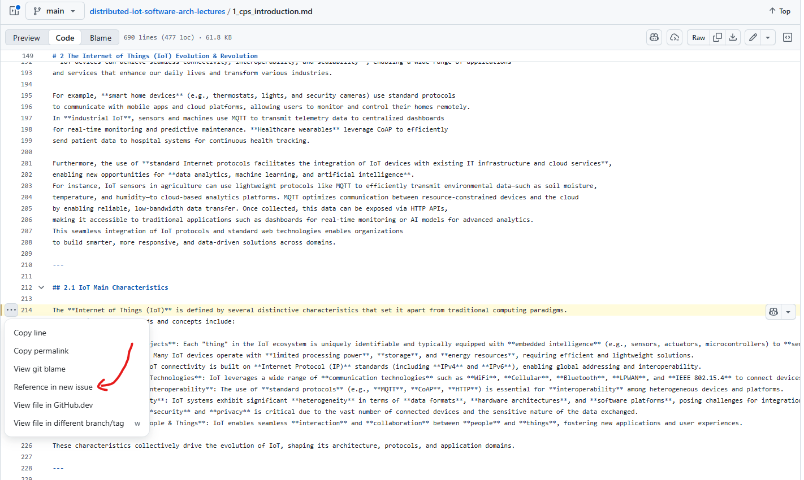
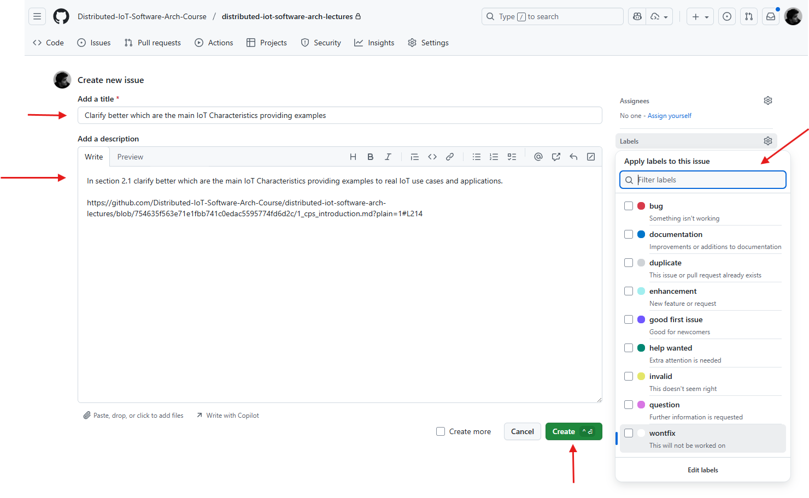

# 📚 Marco Picone Teaching - Lectures

This repository is the **single source of truth for the theoretical material** of Marco Picone's lectures, university courses, and training activities.

The content is not tied to a specific course: each lecture is designed as a self-contained, reusable module that can be combined with others to build different learning paths (e.g., university courses at the University of Modena and Reggio Emilia, PhD courses, workshops, seminars, and professional training programs). Every course or activity references the modules it needs from this repository, so that **all of them stay synchronized** with the same up-to-date version of the material.

## 🧭 The Marco Picone Teaching Organization

This repository is part of the [Marco-Picone-Teaching](https://github.com/Marco-Picone-Teaching) GitHub Organization, which collects all the teaching resources:

- 📖 **Theory** (this repository) — lecture notes and theoretical content, organized in modules.
- 🧪 **Laboratories, playgrounds & code examples** — dedicated repositories with hands-on exercises and reference implementations associated with the lectures (e.g., [`laboratory-python-http-rest-api`](https://github.com/Marco-Picone-Teaching/laboratory-python-http-rest-api), [`python-http-api-playground`](https://github.com/Marco-Picone-Teaching/python-http-api-playground)).

Course-specific information (schedules, exam rules, selected modules, announcements) is managed by each course or activity and is intentionally kept outside this repository.

## 📝 Format

**Markdown** is the primary format used for all the content in this repository: every lecture is authored and maintained directly in Markdown, making it easy to edit, version control, reuse across different activities, and collaboratively improve through issues and pull requests. Additional formats (e.g., slides or PDF) can be generated from these Markdown sources when needed.

## 📂 Repository Structure

```
Lectures/
└── <macro-topic>/                  # e.g., software-architectures
    └── <lecture-name>/             # e.g., soft-arch-microservices
        ├── <lecture_name>.md       # Lecture content
        ├── images/                 # Images used by the lecture
        └── sources/                # (Optional) Editable sources of the diagrams (draw.io, Mermaid)
docs/                               # Documentation resources for this repository
```

## 📚 Available Lectures

Lectures are grouped by **macro-topic**, and each macro-topic corresponds to a folder in `Lectures/`.

Lectures are intentionally **not numbered**: there is no mandatory order, and each course or activity selects and arranges the modules it needs. To keep every lecture self-contained, its sections use a local numbering based on letters and numbers (`A.`, `A.1`, `A.1.1`, `B.`, `B.1`, ...), and figures are numbered progressively within the lecture (`Figure 1`, `Figure 2`, ...). In this way, the numbering never depends on the position of the lecture within a specific course.

### 🌐 Cyber-Physical Systems & Internet of Things

- [📖 Introduction to Cyber-Physical Systems and Internet of Things](Lectures/cps-and-iot/cps-introduction/cps_introduction.md)

### 🐍 Programming & Software Engineering

- [📖 Python Best Practices & Object Oriented Programming](Lectures/programming-and-software-engineering/python-best-practices-and-oop/python_best_practices_and_oop.md)
- [📖 Python Advanced Topics: Concurrency, Queues, Event-Driven Architectures & Testing](Lectures/programming-and-software-engineering/python-advanced-topics/python_advanced_topics.md)

### 🔌 Communication Protocols & Patterns

- [📖 IoT Protocols Overview](Lectures/communication-protocols-and-patterns/iot-protocols-overview/iot_protocols_overview.md)
- [📖 The HTTP Protocol & RESTful Architectural Style](Lectures/communication-protocols-and-patterns/http-protocol-and-rest/http_protocol_and_rest.md)
- [📖 Publish/Subscribe Communication Pattern & MQTT Protocol](Lectures/communication-protocols-and-patterns/pubsub-mqtt-protocol/pubsub_mqtt_protocol.md)
- [📖 The Constrained Application Protocol (CoAP)](Lectures/communication-protocols-and-patterns/coap-protocol/coap_protocol.md)

### 🏗️ Software Architectures

- [📖 Software Architecture - Monolithic Approaches](Lectures/software-architectures/soft-arch-monolithic-approaches/soft_arch_monolithic_approaches.md)
- [📖 Software Architecture - Distributed Approaches](Lectures/software-architectures/soft-arch-distributed-approaches/soft_arch_distributed_approaches.md)
- [📖 Software Architecture - Microservices Software Architectures](Lectures/software-architectures/soft-arch-microservices/soft_arch_microservices.md)

### 🧩 End-to-End System Design

- [📖 End-2-End Architecture Design](Lectures/end-to-end-system-design/end2end-architecture-design/end2end_architecture_design.md)

## 🤝 Contributing & Improving the Repository

Since this repository is shared across different courses and activities, every improvement automatically benefits all of them. Contributions to enhance the lecture content, fix issues, or add new features are welcome.
Please feel free to contribute following one of the following two options: 

- 🐛 Open an issue to discuss your ideas or suggestions before making any changes.
- 🍴 Fork the repository, make your changes, and submit a pull request for review.

### 🆕 Create a New Issue

To create a new issue and help improve the lecture content, follow these steps:

1. **📂 Navigate to target Lecture Markdown File**  
    Go to the repository's GitHub page and locate the specific lecture markdown file you want to discuss.

2. **💻 Open the Markdown File in Code Mode**  
    
    

    Switch from `Preview` mode to `Code` mode by clicking the respective tab at the top right of the file view. In this way, you can see the raw markdown content and line numbers, which will help you reference specific parts of the text in your issue.  
    Then, click on the `...` (three dots) and click on `Reference in new issue` to automatically create a new issue with a reference to the specific line you are viewing.

3. **✏️ Describe Your Suggestion or Problem**  
    
    

    - Provide a clear and descriptive **title** for your issue.
    - In the description, explain your suggestion, feedback, or the problem you found in the lecture content.
    - If possible, reference specific sections, files, or lines to make your feedback actionable.
    - You can also attach screenshots or code snippets to clarify your point.
    - The Link "Reference in new issue" will automatically include a reference to the specific line you were viewing, making it easier for maintainers to understand the context of your issue.
    - If you are creating the issue manually please refer to the specific line numbers or sections in your description in order to provide context.
    - If you want you can also assign **labels** to your issue (e.g., `bug`, `enhancement`, `question`) to help categorize it.

4. **✅ Create the Issue**  
    Once you have filled out the details, click "Create"  
    The repository maintainers will review your issue and respond as soon as possible.

Creating issues is a great way to contribute, ask questions, or suggest improvements. 
**💡 Your feedback helps keep the lecture materials accurate and up-to-date!**

### 🍴 Fork and Submit a Pull Request

To contribute directly by making changes to the lecture content, you can fork the repository, make your changes, and submit a pull request. Here’s how to do it:

1. **🍴 Fork the Repository**  
    - Go to the repository's GitHub page.
    - Click the "Fork" button at the top right corner of the page. This will create a copy of the repository under your GitHub account.
2. **💾 Clone Your Fork**  
    - Open your terminal or command prompt.
    - Clone your forked repository to your local machine using the command:
      ```bash
      git clone <your-fork-url>
      ```
3. **🌿 Create a New Branch**  
    - Navigate to the cloned repository:
      ```bash
      cd <repository-name>
      ```
    - Create a new branch for your changes:
      ```bash
      git checkout -b <your-branch-name>
      ```
4. **✏️ Make Your Changes**  
    - Open the files you want to edit in your preferred text editor or IDE.
    - Make the necessary changes to the lecture content.
5. **💾 Commit Your Changes**  
    - After making your changes, stage the modified files:
      ```bash
      git add <file1> <file2> ...
      ```
    - Commit your changes with a descriptive message:
      ```bash
      git commit -m "Your descriptive commit message"
      ``` 
6. **📤 Push Your Changes to Your Fork**  
    - Push your changes to the branch you created on your forked repository:
      ```bash
      git push origin <your-branch-name>
      ```
7. **🔄 Create a Pull Request**  
    - Go to your forked repository on GitHub.
    - You will see a prompt to create a pull request for the branch you just pushed. Click on "Compare & pull request".
    - Provide a clear title and description for your pull request, explaining the changes you made and why they are beneficial.
    - Click "Create pull request" to submit your changes for review.

The repository maintainers will review your pull request and may provide feedback or request changes before merging it into the main repository.

## 📄 License

This work is licensed under the [Creative Commons Attribution 4.0 International License](https://creativecommons.org/licenses/by/4.0/).

[![CC BY 4.0][cc-by-image]][cc-by]

You are free to:
- **📤 Share** — copy and redistribute the material in any medium or format for any purpose, even commercially
- **🔧 Adapt** — remix, transform, and build upon the material for any purpose, even commercially

Under the following terms:
- **✏️ Attribution** — You must give appropriate credit, provide a link to the license, and indicate if changes were made

[cc-by]: http://creativecommons.org/licenses/by/4.0/
[cc-by-image]: https://i.creativecommons.org/l/by/4.0/88x31.png